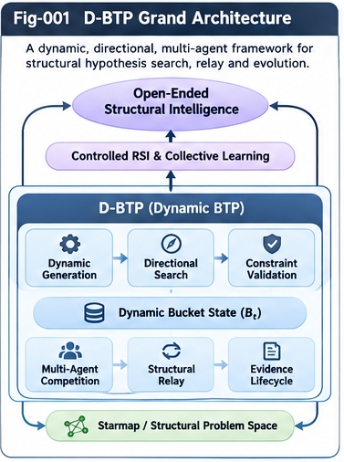

# D-BTP — Dynamic Bucket Tree of Permutation

## Directional Structural Generation and Hypothesis Evolution

**Research framework · Version 1.0.0 (proposed) · Apache-2.0**

> **Research status:** This repository presents a conceptual architecture, formalization proposals, implementation contracts, and falsifiable research hypotheses. It does **not** claim a validated general-purpose solver, demonstrated recursive self-improvement, or established superiority over existing search methods.

## 1. Overview

The **Dynamic Bucket Tree of Permutation (D-BTP)** extends Bucket Tree of Permutation (BTP) from structural matching and metric similarity toward **dynamic, constraint-guided structural hypothesis search**. Rather than assuming that every possible candidate relation is enumerated before search, D-BTP treats the search state as evolving: accepting, rejecting, or deferring a hypothesis may change what candidates can be discovered next.

A second, central idea is that **directional fields couple generation and selection**. Directional signals do not merely rank a fixed list after generation; they can influence which candidates are proposed, which hypotheses receive attention, which evidence is sought, and how limited computation is allocated. Search outcomes and independently checked evidence may, in turn, update these directional fields.

D-BTP is intended as a **research architecture**, not a universal claim about how intelligence or biological cognition works. Its potential value depends on well-defined constraints, calibrated evidence, appropriate baselines, and reproducible experiments.

## 2. Research Motivation

The starting point is structural similarity between two starmaps, including unaligned correspondence problems. A conventional formulation can represent a search over a known set of possible node pairs and test combinations for consistency. But many practical problems are not naturally fixed-candidate problems:

- New candidate relationships become visible only after partial structural decisions.
- A single latent actor may explain multiple observable behaviors, requiring non-bijective mappings.
- Partial observations provide weak but useful signals about where to explore next.
- Competing hypotheses must coexist until discriminating evidence becomes available.
- Search policies and structural operators may themselves become objects of experimentation and improvement.

D-BTP separates **what is feasible**, **what is plausible**, and **what is worth exploring next**. Conflating these questions risks unsound pruning, premature consensus, and overconfident attribution.

## 3. Core Mechanism

A dynamic bucket at step *t* may be abstracted as:

\[
B_t = (H_t, S_t, E_t, D_t, M_t)
\]

where:

- **Hₜ — hypothesis ledger:** accepted, rejected, pending, and deferred structural hypotheses.
- **Sₜ — structural state:** current mappings, relations, constraints, and derived implications.
- **Eₜ — evidence state:** supporting and countervailing observations, provenance, reliability, and dependencies.
- **Dₜ — directional state:** objectives, scoring perspectives, uncertainty, and search-control policy.
- **Mₜ — metadata:** versions, budgets, lineage, termination status, and reproducibility information.

Candidates are generated from the current state rather than assumed to be a complete immutable input:

\[
C_t = G(B_t;\,\theta_G,\mathcal{R}_t)
\]

A candidate is assessed against hard constraints and, when admissible, may be ranked using soft evidence and directional objectives. The system then branches, propagates constraints, acquires further evidence when justified, and updates its state. This is a **coupled loop**:

**State → Candidate generation → Constraint validation → Directional selection → Evidence/feedback → Updated state and guidance.**

The loop must distinguish *logical infeasibility* from *low search priority*. A weak directional signal can reorder exploration, but cannot by itself prove a candidate impossible.



*Fig-001. D-BTP grand architecture. A dynamic bucket maintains structural hypotheses and evidence; state-dependent candidate generation, constraint validation, directional search control, and feedback jointly govern exploration. Structural relay and learning may operate across search episodes.*

## 4. Design Principles

1. **Dynamic generation, not necessarily exhaustive upfront enumeration.** Search must record what has and has not been explored.
2. **Constraint soundness before heuristic efficiency.** Hard rejection requires a valid constraint basis; unknown and plugin errors are not automatic failures.
3. **Generation–selection coupling.** Directional fields influence both the candidate frontier and allocation of attention.
4. **Weak evidence is guidance, not proof.** Track provenance, dependence, counterevidence, and calibration.
5. **Competing hypotheses remain first-class.** Preserve useful diversity rather than equating agent consensus with truth.
6. **Relay requires independent validation.** Receiving a structural unit does not confer correctness.
7. **Learning and RSI are distinct claims.** State iteration, adaptive tuning, collective learning, and validated self-improvement require different evidence.
8. **Explicit limits and leftovers.** Report quiescence, conditional closure, budget exhaustion, unresolved alternatives, and failure modes separately.

## 5. Architecture at a Glance

```text
Structural problem / starmaps / observations
                   |
                   v
          Dynamic Bucket State
          (hypotheses, constraints,
           evidence, directions)
                   |
          +--------+---------+
          |                  |
          v                  v
  Candidate generation   Directional field
          |              (guides generation,
          |               selection, budgets)
          v                  |
  Constraint plugins <------+ 
          |
   admissible candidates
          |
          v
  Branching / selection / portfolio
          |
          v
  Evidence and feedback evaluation
          |
          +----> update state and guidance
          |
          v
  Structural Relay / Collective Learning
          |
          v
  Validated operator or policy proposals
  (subject to independent evaluation)
```

This diagram is explanatory; actual implementations may use asynchronous agents, multiple frontiers, or different scheduling policies.

## 6. Repository Map

### Foundations — conceptual and algorithmic basis

| Document | Focus |
|---|---|
| [D-BTP-001](docs/foundations/D-BTP-001-From-Metric-Similarity-to-Structural-Hypothesis-Search.md) | From metric similarity and unaligned matching to structural hypothesis search |
| [D-BTP-002](docs/foundations/D-BTP-002-Dynamic-Bucket-States-and-Candidate-Generation.md) | Dynamic bucket states, transitions, and state-driven candidates |
| [D-BTP-003](docs/foundations/D-BTP-003-Constraint-Guided-Structural-Composition.md) | Constraint propagation, composition, and sound pruning |
| [D-BTP-004](docs/foundations/D-BTP-004-Directional-Fields-for-Generation-and-Selection.md) | Directional guidance for generation and selection |
| [D-BTP-005](docs/foundations/D-BTP-005-Weak-Evidence-and-Directional-Exploration.md) | Weak evidence, counterevidence, and exploration value |
| [D-BTP-006](docs/foundations/D-BTP-006-Coupled-Generation-Selection-and-Feedback.md) | Unified generation–selection–feedback loop |
| [D-BTP-007](docs/foundations/D-BTP-007-Multi-Agent-RSI-and-Collective-Structural-Learning.md) | Multi-agent competition, relay, and controlled learning |
| [D-BTP-008](docs/foundations/D-BTP-008-Open-Ended-Structural-Evolution-and-Intelligence.md) | Open-ended structural growth and its limits |

### Specifications — proposed contracts, not certified standards

| Document | Focus |
|---|---|
| [SPEC-001](docs/specifications/SPEC-001-Dynamic-Bucket-State-Contract.md) | Bucket state, lifecycle, provenance, and invariants |
| [SPEC-002](docs/specifications/SPEC-002-Candidate-Generation-and-Constraint-Plugins.md) | Generator and constraint-plugin interfaces |
| [SPEC-003](docs/specifications/SPEC-003-Directional-Scoring-and-Search-Control.md) | Multi-objective scoring and control plane |
| [SPEC-004](docs/specifications/SPEC-004-Evidence-Relay-and-Learning-Lifecycle.md) | Evidence lifecycle, structural relay, and learning governance |

### Cases — illustrative, not empirical validation

| Document | Focus |
|---|---|
| [CASE-001](docs/cases/CASE-001-Blockchain-Actor-Attribution.md) | Latent behavioral actors and observable blockchain activity |
| [CASE-002](docs/cases/CASE-002-Dynamic-Starmap-Similarity.md) | Dynamic vs. fixed-candidate structural matching |
| [CASE-003](docs/cases/CASE-003-Multi-Agent-Hypothesis-Competition.md) | Competing explanations, counterevidence, and portfolios |

### Extensions — exploratory research directions

| Document | Focus |
|---|---|
| [EXT-001](docs/extensions/EXT-001-Biomimetic-Directional-Intelligence.md) | Functional analogies to biological exploration |
| [EXT-002](docs/extensions/EXT-002-Recursive-Directional-Field-Evolution.md) | Directional fields as evolvable objects |
| [EXT-003](docs/extensions/EXT-003-Open-Ended-BTP-and-Structural-Relay.md) | Structural invention, relay, and open-ended growth |

### Figures

The eight-figure sequence is:

1. [Fig-001 — Grand Architecture](figures/Fig-001-D-BTP-Grand-Architecture.png)
2. [Fig-002 — From Static to Dynamic BTP](figures/Fig-002-From-Static-to-Dynamic-BTP.png)
3. [Fig-003 — Dynamic Bucket State and Candidate Generation](figures/Fig-003-Dynamic-Bucket-State-and-Candidate-Generation.png)
4. [Fig-004 — Constraint-Guided Structural Hypothesis Search](figures/Fig-004-Constraint-Guided-Structural-Hypothesis-Search.png)
5. [Fig-005 — Directional Generation and Selection Coupling](figures/Fig-005-Directional-Generation-and-Selection-Coupling.png)
6. [Fig-006 — Weak Evidence and Multi-Directional Scoring](figures/Fig-006-Weak-Evidence-and-Multi-Directional-Scoring.png)
7. [Fig-007 — Blockchain Actor Attribution BTP](figures/Fig-007-Blockchain-Actor-Attribution-BTP.png)
8. [Fig-008 — Recursive Structural Evolution and Collective Learning](figures/Fig-008-Recursive-Structural-Evolution-and-Collective-Learning.png)

**Assembly note:** The figure links assume the eight illustrations have been saved as separate PNG files at the paths above. A single composite poster does not satisfy those individual paths; split/export and verify the files before publication.

## 7. Suggested Reading Paths

**New readers:** [START-HERE.md](START-HERE.md) → D-BTP-001 → D-BTP-002 → D-BTP-004 → D-BTP-006 → CASE-002.

**Algorithm and implementation researchers:** D-BTP-002 → D-BTP-003 → SPEC-001 → SPEC-002 → SPEC-003 → SPEC-004.

**Weak-evidence and attribution researchers:** D-BTP-005 → SPEC-003 → CASE-001. Treat inferred behavioral entities as hypotheses, not automatically identified people.

**Multi-agent and evolution researchers:** D-BTP-007 → CASE-003 → EXT-002 → EXT-003.

For an exhaustive index, see [CONTENTS.md](CONTENTS.md). For definitions, see [GLOSSARY.md](GLOSSARY.md).

## 8. Evaluation Agenda

The central questions are empirical and comparative:

- Does state-driven generation improve useful candidate discovery over a fixed-candidate baseline under matched resource budgets?
- Do directional fields improve time-to-quality, evidence efficiency, or hypothesis recall without increasing false rejection?
- What is the incremental benefit of constraint propagation, adaptive guidance, multi-agent diversity, and feedback learning?
- Under what regimes do coordination overhead, evidence dependence, or candidate explosion negate these gains?
- Can learned operators or directional policies transfer to held-out tasks and remain beneficial after independent verification?

Suggested baselines include **static BTP**, **dynamic unguided search**, **dynamic search with fixed directional scoring**, and **dynamic search with adaptive feedback**, with additional multi-agent variants. Measure wall-clock time, compute cost, constraint violations, hypothesis quality, calibration, diversity, reproducibility, and negative-transfer rates. Report both successes and failure cases.

Supporting research planning documents: [TESTABLE-HYPOTHESES.md](TESTABLE-HYPOTHESES.md), [VALIDATION-ROADMAP.md](VALIDATION-ROADMAP.md), and [OPEN-QUESTIONS.md](OPEN-QUESTIONS.md).

## 9. Boundaries and Responsible Use

**No universal optimality guarantee.** Dynamic hypothesis search can be combinatorial or exponential; any completeness, optimality, or pruning guarantee must state its assumptions.

**No biological identity claim.** Biomimetic parallels are functional inspirations, not evidence that brains implement BTP.

**No unverified RSI claim.** A system that updates scores, policies, or generators has not thereby demonstrated recursive self-improvement. Claims require held-out evaluation, cost accounting, regression checks, and rollback capability.

**No direct real-world identity inference from weak signals.** Blockchain behavior clustering and latent actor modeling are distinct from identifying individuals. IP addresses, public keys, timing patterns, and other signals may be shared, spoofed, proxied, or context-dependent. Privacy, authorization, data minimization, and evidence governance are essential.

**No conflation of confidence and feasibility.** Low-ranked hypotheses may still be feasible; high-ranked hypotheses may still be false. Record uncertainty and preserve counterevidence.

## 10. Relationship to the Structural Intelligence Research Ecosystem

D-BTP is designed to be interoperable in principle with related structural-intelligence research directions: structural similarity and folding, directional weak-evidence intelligence, control planes and scoring, dynamic intelligence units, Structural Relay, autonomous questioning, multi-agent competition, and collective learning. Such relationships are **proposed conceptual interfaces**, not assertions of completed integration or validated performance.

A practical implementation should define explicit contracts for representations, scoring, evidence, state transitions, and relay before claiming interoperability.

## 11. Repository Status and Contributions

This release is as a **research-first v1.0.0**: foundations, specifications, illustrative cases, extensions, and publication assets. It need not include a runnable demo to be useful, but claims about runtime behavior remain hypotheses until supported by reproducible implementations and experiments.

Contributions are especially welcome in the form of:

- Counterexamples to proposed invariants or closure conditions.
- Minimal benchmark problems and controlled comparisons.
- Alternative candidate-generation, constraint-propagation, and directional-policy contracts.
- Robust evidence provenance, calibration, and adversarial testing.
- Independent conformance suites and cross-domain transfer studies.

Please distinguish **specification proposals**, **implemented behavior**, **measured findings**, and **speculative extensions** in all submissions.

## 12. Citation, License, and Publication

- **License:** Apache License 2.0; see [LICENSE](LICENSE) once added to the repository.
- **Citation metadata:** [CITATION.cff](CITATION.cff) and [.zenodo.json](.zenodo.json) are publication assets; verify authors, repository URL, release tag, and DOI before publication.
- **Release notes:** [publication/GitHub-Release-Notes-v1.0.0.md](publication/GitHub-Release-Notes-v1.0.0.md).
- **ResearchGate overview:** [publication/D-BTP-v1.0.0-ResearchGate-Overview.pdf](publication/D-BTP-v1.0.0-ResearchGate-Overview.pdf).

**DOI:** To be assigned after an archived release; no DOI is claimed here.

---

## 📚 DBM-SI Series Navigation

See:\
[./docs/DBM-SI-Series-of-gitHub-Repositories/DBM-SI-Series-of-gitHub-Repositories.md](./docs/DBM-SI-Series-of-gitHub-Repositories/DBM-SI-Series-of-gitHub-Repositories.md)

---

**Core proposition:** *D-BTP investigates whether state-dependent structural generation, constraint-sound composition, directional selection, and validated feedback can form a reusable framework for exploring and evolving structural hypotheses.*
