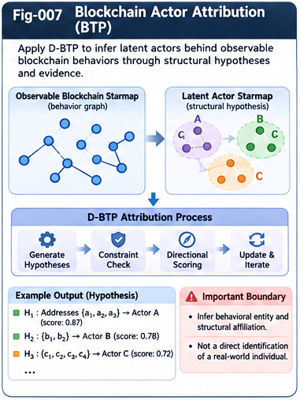

# CASE-001 — Blockchain Actor Attribution

**Project:** D-BTP — Dynamic Bucket Tree of Permutation: Directional Structural Generation and Hypothesis Evolution  
**Document type:** Research case study / proposed validation design  
**Status:** Conceptual, testable design; no empirical performance claims  
**Version:** 1.0.0-draft

## Abstract

Public blockchains expose transaction histories and graph structure, but they do not directly expose the human or organizational actors responsible for every observed action. This case study develops a **Dynamic Bucket Tree of Permutation (D-BTP)** formulation for *behavioral actor attribution*: constructing and comparing hypotheses about which latent operational actors may control or coordinate observed blockchain activity. The problem is treated as dynamic, constraint-guided structural hypothesis search rather than a static address-matching exercise. A directional field steers candidate generation, branch selection, and evidence acquisition, while independently assessed evidence and hard constraints determine what is justified. The result is a research architecture for producing auditable, competing hypotheses—not a method for asserting real-world identities from on-chain data alone.

---



*Fig-007. Illustrative blockchain behavior attribution using D-BTP. Observed transactions and behavioral patterns support competing latent-actor grouping hypotheses, subject to constraints and directional evidence. The inferred units are behavioral actors, not verified real-world identities.*

---

## 1. Research question and scope

The central question is:

> Can dynamic, directionally guided structural search recover useful latent-actor groupings from partially observed blockchain behavior more efficiently and more accurately calibrated than static or unguided alternatives?

Here, an **actor** is an abstract operational controller or coordinated operational unit, not necessarily one person. A single person may operate several actors; a service may combine many persons; a smart contract may execute actions initiated by many unrelated users. The model must not silently equate addresses, wallets, devices, legal entities, and people.

The case focuses on permitted analysis of public or appropriately authorized datasets, synthetic benchmark data, and reproducible evaluation. It excludes covert collection of network identifiers, unauthorized access to device telemetry, attempts to obtain private keys, or publication of unverified personal identity allegations.

## 2. Why ordinary address clustering is insufficient

Simple heuristics can cluster addresses using shared funding sources, temporal proximity, transaction motifs, or repeated counterparties. Such signals may be useful but can be misleading: exchanges, bridges, relayers, mixers, automated market makers, smart-contract wallets, batching services, and common software can create apparent links without common control. Conversely, a single actor can deliberately or routinely distribute activity across unrelated addresses and protocols.

D-BTP adds three capabilities:

1. **Hypothesis-dependent generation:** a partial grouping can expose new candidate relations not apparent in the initial graph.
2. **Constraint-aware branching:** competing assignments can be evaluated for consistency rather than simply accumulated.
3. **Directional exploration:** uncertainty, novelty, and prospective information gain influence which branches receive scarce computation and evidence-review effort.

None of these capabilities guarantees unique attribution or polynomial-time inference.

## 3. Observed and latent structures

Let the observed blockchain structure be

\[
G_O=(V_O,E_O,X_O),
\]

where \(V_O\) represents observed addresses, contracts, transactions, and optionally time-indexed behavioral events; \(E_O\) represents transfers, calls, temporal succession, and other typed relationships; and \(X_O\) contains features with provenance and measurement uncertainty.

Let the latent actor structure be

\[
G_A=(V_A,E_A,X_A),
\]

where \(V_A\) consists of hypothesized operational actors, potentially created or split during search, and \(E_A\) represents hypothesized control, coordination, or service-mediated relationships.

The inference object is a typed, possibly many-to-one relation

\[
R\subseteq V_A\times V_O\times \mathcal T,
\]

with \(\mathcal T\) denoting relation types such as `controls`, `initiated`, `operated`, `benefited-from`, `intermediated`, and `unknown`. A relation may have a temporal validity interval and a confidence assessment. The relation is **not** assumed to be a bijection or even a total mapping.

An actor node may be a wildcard-like placeholder whose properties are refined as evidence accumulates. The model may create additional actor nodes when a proposed grouping becomes inconsistent or when a split better explains the observations.

## 4. Canonical D-BTP bucket for this case

A search bucket \(B_t\) contains:

- **Hypothesis ledger:** accepted, rejected, deferred, and superseded actor–behavior relations, including typed relation semantics.
- **Structural state:** the current actor graph, behavior partitions, unresolved relations, temporal constraints, and derived features.
- **Evidence state:** source records, observations, corroboration and counterevidence, dependency groups, and uncertainty.
- **Directional state:** objective vectors, priorities, exploration quotas, and policy versions.
- **Governance metadata:** provenance, plugin versions, evaluation budget, branch lineage, and reproducibility information.

A bucket records the current *hypothesis*, not a verified description of reality. Branch acceptance means inclusion in a candidate explanation, not an external-world finding.

### 4.1 Example relation record

```yaml
relation_id: rel-017
latent_actor_id: actor-hyp-03
observed_behavior_id: motif-221
relation_type: operated
validity_window: [t1, t2]
disposition: accepted_in_hypothesis
supporting_evidence: [ev-08, ev-12]
counterevidence: [ev-19]
constraint_status: unresolved
provenance: synthetic-benchmark-01
```

All identifiers above are illustrative and synthetic.

## 5. Dynamic candidate generation

Candidate generation is state-dependent:

\[
C_t=\operatorname{Generate}(B_t,G_O,\Phi_t,\mathcal P_G),
\]

where \(\Phi_t\) is the current directional field and \(\mathcal P_G\) is a versioned set of generator plugins.

Generators may propose:

- linking a behavior motif to an existing latent actor;
- creating a new latent actor to explain otherwise unassigned behavior;
- splitting a provisional actor into multiple actors;
- merging compatible provisional actors;
- assigning an intermediary or service-mediated relation rather than direct control;
- testing whether an apparent connection is better explained by shared infrastructure;
- requesting a targeted, authorized evidence check.

**Generation is not adjudication.** A generator may propose a low-confidence candidate. Constraint checks and evidence review determine whether the branch is admissible and worth further exploration.

### 5.1 Dynamic discovery example

Suppose two transaction motifs have similar execution cadence but no direct fund-flow link. Initially, the system keeps them separate. A third motif reveals a repeated sequence of contract interactions that connects both through a common operational pattern. The new structural state can generate a candidate shared-operator hypothesis. A competing hypothesis attributes the similarity to a widely used automation service. Both should remain available until discriminating evidence is found.

This illustrates why a fixed list of candidate pairs can be inadequate.

## 6. Constraint taxonomy

Constraints must carry explicit semantics, strength, applicability, and provenance.

| Constraint class | Example | Permitted inference effect |
|---|---|---|
| Logical / type hard constraint | An event cannot simultaneously have two mutually exclusive values under the declared schema | Reject inconsistent branches |
| Provenance hard constraint | A source record fails integrity verification | Exclude that record from trusted input |
| Conditional domain rule | A relation type implies a temporal ordering under a specified protocol model | Reject only if the rule's assumptions are satisfied |
| Soft behavioral signal | Similar gas usage, timing, or interaction motifs | Adjust ranking; do not prove common control |
| Weak directional evidence | A novel cross-protocol pattern suggests a fruitful investigation | Prioritize generation or review |
| Counterevidence | A shared-service explanation accounts for apparent similarity | Lower support or create competing branches |

A frequent mistake is to treat a plausible behavioral heuristic as a universal hard rule. Blockchain systems have exceptional transaction semantics, custodial arrangements, delegated execution, and cross-chain mechanisms. Domain plugins must declare their scope and failure conditions.

### 6.1 Sound pruning

Pruning is *sound* only relative to a clearly specified formal model and constraints. If a hard constraint is not established, low score alone cannot justify labeling a hypothesis impossible. Budget-based omission and heuristic deprioritization must be recorded separately from logical infeasibility.

## 7. Evidence model and provenance

Evidence units should specify:

- observation and chain/network context;
- collection method and source integrity;
- time window and feature-extraction version;
- which hypothesis propositions the observation bears upon;
- alternative explanations and counterevidence;
- correlation/dependency group;
- uncertainty, known limitations, and applicable use restrictions.

Repeated observations from one upstream service or software implementation are not necessarily independent. An evidence dependency graph can prevent repeated scoring of the same underlying cause.

Off-chain records, if ever used, require a lawful basis and explicit authorization. Network IP addresses and device fingerprints are especially prone to shared-use, proxy, NAT, and attribution errors; public cryptographic keys are identifiers or verification artifacts, not by themselves proof of who controlled a transaction. Private keys and credentials are out of scope.

## 8. Directional field design

Let a directional field be a vector

\[
\Phi_t=(\phi_{\mathrm{fit}},\phi_{\mathrm{discrimination}},
\phi_{\mathrm{information}},\phi_{\mathrm{diversity}},
\phi_{\mathrm{cost}},\phi_{\mathrm{risk}})_t.
\]

Illustrative components are:

- **Structural fit:** how well the current hypothesis explains observed typed relations.
- **Discriminating power:** expected ability to distinguish rival explanations.
- **Information gain:** value of a feasible next observation or test.
- **Diversity:** preservation of materially different hypotheses.
- **Computational cost:** expected resources required for expansion.
- **Attribution risk:** risk of overstating control or implying an unsupported identity.

A search controller may use a policy such as

\[
\operatorname{Priority}(c\mid B_t)=
F\bigl(\Phi_t,\operatorname{Features}(c,B_t),
\operatorname{Uncertainty}(c),\operatorname{Cost}(c)\bigr),
\]

where \(F\) is a declared, versioned policy rather than an assumed universal formula.

The directional field influences **both** which candidates are generated and which generated candidates are explored. Evidence gained from exploration can subsequently update the field. This is a coupled process, not merely “generate everything, then sort.”

## 9. Coupled generation, selection, and feedback

A conceptual iteration proceeds as follows:

1. Read a bucket and its provenance-checked evidence state.
2. Propose state-dependent candidate relations, splits, merges, and tests.
3. Evaluate applicable hard constraints and propagate safe implications.
4. Produce directional assessments with uncertainty and dependencies.
5. Select a bounded, diverse set of branches and evidence checks.
6. Obtain authorized observations or run synthetic tests.
7. Update evidence, counterevidence, and hypothesis ledgers.
8. Recompute directional priorities where justified by feedback.
9. Relay reusable findings with their limits and validation status.

The controller should maintain explicit distinctions among **closed**, **quiescent**, and **budget-terminated** buckets. An absence of newly generated candidates is not necessarily proof that the hypothesis space is exhausted.

## 10. Worked synthetic scenario

Consider a synthetic ledger with four behavioral clusters:

- **A:** repeated deposits to a service endpoint;
- **B:** scheduled withdrawals following similar timing patterns;
- **C:** interactions with a common automation contract;
- **D:** a distinct settlement pattern involving a bridge.

Three competing hypotheses are proposed:

- **H1 — Single operator:** one latent operational actor controls A, B, C, and D.
- **H2 — Service-mediated:** A and B are customer-side behavior while C and D reflect a common service.
- **H3 — Partial coordination:** A and C share an operator; B and D are independent or mediated.

A static similarity system may favor H1 because the cadence and counterparties look related. D-BTP instead explores all three, generating targeted discriminating tests: whether timing correlations persist after accounting for the service's batch schedule; whether transaction sequences exhibit operator-specific features; and whether cross-chain transitions are compatible with the hypothesized roles.

A new observation may make H1 less plausible without making it logically impossible. H2 may gain support while H3 remains unresolved. The output should be a **portfolio with uncertainty and counterevidence**, not a single categorical attribution.

### 10.1 Illustrative decision record

```yaml
hypothesis: H2
status: provisionally_preferred
scope: synthetic_case_only
hard_constraint_result: pass
support_summary: shared_service_explanation_supported
counterevidence_summary: incomplete_operator_specific_tests
uncertainty: substantial
next_discriminating_test: compare_batch_timing_against_service_baseline
real_world_identity_claim: none
```

This is a specification example, not a measured result.

## 11. Multi-agent division of labor

A multi-agent configuration can separate roles:

| Agent | Primary responsibility | Required safeguard |
|---|---|---|
| Structural generator | Propose assignments, splits, merges | Mark proposals as unverified |
| Constraint auditor | Check model consistency | Distinguish hard failure from unknown |
| Evidence analyst | Assess support and source dependency | Record provenance and alternatives |
| Counterhypothesis agent | Search for competing explanations | Avoid forced adversarial conclusions |
| Directional controller | Allocate search budget | Preserve diversity and exploration quotas |
| Relay curator | Package reusable hypothesis units | Include scope, limitations, and validation status |
| Governance reviewer | Check policy and release criteria | Prevent unsupported personal identification |

Multi-agent consensus is not independent corroboration if agents rely on the same source data or inherited assumptions.

## 12. Structural relay and collective learning

Reusable artifacts can include:

- validated constraint plugins for particular protocol semantics;
- evidence-dependency templates;
- candidate-generation patterns that generalize across synthetic cases;
- counterexample libraries documenting failed heuristics;
- search policies evaluated against controlled baselines.

A relay package should carry source lineage, assumptions, evaluation results, policy version, and known failure modes. A receiving system must revalidate compatibility rather than treating a relayed hypothesis as a fact.

Learning from prior cases may improve future search. However, ordinary reuse, online adaptation, and **recursive self-improvement (RSI)** are distinct. RSI requires demonstrable improvements to the search mechanism itself under independent evaluation, with rollback and regression controls.

## 13. Reference workflow pseudocode

```text
function AttributeBehavior(observations, policy, budget):
    verify_source_integrity(observations)
    root = initialize_bucket(observations, policy)
    frontier = priority_queue(root)
    portfolio = empty_diverse_portfolio()

    while frontier.not_empty() and budget.available():
        bucket = frontier.pop()
        if provably_closed(bucket):
            portfolio.consider(bucket)
            continue

        candidates = generate_from_state(bucket, policy.directional_field)
        if candidates.empty():
            mark_quiescent_or_partial(bucket)
            portfolio.consider(bucket)
            continue

        for candidate in candidates:
            result = check_applicable_constraints(bucket, candidate)
            if result == HARD_FAIL_WITH_VALID_PROOF:
                record_sound_prune(bucket, candidate)
                continue
            if result == ERROR or result == UNKNOWN:
                record_unresolved_constraint(bucket, candidate)

            child = branch_and_propagate(bucket, candidate)
            child = assess_evidence_and_counterevidence(child)
            child = score_directionally(child, policy)
            if within_budget_and_diversity_policy(child):
                frontier.push(child)
            else:
                record_deferred_not_infeasible(child)

        policy = update_policy_only_from_validated_feedback(policy)
        budget.consume_iteration()

    for remaining in frontier:
        mark_budget_terminated(remaining)
    return portfolio.with_provenance_and_uncertainty()
```

The pseudocode is conceptual. A production implementation needs transactional state handling, deterministic replay, explicit plugin failure isolation, and carefully defined state equivalence for deduplication.

## 14. Evaluation design

### 14.1 Datasets

Prefer multiple tiers:

1. **Synthetic ground-truth ledger:** known latent actors, intermediary services, noise, adversarial confounders, and temporal shifts.
2. **Permissioned or consented benchmark:** controlled entities and known operational assignments.
3. **Public-chain case collection:** useful for qualitative stress testing but usually lacking complete actor ground truth; avoid treating heuristic labels as truth.

Synthetic data should vary actor count, service prevalence, overlap, missing observations, behavioral mimicry, graph density, and the strength of misleading weak evidence.

### 14.2 Baselines

Compare at least:

- static similarity clustering;
- static BTP with fixed candidate lists;
- dynamic candidate generation without directional guidance;
- dynamic BTP with a fixed directional field;
- adaptive coupled D-BTP;
- coupled D-BTP with counterevidence and diversity ablated.

### 14.3 Metrics

Where verified ground truth exists, measure pairwise precision/recall, grouping quality, false merges, false splits, confidence calibration, and selective risk–coverage. Across all tiers, measure constraint violations, provenance completeness, counterhypothesis retention, search cost, candidate diversity, information gain per evaluation, and sensitivity to misleading evidence.

Report outcomes by scenario and confidence level. Do not substitute accuracy on easy synthetic cases for evidence of real-world identity attribution capability.

## 15. Testable hypotheses

**H1 — Dynamic discovery.** Under controlled latent-actor benchmarks, state-dependent candidate generation improves coverage of correct relational hypotheses over a fixed candidate list at matched budget.

**H2 — Constraint quality.** Explicit typed constraints reduce logically inconsistent accepted hypotheses relative to heuristic-only clustering.

**H3 — Directional efficiency.** Coupled generation and selection improve correct-hypothesis recall per unit compute over unguided dynamic search for at least some specified task distributions.

**H4 — Counterevidence robustness.** Dedicated counterhypothesis exploration reduces false merges caused by common-service confounders.

**H5 — Evidence calibration.** Provenance and dependency-aware scoring improve confidence calibration over naive evidence aggregation.

**H6 — Portfolio value.** Retaining diverse alternatives improves recovery under distribution shift relative to a single best-first hypothesis.

**H7 — Relay generalization.** Validated plugin and counterexample relay reduces search cost on held-out synthetic networks without increasing false attribution rates.

All hypotheses are empirical questions, not established findings. Negative and mixed results should be preserved.

## 16. Failure modes and mitigations

| Failure mode | Consequence | Mitigation |
|---|---|---|
| Shared infrastructure mistaken for shared actor | False merge | Explicit intermediary hypotheses and negative controls |
| Correlated signals counted independently | Inflated confidence | Evidence dependency graph |
| Weak evidence promoted to hard rule | Unsound pruning | Constraint strength and proof requirements |
| Directional feedback loop | Confirmation bias | Frozen baselines, exploration quotas, counterevidence |
| Candidate explosion | Budget exhaustion | Bounded portfolios, state-aware deduplication, deferred records |
| Incorrect protocol assumptions | Invalid constraints | Versioned plugins and scope declarations |
| Label leakage in benchmarks | Inflated evaluation | Held-out scenarios and generator separation |
| Cross-chain ambiguity | Spurious control inference | Bridge/service semantics and uncertainty |
| Public address equated to person | Privacy and reputational harm | Strict actor-vs-identity distinction and release review |
| Agent agreement from common source | False corroboration | Source-lineage accounting |

## 17. Governance and privacy boundary

The purpose of this case is to evaluate a structural inference framework, not to operationalize personal surveillance. A responsible study should:

- use public or explicitly authorized inputs;
- avoid collecting or inferring unnecessary personal data;
- refrain from identifying individuals without independently sufficient lawful evidence and appropriate review;
- distinguish operational-control hypotheses from identity assertions;
- publish aggregate or synthetic examples when practical;
- maintain audit trails, access controls, and retention limits;
- permit contested or unresolved classifications rather than forcing a definitive label.

Cryptographic public keys, IP addresses, browser/device characteristics, and similar identifiers can be shared, rotated, proxied, or misattributed. None is automatically a reliable person-level identity key.

## 18. Integration with the D-BTP research corpus

- **D-BTP-001:** generalizes metric similarity into structural hypothesis search.
- **D-BTP-002:** supplies dynamic bucket state and candidate-generation semantics.
- **D-BTP-003:** defines constraint-guided composition and safe pruning.
- **D-BTP-004:** formalizes directional generation and selection.
- **D-BTP-005:** develops weak-evidence exploration and counterevidence handling.
- **D-BTP-006:** specifies the coupled generation–selection–feedback loop.
- **D-BTP-007:** extends the loop to multi-agent relay and controlled learning.
- **D-BTP-008:** frames open-ended structural evolution as a distinct research frontier.
- **SPEC-001:** dynamic bucket state contract.
- **SPEC-002:** candidate generator and constraint plugin contracts.
- **SPEC-003:** directional scoring and search control contract.
- **SPEC-004:** evidence relay and learning lifecycle contract.

The case can be cross-referenced from a separate adversarial structural-security research track without conflating domain-specific attribution assumptions with the foundational D-BTP algorithm.

## 19. Open research questions

1. What relation types best distinguish operational control from coordination and service mediation?
2. How should the search represent actors that split, merge, or change roles over time?
3. Which hard constraints remain valid across different blockchain execution models?
4. How can one estimate evidence dependence when source lineage is incomplete?
5. Under what conditions does adaptive directional guidance outperform fixed guidance?
6. How much portfolio diversity is sufficient under a fixed compute budget?
7. Can counterexample relay improve generalization without encoding hidden dataset bias?
8. What calibration metrics remain meaningful when reliable ground truth is sparse?
9. How should the system abstain when actor-level attribution is underdetermined?
10. Which aspects of this case transfer to non-blockchain structural inference problems?

## 20. Conclusion

Blockchain behavioral attribution is a useful stress test for D-BTP because the observable graph is rich while the controlling actors remain partially hidden. Dynamic bucket states support evolving hypotheses; constraint plugins protect structural consistency; directional fields focus computation; weak evidence guides inquiry without becoming proof; and competing hypotheses preserve uncertainty. The research value lies in testing whether these mechanisms produce better, more auditable structural explanations under controlled conditions. The architecture does not, by itself, establish who a real-world person is.

---

**Research note:** This document presents a proposed method and validation program. All worked examples are synthetic. No experimental results, attribution findings, or operational capabilities are claimed.
