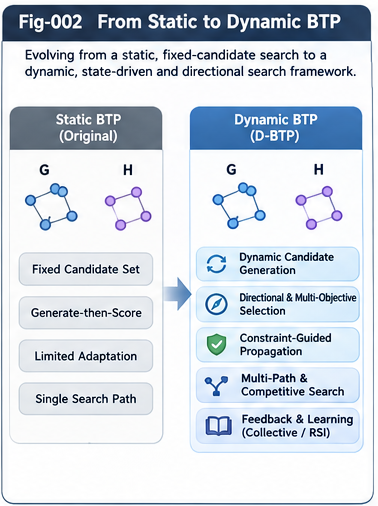
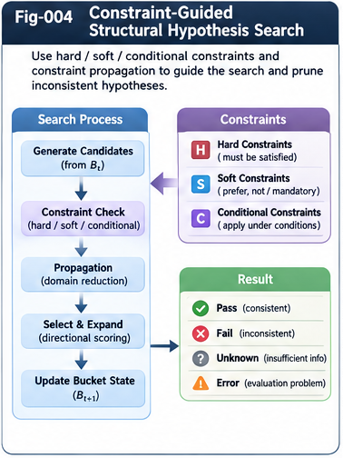

# CASE-002 — Dynamic Starmap Similarity

**D-BTP: Dynamic Bucket Tree of Permutation — Directional Structural Generation and Hypothesis Evolution**  
**Document type:** Research case / algorithmic evaluation design  
**Status:** Proposed methodology; illustrative examples, not empirical findings  
**Version:** 1.0.0

## Abstract

This case returns to the original Bucket Tree of Permutation (BTP) setting: similarity between two structural maps whose nodes and relations are not necessarily aligned. It investigates what changes when candidate correspondences are generated dynamically from the evolving Bucket state, and when directional fields influence both generation and selection. Rather than treating structural similarity as a fixed matching problem, Dynamic BTP (D-BTP) maintains competing partial correspondences, constraint-propagated structural consequences, evidence provenance, and a search frontier that can change as the comparison proceeds. The case defines the problem, state transitions, admissible and heuristic bounds, a worked synthetic example, baseline comparisons, evaluation metrics, conformance requirements, and falsifiable hypotheses. It makes no claim of guaranteed polynomial complexity or demonstrated superiority without experiments.

---



*Fig-002. From fixed-candidate BTP to dynamic BTP. A static search explores a previously defined candidate universe; dynamic BTP generates additional candidates from the evolving bucket state and observed structural consequences. Both retain explicit branch decisions and feasibility checks.*

---



*Fig-004. Constraint-guided structural composition. Candidate hypotheses pass through explicit hard-constraint checks, conditional evaluations, and propagation. Soundly inconsistent branches can be pruned; uncertain or weakly supported branches remain eligible for further investigation.*

---

## 1. Purpose and Scope

The original BTP motivation is to find structurally compatible combinations of node pairs drawn from two starmaps under a finite search budget. In a static formulation, an initial pool of candidate pairs is ranked and explored. In a dynamic formulation, the state of an accepted or rejected correspondence can reveal, suppress, or alter subsequent candidates. D-BTP adds a second coupling: directional guidance can alter *which* candidates are generated and *which* branches receive resources, while verified search outcomes can update guidance.

The present case asks:

1. Can state-dependent generation find high-quality structural alignments that a fixed candidate pool misses?
2. Can directional guidance reduce the cost of finding comparable-quality alignments without compromising hard-constraint soundness?
3. Under what conditions is dynamic generation useful, and when is its overhead unjustified?
4. How should uncertainty, ambiguity, and structural differences be represented rather than forced into a single alignment?

This is a methodological case, not a benchmark report. All numeric examples below are invented solely to clarify mechanics.

## 2. Formal Problem Definition

Let two starmaps be attributed relational structures

$$
A=(V_A,E_A,\tau_A,\alpha_A),\qquad B=(V_B,E_B,\tau_B,\alpha_B),
$$

where $V$ denotes nodes, $E$ typed and possibly directed relations, $\tau$ node/edge types, and $\alpha$ attributes or metrics. Starmaps may contain hyperedges, uncertain relations, temporal annotations, or nested submaps, provided their semantics are declared in a schema.

A correspondence hypothesis is a typed relation $h=(a,b,r,\pi)$, with $a\in V_A$, $b\in V_B$, mapping relation $r$, and provenance $\pi$. For conventional one-to-one matching, $r$ means `corresponds-to`; for generalized alignment it may express partial, many-to-one, split, merge, or abstraction-level correspondence. Such generalizations require an explicit cardinality policy; they must not be assumed by default.

A partial alignment $M\subseteq V_A\times V_B$ is feasible if it satisfies a declared hard-constraint family $\mathcal C_H$:

$$
\mathrm{Feasible}(M)\iff \bigwedge_{c\in\mathcal C_H}c(M)=\mathrm{true}.
$$

Unknown constraint outcomes are not automatically `true` or `false`. The evaluation contract specifies whether they require deferral, further evidence, or a conservative non-pruning branch.

A generic structural objective is

$$
J(M)=w_n N(M)+w_e R(M)+w_a A(M)-w_u U(M)-w_x X(M),
$$

where $N$ rewards compatible nodes, $R$ rewards preserved relations, $A$ rewards attribute compatibility, $U$ penalizes unmatched structural mass, and $X$ penalizes soft inconsistencies. Each term needs an operational definition and scale. A metric *distance* may instead be minimized, or multiple non-commensurate objectives may be retained as a Pareto portfolio. This is not a claim that a single score captures all structural similarity.

**Unaligned AND interpretation.** The alignment seeks a jointly consistent structural intersection without presupposing that node indices or local coordinate frames coincide. The matching relation itself is part of the hypothesis. In particular, unaligned AND is not ordinary elementwise intersection of already aligned arrays.

## 3. Baseline Static BTP

A useful baseline creates a finite candidate set $C_0\subseteq V_A\times V_B$, then explores acceptance/exclusion decisions under constraint plugins. Its strengths include reproducible candidate coverage, simpler bookkeeping, and lower generator overhead. Its limitations arise when useful correspondences are conditional on earlier choices, inferred abstraction levels, discovered motifs, or revised context.

Static BTP should not be caricatured as an exhaustive brute-force matcher: a strong static baseline may use informative similarity metrics, structural filtering, branch-and-bound, memoization, and plugin-driven feasibility. The comparison must hold these capabilities as constant as practical.

## 4. Dynamic Bucket State

Define a Bucket at search step $t$ as

$$
\mathcal B_t=(H_t,S_t,E_t,P_t,M_t),
$$

where:

- $H_t$: hypothesis ledger with candidate dispositions (`proposed`, `accepted`, `excluded`, `deferred`) and reasons;
- $S_t$: derived structural alignment state, domains, matched subgraphs, and unresolved residuals;
- $E_t$: evidence, confidence annotations, counterevidence, and provenance/dependency records;
- $P_t$: directional field configuration, priorities, exploration quotas, and policy version;
- $M_t$: search metadata, budget consumption, lineage, fingerprints, and termination status.

A Bucket represents a *partial hypothesis*, not an assertion that its correspondence is true. Two Buckets may disagree and both remain valid search states until a hard contradiction or an explicit portfolio policy removes one from active exploration.

The ledger must distinguish a candidate that has never been generated from one that was generated and rejected. This distinction is essential to sound closure claims.

## 5. State-Dependent Candidate Generation

The dynamic generator is

$$
C_t=G(A,B,\mathcal B_t,\mathcal R_t;\theta_G),
$$

where $\mathcal R_t$ is a registry of available candidate sources and $\theta_G$ the generator configuration. Candidate generation may be triggered by:

1. **Neighborhood exposure:** accepting $(a,b)$ suggests pairs among neighbors of $a$ and $b$.
2. **Motif propagation:** a newly aligned triangle, path, or typed relation reveals additional motifs.
3. **Residual targeting:** unmatched high-information substructures become candidate seeds.
4. **Abstraction shift:** failure at a fine granularity suggests comparison at a coarser level.
5. **Counterevidence:** contradictions reveal alternative mappings or a needed split/merge hypothesis.
6. **Directional probes:** a search policy requests candidates in an underexplored region or perspective.

Generators should declare their coverage assumptions. If a generator is selective and cannot certify that all feasible extensions have been exposed, the search must not label a Bucket *exhaustively closed* solely because its current candidate list is empty.

## 6. Dynamic State Transitions

For candidate $h$, the acceptance transition is

$$
\mathcal B_{t+1}=T_{+}(\mathcal B_t,h),
$$

which updates the ledger, applies hard constraints, propagates structural consequences, records evidence, and may trigger new candidates. The exclusion transition

$$
\mathcal B'_{t+1}=T_{-}(\mathcal B_t,h)
$$

records a rejected branch decision and may also reveal new alternatives. Rejection of a hypothesis is not equivalent to proving that all structurally related candidates are invalid.

Each transition must preserve: internal ledger consistency; nonviolation of hard constraints; evidence provenance; bounded resource accounting; coherent policy/schema versions; and an auditable explanation of pruning. A transition can yield `valid`, `invalid-with-certificate`, or `unknown-needs-review` rather than forcing a binary verdict.

## 7. Structural Constraints and Plugins

For conventional injective alignment, one-to-one uniqueness can be a hard constraint:

$$
(a,b),(a,b')\in M\Rightarrow b=b',\quad
(a,b),(a',b)\in M\Rightarrow a=a'.
$$

Other constraints include node-type compatibility, edge-direction preservation, relation-type preservation, temporal ordering, mandatory anchors, cardinality limits, and domain-specific invariants. Some apparent mismatches are *soft*: a missing edge might reflect incomplete observation rather than an impossible alignment.

A plugin result should include `PASS`, `FAIL`, `UNKNOWN`, or `ERROR`; an explanation; affected hypothesis IDs; evidence references; and, for `FAIL`, the precise hard constraint and certificate supporting rejection. `ERROR` must not silently become `FAIL`. A score-based low ranking is not a proof of infeasibility.

A plugin may also return *entailed* assignments or domain reductions. Such propagation is sound only relative to the declared constraint semantics. Derived facts must be tagged separately from observations.

## 8. Directional Fields: Generation and Selection

A directional field $D_t$ is a policy-bearing object, not merely a post hoc similarity score. It may contain weights, target regions, exploration quotas, uncertainty preferences, risk penalties, and a versioned update rule. Two roles must be distinguished:

$$
C_t\sim G(\mathcal B_t\mid D_t),\qquad
\mathrm{priority}(\mathcal B_t,h)=Q(\mathcal B_t,h\mid D_t).
$$

The first changes the candidate distribution or coverage; the second changes selection and resource allocation. Their interaction is the central D-BTP mechanism. A policy that only reranks a fixed $C_0$ is a useful baseline but not the full coupled design.

Examples of direction dimensions include local metric similarity, edge-consistency potential, structural novelty, expected information gain, uncertainty reduction, computational cost, and residual coverage. A policy should reserve a configurable fraction of budget for alternative hypotheses and counterevidence so that early noisy guidance does not irreversibly dominate search.

## 9. Weak Evidence and Similarity Signals

Local attribute resemblance, neighborhood similarity, shared motifs, and embedding proximity may be useful **weak evidence**. They can prioritize candidate pairs and guide active probing. They cannot, by themselves, establish a hard correspondence or justify logically sound pruning.

Correlated features must not be counted as independent evidence. For example, node degree and a degree-derived embedding coordinate may largely represent the same underlying signal. Record source dependencies and conduct ablations to test whether directional information provides genuine incremental value.

If a field is learned from benchmark labels, leakage controls must prevent evaluation labels or held-out structures from entering the generator. Feedback-driven adaptation should be measured on held-out instances, not only on the search traces used to tune the policy.

## 10. A Synthetic Worked Example

Consider two small directed, typed starmaps:

- **Map A:** `A1` (controller) connects to `A2` and `A3` (workers); `A2` connects to `A4` (storage); `A3` connects to `A5` (storage).
- **Map B:** `B7` (controller) connects to `B2` and `B9` (workers); `B2` connects to `B5` (storage); `B9` connects to `B4` (storage).

Assume attributes make `A1↔B7` a plausible anchor. Before accepting the anchor, a generator using only local attribute thresholds may expose `A2↔B9` and `A3↔B2` as high-ranked but ambiguous pairs. After the anchor is accepted, typed-neighborhood propagation reveals both worker alternatives, and subsequent storage-edge consistency distinguishes the two possible global alignments. Depending on the edge attributes, either alignment may be preferred; absent discriminating evidence, the system should retain both.

| Stage | State change | Newly relevant candidates | Decision basis |
| --- | --- | --- | --- |
| 0 | Empty partial alignment | Anchor and a few attribute-near pairs | Weak local similarity |
| 1 | Accept `A1↔B7` | Worker-neighborhood pairs | Structural propagation |
| 2 | Accept `A2↔B2` in one branch | `A4↔B5`, alternate residuals | Typed edge consistency |
| 3 | Exclude incompatible worker assignment | Remaining compatible worker/storage pairs | Injectivity and hard edge constraints |
| 4 | Compare surviving alignments | Counterfactual alternatives | Global objective and uncertainty |

This example illustrates *mechanism*, not evidence that dynamic BTP is faster. A static baseline with complete candidate coverage and good propagation may solve the same instance equally well or faster. The benefit of dynamic generation is most plausible when initial candidate enumeration is expensive, sparse, or incomplete and structural context is highly informative.

## 11. Structural Similarity and Distance Semantics

Similarity should be reported with its coverage and normalization policy. A high score on a tiny matched subgraph may be misleading if most of the maps remain unmatched. One possible normalized score is

$$
\mathrm{Sim}(M)=\frac{\mathrm{matched\ structural\ mass}(M)}{\mathrm{reference\ mass}(A,B)}-\lambda\,\mathrm{soft\ violations}(M),
$$

where the denominator is explicitly chosen (union mass, maximum mass, task-weighted mass, etc.). This formula is illustrative, not canonical. Asymmetric tasks may require directional coverage scores $\mathrm{Coverage}\_{A\to B}$ and $\mathrm{Coverage}\_{B\to A}$ rather than a symmetric metric.

When defining a distance $d(A,B)$, do not call it a mathematical metric without checking nonnegativity, identity of indiscernibles, symmetry, and triangle inequality. Approximate graph edit distance, maximum common subgraph, and attributed graph matching have different semantics and complexity properties.

## 12. Search Frontier, Bounds, and Termination

The active frontier contains partial Buckets, each with a priority and budget state. Best-first, beam, depth-first, and branch-and-bound policies are all possible. A branch-and-bound implementation may prune only when a **valid optimistic bound** establishes that the branch cannot improve the incumbent. A learned directional score is not an admissible upper bound unless separately proven to be one.

Three terminal labels must remain distinct:

- **Exhaustively closed:** no further feasible extensions under a declared complete generation and constraint regime.
- **Quiescent:** no candidates currently offered, but generation coverage is not proven complete.
- **Budget terminated:** search stopped because of time, memory, calls, or other limits.

The reported result must include the termination reason and, when possible, a bound on remaining optimality gap. If the generator can introduce new abstraction operators without a finite bound, global completeness is generally not established.

## 13. Reference Algorithm

```text
function DYNAMIC_STARMAP_MATCH(A, B, policy, budget):
    root = initialize_bucket(A, B, policy)
    frontier = priority_queue(root)
    portfolio = empty_diverse_portfolio()
    visited = safe_state_index()

    while frontier not empty and budget.available():
        bucket = frontier.pop()
        if hard_constraint_violation(bucket):
            record_prune(bucket, proof_or_certificate)
            continue

        candidates, coverage = generate_candidates(A, B, bucket, bucket.directional_field)
        candidates = validate_and_deduplicate(candidates, bucket)

        if candidates is empty:
            if coverage.proves_exhaustive_closure:
                portfolio.add(bucket, status="closed")
            else:
                portfolio.add(bucket, status="quiescent")
            continue

        for candidate in policy.choose_probes(candidates, bucket, budget):
            for action in [ACCEPT, EXCLUDE]:
                child = transition(bucket, candidate, action)
                child = propagate_sound_constraints(child)
                if child.has_certified_hard_conflict():
                    record_prune(child, child.conflict_certificate)
                    continue
                child = attach_evidence_and_provenance(child)
                child = update_directional_state_if_authorized(child)
                if visited.proves_equivalent(child):
                    continue
                frontier.push(child, priority=policy.rank(child))

        portfolio.update_with(bucket, diversity_and_quality_policy)

    return portfolio, frontier, budget.report(), coverage_report()
```

The pseudocode intentionally leaves generator completeness, admissible bounds, equivalence proofs, and field-update governance as pluggable contracts. It does not imply that all candidate combinations are enumerated or that the returned portfolio is globally optimal.

## 14. Implementation Contracts

A minimal implementation should define interoperable records for:

| Record | Required fields | Principal invariant |
| --- | --- | --- |
| `Starmap` | schema, nodes, relations, attributes, version | Typed, versioned semantics |
| `Candidate` | pair/relation, generator, dependencies, provenance | Reproducible generation reason |
| `Bucket` | ledger, alignment, evidence, policy, lineage, budget | No contradictory accepted decisions |
| `ConstraintResult` | status, rule ID, certificate, affected IDs | Only certified hard failures prune |
| `DirectionalField` | objectives, weights, uncertainty, version | No implicit hard-constraint override |
| `GenerationCoverage` | scope, completeness claim, assumptions | Closure justified by coverage proof |
| `SearchReceipt` | outcome, status, budget, policy/schema versions | Auditable search provenance |

A candidate's stable ID should include enough canonical information to avoid confusing two semantically different relations. A Bucket fingerprint is safe for state merging only if all future-relevant information is equivalent; identical accepted pairs alone may be insufficient when evidence, exclusions, or generator state differ.

## 15. Baselines and Experimental Matrix

Evaluate at least the following methods on identical instances and budgets:

| Baseline | Candidate source | Directional policy | Purpose |
| --- | --- | --- | --- |
| B0: Static BTP | Fixed initial pool | Static ranking | Original-style reference |
| B1: Static + strong propagation | Fixed, broadly covered pool | Static ranking | Control for constraint power |
| B2: Dynamic unguided | State-dependent | Uniform or neutral | Isolate generation effect |
| B3: Dynamic + fixed field | State-dependent | Fixed guidance | Isolate directional selection |
| B4: Dynamic + coupled field | Field-dependent generation | Adaptive, validated guidance | Test full D-BTP mechanism |
| B5: Oracle-assisted upper reference | Ground-truth-informed candidates, offline only | Oracle | Diagnose headroom, not deployable |

Where feasible, add conventional graph-matching baselines appropriate to the starmap schema, such as graph edit distance approximations, maximum-common-subgraph heuristics, and attributed graph matching. No algorithm should be compared under a different allowed evidence set without disclosure.

## 16. Dataset Design

Construct a progression of controlled synthetic instances and, if permitted, real-world non-sensitive structural datasets:

1. **Exact isomorphism:** relabel nodes, preserving all structure.
2. **Partial overlap:** inject missing nodes and edges at measured rates.
3. **Attribute noise:** perturb metrics while preserving relation structure.
4. **Structural ambiguity:** introduce repeated motifs and automorphisms.
5. **Non-injective mappings:** permit split/merge or abstraction correspondences under explicit contracts.
6. **Adversarial decoys:** add locally similar but globally incompatible regions.
7. **Evolving maps:** reveal relations over time, testing state and version handling.
8. **Transfer conditions:** change domain or relation vocabulary to assess policy reuse.

Record generator recall separately from final matching quality. A dynamic method may appear accurate on easy cases while systematically failing to generate rare but necessary correspondences.

For real datasets, document license, data provenance, sampling, preprocessing, and whether reference alignments are complete or only partially known.

## 17. Metrics and Reporting

Primary metrics should include:

- **Alignment quality:** precision/recall/F1 where ground truth exists, structural consistency, matched-mass coverage, objective value, and uncertainty calibration.
- **Search efficiency:** wall-clock time, CPU/GPU work, candidate generation count, constraint calls, explored Buckets, peak memory, and quality-versus-budget curves.
- **Candidate coverage:** recall of ground-truth pairs in the generated frontier, fraction of candidate families never explored, and residual coverage.
- **Directional effectiveness:** incremental gain from field-guided generation versus ranking-only and unguided generation.
- **Robustness:** sensitivity to noise, motif symmetry, field misspecification, and adversarial decoys.
- **Governance:** rate of uncertified pruning, provenance completeness, replay agreement, and plugin-version consistency.

Report medians and dispersion across random seeds and problem families, not only best runs. Use paired instances, fixed budgets, confidence intervals, and ablations. Pre-register primary outcomes where feasible.

## 18. Falsifiable Hypotheses

**H1 — Conditional candidate discovery.** On tasks where useful correspondences become apparent only after structural commitments, dynamic generation increases candidate recall at a fixed generation budget relative to a fixed initial candidate pool.

**H2 — Efficiency in sparse overlap.** With sparse true overlap and expensive full-pair enumeration, dynamic generation improves time-to-target-quality relative to comparably optimized static baselines.

**H3 — Directional coupling.** Field-guided *generation plus selection* improves the quality-versus-budget frontier relative to field-guided selection alone, when the field is informative.

**H4 — Misguidance tolerance.** A diversified hypothesis portfolio and exploration quota reduce catastrophic failure under misleading directional evidence relative to greedy single-path search.

**H5 — Soundness preservation.** With identical certified hard constraints, directional guidance changes exploration order and candidate exposure but does not produce a hard-constraint-invalid accepted alignment.

**H6 — Structural ambiguity.** Maintaining multiple hypotheses improves calibrated uncertainty and top-K ground-truth coverage on automorphism-rich maps relative to a forced single match.

**H7 — Adaptive feedback.** Validated policy updates improve held-out performance over a frozen field, without increasing hard-constraint errors or evidence leakage.

**H8 — Boundary conditions.** For small, fully enumerated, low-ambiguity maps, dynamic generation overhead can make D-BTP slower than a strong static baseline. This hypothesis is deliberately adverse to the proposed approach.

Each hypothesis must specify a dataset family, metric, minimum practical effect, and test budget before conclusions are drawn.

## 19. Ablation and Failure Analysis

Run ablations disabling: dynamic generation; field influence on generation; field influence on selection; constraint propagation; counterevidence probes; portfolio diversity; feedback updates; and abstraction-shift operators. The resulting differences help attribute improvements to mechanisms rather than to an increased compute budget.

Important failure modes include:

- **Generator blind spots:** the correct pair is never proposed.
- **Feedback lock-in:** early false matches bias subsequent generation.
- **Symmetry collapse:** equivalent or near-equivalent mappings are discarded without justification.
- **Unsound pruning:** a heuristic is mistaken for a hard proof.
- **Duplicate evidence:** correlated features inflate apparent confidence.
- **Unsafe state merging:** differing future generation possibilities are conflated.
- **Budget opacity:** one method hides expensive generation or plugin costs.
- **Schema drift:** version mismatches change constraint meaning during search.
- **Overgeneralization:** a structural alignment is presented as semantic identity or causal equivalence.

Mitigations include candidate-coverage audits, bounded random exploration, explicit uncertainty, proof-carrying pruning, version pinning, full cost accounting, and independent replay.

## 20. Relationship to Other D-BTP Documents

- **D-BTP-001:** extends metric similarity toward structural hypothesis search.
- **D-BTP-002:** defines dynamic Bucket states and candidate generation.
- **D-BTP-003:** supplies constraint-guided composition and pruning semantics.
- **D-BTP-004:** defines directional fields acting on generation and selection.
- **D-BTP-005:** distinguishes weak evidence from certified constraints.
- **D-BTP-006:** integrates generation, selection, and feedback.
- **D-BTP-007:** considers multi-agent RSI and collective structural learning.
- **D-BTP-008:** examines open-ended structural evolution and its limits.
- **SPEC-001:** Dynamic Bucket State Contract.
- **SPEC-002:** Candidate Generation and Constraint Plugins.
- **SPEC-003:** Directional Scoring and Search Control.
- **SPEC-004:** Evidence Relay and Learning Lifecycle.
- **CASE-001:** Blockchain Actor Attribution, a more domain-specific latent-actor mapping task.
- **CASE-003:** Multi-Agent Hypothesis Competition, evaluating collaborative and adversarial search roles.

This case is deliberately closer to the original BTP application than CASE-001. It serves as a controlled bridge between the historical structural-matching problem and the generalized D-BTP framework.

## 21. Validation Roadmap

**Phase 1 — Semantics and conformance.** Freeze schemas, cardinality policies, constraints, termination statuses, and deterministic test fixtures. Demonstrate that all accepted alignments satisfy hard constraints.

**Phase 2 — Static/dynamic equivalence tests.** On small exhaustively enumerable instances, verify that complete dynamic generation can recover the same feasible solution set as a complete static reference, subject to identical semantics.

**Phase 3 — Directional ablations.** Measure guidance-only, generation-only, and coupled variants across noise, overlap, and ambiguity regimes. Include intentionally misleading fields.

**Phase 4 — Learning and transfer.** Train or update directional policies only on designated training instances. Evaluate on held-out domains and report negative transfer.

**Phase 5 — Multi-agent relay.** Exchange versioned alignment hypotheses, independent constraint receipts, and counterexamples among agents; measure whether collaboration adds value beyond equivalent single-agent compute.

A publishable empirical claim requires reproducible datasets, exact configuration files, resource accounting, baselines, and uncertainty estimates. A theoretically attractive architecture alone is not evidence of speedup.

## 22. Open Research Questions

1. Which starmap families admit useful candidate-generation completeness certificates?
2. Can residual-driven generation be made both high-recall and computationally economical?
3. What state abstraction preserves all future-relevant information for safe deduplication?
4. How should directional fields represent epistemic uncertainty versus optimization preference?
5. Can admissible structural bounds coexist efficiently with adaptive heuristic guidance?
6. When does a many-to-one or abstraction-level alignment retain meaningful similarity semantics?
7. What is the best way to handle graph automorphisms without overcounting hypotheses?
8. Can feedback updates be evaluated independently of the search instances that produced them?
9. How should one compare candidate-generation recall when the full candidate universe is unknown?
10. What constitutes a reusable structural insight across maps with different ontologies?

## 23. Conclusion

Dynamic Starmap Similarity is the natural controlled test bed for D-BTP. It retains the original structural-matching motivation while exposing the generalization that matters: candidate correspondences can be generated as the partial alignment evolves, and directional fields can guide both candidate discovery and search allocation. The resulting search may be more adaptive, but its value is contingent on candidate coverage, constraint correctness, evidence quality, and computational overhead. A rigorous evaluation must compare against strong static baselines and must separate improvements in structural alignment from improvements in search efficiency.

The principal research proposition is therefore testable rather than assumed: **coupling state-dependent structural generation with directionally guided selection can improve the efficiency and coverage of unaligned structural similarity search in identifiable problem regimes, while preserving explicitly certified constraints.**

---

*Research note:* This document proposes algorithms, contracts, and evaluation protocols. Its synthetic examples are explanatory and do not represent observed experimental results. Claims about complexity, optimality, and generalization require separate proof or empirical validation.
