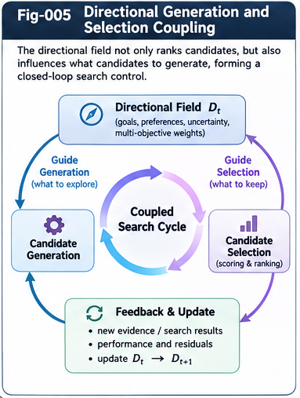
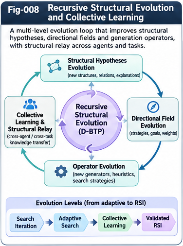

# EXT-002 — Recursive Directional Field Evolution

**Project:** Dynamic Bucket Tree of Permutation (D-BTP): Directional Structural Generation and Hypothesis Evolution  
**Document class:** Research Extension / Directional Control and Recursive Learning  
**Status:** Research proposal; mechanisms and hypotheses require empirical validation  
**Version:** 1.0.0 (proposed)

## Abstract

A directional field in Dynamic Bucket Tree of Permutation (D-BTP) is more than a scalar used to rank branches. It may shape which structural candidates are proposed, which hypotheses receive attention, what evidence is sought, how resources are allocated, and which lessons are retained. If the field itself can be revised from validated outcomes, the system gains a second level of adaptation: not only do hypotheses evolve within a search, but the policies governing that evolution can change. This extension examines a further possibility—**recursive directional field evolution**—in which a system proposes, tests, composes, and selectively deploys modifications to its own directional control mechanisms.

The proposal distinguishes state updates, parameter adaptation, policy revision, and verified recursive improvement. It introduces versioned field units, explicit improvement contracts, evidence provenance, evaluation sandboxes, counterfactual comparisons, bounded promotion, rollback, and cross-agent relay. The central claim is conditional: recursive field evolution could improve search efficiency and discovery under changing structural tasks, but it can also amplify biases, exploit evaluation metrics, or destabilize search. Accordingly, recursion is treated as a testable engineering hypothesis, not a demonstrated route to general intelligence.

**Keywords:** D-BTP; directional field; recursive adaptation; structural hypothesis search; weak evidence; control plane; meta-learning; structural relay; collective learning; RSI; validation.

---



*Fig-005. Directional fields couple what is proposed with what is explored next. Directional policies influence candidate generation, branch prioritization, and resource allocation; evaluated outcomes and independently checked evidence feed back into subsequent policy updates.*

---



*Fig-008. Multi-agent structural relay and recursive evolution. Competing search agents exchange versioned hypotheses, evidence, and candidate improvements. Independent validation and governance distinguish ordinary adaptation from accepted reusable improvements and from stronger claims of recursive self-improvement.*

---

## 1. Motivation: When the Search Direction Becomes a Search Object

The foundations of D-BTP separate three interacting processes:

1. **Structural generation:** propose feasible candidate relationships or new structural operators from a current Bucket state.
2. **Directional selection:** prioritize candidates, hypotheses, evidence requests, and computational resources.
3. **Feedback:** update beliefs and search control using outcomes, residuals, and validation results.

A fixed directional field can already be useful. A field adjusted by feedback may be more useful in a changing task environment. But a field is itself a structured artifact with objectives, features, dependencies, weights, uncertainty models, policies, and constraints. It can therefore become the subject of structural search.

This extension asks: **Can D-BTP search over its own directional fields while retaining the correctness boundaries that govern ordinary structural hypotheses?**

The proposed answer is a constrained research program: represent field revisions as hypotheses, evaluate them as candidates, and permit deployment only after explicit checks. Recursive improvement is possible only if the revised control mechanism demonstrably improves the process used to discover or evaluate subsequent revisions.

## 2. Scope and Non-Claims

This document addresses:

- The representation and lifecycle of directional fields as versioned structural units.
- Mechanisms for generating candidate field modifications.
- Objective, evidence, and validation contracts for selecting modifications.
- Recursive learning across search episodes and agents.
- Risks of reward hacking, evidence leakage, premature convergence, and unsafe policy drift.

It does **not** claim that biological brains implement D-BTP, that arbitrary field recursion converges, that the method guarantees global optimality, or that improving a benchmark constitutes general intelligence. The term *RSI* is reserved for a demonstrated process in which a system improves an improvement-relevant component of itself under independent evaluation; routine feedback tuning alone is not sufficient.

## 3. Four Distinct Levels of Change

Confusing different levels of adaptation obscures both capabilities and risks.

| Level | What changes | Example | Evidence required |
|---|---|---|---|
| L0 — Search-state evolution | Bucket hypotheses and evidence | Accept or exclude a candidate match | Structural consistency and task evidence |
| L1 — Field-state adaptation | Field values within a fixed design | Reweight exploration after observing a residual | Calibration and held-out task results |
| L2 — Field-policy revision | Features, objectives, update rules, or scheduling | Add a counterevidence-seeking objective | Controlled comparison against incumbent |
| L3 — Recursive field improvement | Mechanism that proposes or evaluates field revisions | Improve the field-revision generator itself | Independent, repeated improvement on unseen tasks |

L0 and L1 are not, by themselves, RSI. L2 may constitute meta-learning if it generalizes. L3 is the strongest and most difficult claim; it must be supported by longitudinal evidence rather than terminology.

## 4. Canonical Model

Let a search episode at time \(t\) contain:

\[
\mathcal{B}_t=(H_t,S_t,E_t,P_t,M_t),
\]

where \(H_t\) is the hypothesis ledger, \(S_t\) structural state, \(E_t\) evidence and provenance, \(P_t\) directional/search policy state, and \(M_t\) metadata, versions, and budgets.

A directional field is represented as a versioned unit:

\[
\Phi^v=(\mathcal{O},\mathcal{F},\mathcal{W},\mathcal{U},\mathcal{G},\mathcal{Q},\mathcal{R},\mathcal{V}),
\]

with objectives \(\mathcal{O}\), features \(\mathcal{F}\), weighting or aggregation \(\mathcal{W}\), uncertainty representation \(\mathcal{U}\), generation guidance \(\mathcal{G}\), selection/resource policy \(\mathcal{Q}\), update rules \(\mathcal{R}\), and provenance/validation metadata \(\mathcal{V}\).

A coupled D-BTP step is:

\[
C_t=G(\mathcal{B}_t,\Phi^v,\mathcal{K}_t),\qquad
c_t=\operatorname{Select}(C_t,\mathcal{B}_t,\Phi^v),
\]

\[
\mathcal{B}_{t+1}=T(\mathcal{B}_t,c_t,\operatorname{Check}(c_t)),
\]

where \(\mathcal{K}_t\) denotes constraints and available plugin capabilities. Candidate generation and selection may be mutually conditioned; these equations express an interface boundary, not a mandatory two-pass implementation.

Across episodes, a proposed field update is:

\[
\widehat{\Phi}^{v+1}=M(\Phi^v,\mathcal{D}_{\leq t},\mathcal{R}_{\leq t}),
\]

where \(M\) is a revision operator, \(\mathcal{D}\) contains appropriately partitioned experience, and \(\mathcal{R}\) contains residuals and validation feedback. **Proposal is not promotion:** deployment requires a separate gate.

## 5. Directional Fields Are Structured Hypotheses

A field revision should be treated as a falsifiable hypothesis about search control:

> Under declared task conditions and budgets, field version \(\Phi'\) will improve a specified evaluation objective relative to \(\Phi\), without violating protected invariants or unacceptable regressions.

The hypothesis must identify its domain of applicability. A field that improves sparse graph matching may harm dense graph matching. An evidence-acquisition strategy useful in one domain may be costly or misleading in another. Consequently, field units should carry **applicability predicates**, not universal superiority claims.

Candidate revisions may modify:

- Feature definitions, feature interactions, and reliability estimates.
- Objective portfolios and Pareto preferences.
- Candidate-generation priors and structural templates.
- Exploration/exploitation scheduling and diversity quotas.
- Counterevidence acquisition policies.
- Resource-allocation rules and stopping criteria.
- Field update operators and their own validation procedures.

A revision is invalid if it silently changes hard feasibility constraints or weakens required evidence and governance checks.

## 6. A Versioned Directional Field Unit (DFU)

A portable **Directional Field Unit (DFU)** is proposed as a first-class artifact.

```yaml
field_id: dfu-example
version: 2.1.0
parent_versions: ["2.0.0"]
objective_contract:
  primary: "validated-structural-discovery-per-compute"
  secondary: ["calibration", "hypothesis-diversity"]
applicability:
  task_families: ["synthetic-starmap-matching"]
  exclusions: ["unvalidated-cross-domain-transfer"]
feature_schema:
  - name: "constraint-consistency-estimate"
    uncertainty_required: true
  - name: "counterevidence-value"
    uncertainty_required: true
generation_guidance:
  policy_ref: "generator-policy-v3"
selection_policy:
  policy_ref: "portfolio-policy-v2"
update_policy:
  policy_ref: "feedback-update-v4"
validation:
  status: "candidate"
  baseline: "dfu-example@2.0.0"
  evaluation_suite: "heldout-suite-2026-a"
  promotion_decision: null
provenance:
  proposal_source: "meta-search-agent"
  evidence_ids: []
  audit_log_ref: "audit-example"
rollback:
  previous_stable_version: "2.0.0"
```

This schema is illustrative, not a finalized wire protocol. It should be aligned with SPEC-001 through SPEC-004 before implementation.

A DFU must distinguish a **field description** from its **runtime execution rights**. A relayed DFU is not automatically executable or trusted.

## 7. Candidate Field Generation

Field proposals may arise from several sources:

**Residual-driven revision.** Repeated failure to explain a structural pattern suggests a missing feature, relation, or generator template. The revision generator proposes a new field component and records the residual it is intended to address.

**Counterexample-driven revision.** A false positive or missed hypothesis exposes a failure in ranking, uncertainty calibration, or evidence acquisition. A candidate field targets that failure without assuming it generalizes.

**Composition.** Complementary fields can be combined into a portfolio or conditional dispatcher. Composition should preserve lineage and avoid double-counting correlated evidence.

**Cross-domain transfer.** A field component learned in one task family is imported as an unvalidated candidate in another, with explicit applicability testing.

**Meta-questioning.** An agent may ask which feature, objective, or validation test is missing. This connects D-BTP with autonomous questioning while keeping the question-to-policy change subject to independent checks.

**Operator invention.** At a more ambitious level, the system proposes a new mechanism for generating field revisions. This is a candidate L3 change and demands stronger validation.

## 8. Field Revision as a Second D-BTP Search

A practical architecture uses two related but separately governed frontiers:

- **Hypothesis frontier \(\mathcal{F}_H\):** structural interpretations of the current task.
- **Field frontier \(\mathcal{F}_\Phi\):** candidate modifications to the policies governing structural exploration.

A field candidate can itself be a Bucket-like hypothesis with a proposal ledger, compatibility constraints, test evidence, and a status such as *proposed*, *sandboxed*, *rejected*, *validated*, *promoted*, or *rolled back*.

The field frontier must not automatically inherit the current search field's biases. A diversity-preserving baseline or independent evaluator should be retained so that a self-preferred field cannot unilaterally validate itself.

## 9. Coupling Without Circular Validation

The architecture must permit beneficial feedback without making evidence self-confirming.

A candidate field \(\Phi'\) may alter which task hypotheses are explored. The resulting data are therefore **policy-selected observations**, not necessarily an unbiased sample of the problem space. Evaluating \(\Phi'\) solely on those observations risks selection bias.

Recommended safeguards include:

1. A fixed, held-out evaluation set unknown to the field-revision generator.
2. Randomized or stratified trials where feasible.
3. A stable incumbent and an unguided or simpler baseline.
4. Separate evidence used for proposal, tuning, and final promotion.
5. Explicit accounting for extra compute spent on meta-search.
6. Independent counterexample generation and adversarial testing.

These controls do not remove all bias, but they make improvement claims more falsifiable.

## 10. Multi-Directional Field Portfolios

A single scalar score may suppress promising minority hypotheses. Instead, D-BTP can maintain a portfolio:

\[
\mathbf{s}_{\Phi}(c)=(s_{\mathrm{feasibility}},s_{\mathrm{promise}},s_{\mathrm{information}},s_{\mathrm{diversity}},s_{\mathrm{cost}},s_{\mathrm{risk}}).
\]

The feasibility component must not replace hard constraint validation. The other components may be uncertain or incomparable. Selection can use Pareto dominance, lexicographic safeguards, constrained optimization, or budgeted exploration quotas.

A recursive revision can change not just the weights but the **structure of the portfolio**—for example, adding a novelty objective when the search stagnates. Such additions must be evaluated for their effect on real discovery rather than on novelty scores alone.

## 11. Weak Evidence, Directional Intuition, and Provenance

Weak evidence is valuable when it predicts which exploratory action may be informative. It is not a substitute for proof. In field evolution, weak evidence may support a candidate policy revision, but cannot by itself establish that the revision is better.

Each evidence item should record source, timestamp, task context, dependence on other evidence, confidence representation, counterevidence, and allowed uses. Repeated measurements of the same latent source must not be treated as independent confirmation.

A directional field should also be capable of saying **“insufficient evidence to prioritize strongly.”** Preserving this uncertainty may outperform overconfident selection in open-ended environments.

## 12. A Field-Improvement Objective

For a task distribution \(\mathcal{T}\), define an illustrative performance functional:

\[
J(\Phi;\mathcal{T})=
\mathbb{E}_{\tau\sim\mathcal{T}}
\left[Q_{\mathrm{validated}}(\tau,\Phi)
-\lambda C(\tau,\Phi)
-\mu R(\tau,\Phi)\right],
\]

where \(Q_{\mathrm{validated}}\) measures validated structural outcomes, \(C\) is computational and evidence-acquisition cost, and \(R\) is a defined risk or calibration penalty. These terms require domain-specific operational definitions and normalization.

A field revision is a candidate improvement if:

\[
\Delta J=J(\Phi';\mathcal{T}_{\mathrm{heldout}})-J(\Phi;\mathcal{T}_{\mathrm{heldout}})>\delta,
\]

with a predeclared practical threshold \(\delta\), appropriate uncertainty estimates, and no violations of protected constraints. A positive point estimate alone is insufficient.

An important alternative is **regret under distribution shift**: a field can perform well on average while failing catastrophically on a minority task family. Promotion criteria should therefore include worst-group or risk-sensitive measures where relevant.

## 13. Improvement Contracts and Promotion Gates

Every field revision proposal should declare:

| Contract element | Required question |
|---|---|
| Target | Which component is being changed? |
| Rationale | Which observed residual or counterexample motivates the change? |
| Predicted benefit | What measurable outcome should improve? |
| Scope | On which task families is improvement expected? |
| Protected invariants | Which hard constraints and governance rules must remain unchanged? |
| Evaluation | Which baselines, datasets, metrics, and budgets will be used? |
| Promotion | What statistical and practical criteria must pass? |
| Rollback | What triggers reversion, and to which version? |

Promotion follows a staged lifecycle: **proposal → static checks → sandbox evaluation → independent comparison → limited deployment → monitored promotion**. Failed proposals remain available as negative learning artifacts, with their failure context intact.

## 14. Reference Recursive Lifecycle

```text
function RecursiveDirectionalFieldEvolution(stable_field, task_stream, budget):
    field_registry = {stable_field}
    incumbent = stable_field
    improvement_history = []

    for episode in task_stream while budget.available():
        # Operational search remains subject to hard constraints.
        result = DynamicBTP_Search(episode, incumbent, budget.search_slice())
        record_outcomes_and_provenance(result)

        residuals = analyze_validated_failures(result)
        proposals = propose_field_revisions(
            incumbent, residuals, improvement_history,
            budget.meta_search_slice()
        )

        for proposal in proposals:
            if not static_contract_check(proposal):
                archive_rejection(proposal, "contract failure")
                continue

            trial = sandbox_evaluate(
                proposal, incumbent,
                heldout_suite=independent_evaluation_suite(),
                matched_budget=True
            )
            record_trial_with_provenance(trial)

            if independent_promotion_gate(trial):
                candidate = limited_deploy(proposal)
                if monitoring_passes(candidate):
                    incumbent = promote_version(candidate)
                    field_registry.add(incumbent)
                else:
                    rollback_to_last_stable()

        improvement_history.append(summarize_episode_and_trials())

    return incumbent, field_registry, improvement_history
```

This pseudocode is intentionally conservative. It leaves evaluator independence, statistical testing, permissions, and domain-specific policies to concrete contracts. A real implementation must prevent training/evaluation leakage and enforce budget accounting.

## 15. Recursive Improvement of the Revision Operator

Suppose the field revision operator is itself parameterized by \(\Psi\):

\[
\Phi^{v+1}=M_{\Psi}(\Phi^v,\mathcal{D},\mathcal{R}).
\]

A proposed meta-revision \(\Psi'\) may improve how useful field proposals are generated. A credible L3 claim requires demonstrating that \(M_{\Psi'}\), under comparable budgets and on unseen tasks, yields better validated revisions than \(M_{\Psi}\).

This introduces two levels of measurement:

- **Task-level:** Does a deployed field improve structural search?
- **Meta-level:** Does the revised improvement operator produce better field candidates or reach equivalent quality at lower total cost?

The cost of meta-search must be included in the latter. Otherwise an expensive revision process may appear beneficial while reducing end-to-end efficiency.

## 16. Multi-Agent Field Evolution and Collective Learning

A multi-agent arrangement can separate duties:

- **Explorer agents** discover structural residuals and propose candidate field changes.
- **Skeptic agents** generate counterexamples and competing explanations.
- **Evaluator agents** run controlled comparisons using restricted evaluation access.
- **Portfolio agents** preserve diverse field candidates and task-specific alternatives.
- **Governance agents** check permissions, provenance, budget limits, and promotion rules.

A validated DFU can be relayed to another agent or domain, but relay should carry its original task scope, evaluation results, and known failures. Receiving agents must revalidate applicability; imported success is not proof of local success.

Collective learning may accumulate reusable field components and negative results. It becomes controlled RSI only when improvement to an improvement-relevant mechanism is independently established.

## 17. Field Composition, Specialization, and Conditional Dispatch

One field need not dominate all others. A family of fields \(\{\Phi_1,\ldots,\Phi_k\}\) may be governed by a context-dependent dispatcher \(D(x)\), where \(x\) is a task descriptor. This permits specialization without forcing a single universal weighting scheme.

Potential composition modes include:

- **Mixture:** combine compatible guidance signals with explicit correlation controls.
- **Switching:** select one field based on declared task conditions.
- **Hierarchical:** use a high-level control field to allocate budget among specialized fields.
- **Competitive:** run several fields under matched budgets and compare validated results.

The dispatcher is itself a candidate for revision and must be evaluated independently. Composition is not automatically superior; coordination overhead and policy instability may outweigh benefits.

## 18. Stability, Forgetting, and Distribution Shift

Recursive adaptation introduces failure modes absent from a fixed field:

**Feedback oscillation:** rapid promotion of alternating policies. Mitigation: minimum evaluation windows, hysteresis, and cooldown periods.

**Catastrophic forgetting:** improvement on recent tasks degrades older capabilities. Mitigation: representative regression suites and retained stable versions.

**Distribution shift:** a field becomes miscalibrated outside its original task family. Mitigation: applicability checks, drift detection, and fallback baselines.

**Self-confirming exploration:** a field only explores hypotheses consistent with its own priors. Mitigation: randomized exploration, counterevidence quotas, and diversity-preserving portfolios.

**Metric gaming:** field revisions optimize the benchmark rather than genuine structural discovery. Mitigation: hidden tests, independent evaluators, multiple metrics, and periodic suite renewal.

**Unbounded recursion cost:** meta-search consumes more resources than task search. Mitigation: explicit meta-budget ceilings and measured return on compute.

## 19. Protected Invariants

A conforming implementation should enforce at least the following invariants:

**RFI-01 — Hard-constraint separation.** Directional scores cannot override hard feasibility failures.

**RFI-02 — Proposal/promotion separation.** A generated field candidate cannot deploy itself merely by being proposed.

**RFI-03 — Version immutability.** Promoted field versions and their evaluation artifacts are immutable; updates create new versions.

**RFI-04 — Provenance retention.** Evidence and policy ancestry remain traceable across revisions and relay.

**RFI-05 — Evaluation independence.** Promotion requires evaluation not solely controlled by the candidate field or its proposer.

**RFI-06 — Weak-evidence integrity.** Weak evidence may guide search but is not silently elevated to proof.

**RFI-07 — Budget accounting.** Task and meta-search resources are measured together.

**RFI-08 — Rollback availability.** A stable, previously validated version remains recoverable.

**RFI-09 — Scope preservation.** Cross-domain transfer retains applicability limitations until revalidated.

**RFI-10 — Counterevidence access.** The system preserves pathways to seek disconfirming evidence.

**RFI-11 — Diversity preservation.** Selection policies may not silently remove all competing hypotheses when diversity is contractually required.

**RFI-12 — Auditability.** Field changes, evaluation results, and promotion decisions can be reconstructed from retained records.

## 20. Proposed Conformance Tests

| ID | Test | Expected result |
|---|---|---|
| RF-C01 | Candidate field attempts to override hard constraint | Reject or quarantine revision |
| RF-C02 | Field proposal lacks parent version | Reject as invalid provenance |
| RF-C03 | Same evidence enters through two relays | Detect shared dependency or mark unresolved |
| RF-C04 | Candidate field evaluates itself only | Block promotion |
| RF-C05 | Held-out performance declines beyond threshold | Reject or rollback |
| RF-C06 | Candidate improves score by suppressing counterexamples | Fail adversarial evaluation |
| RF-C07 | Task family lies outside applicability predicate | Require revalidation or fallback |
| RF-C08 | Meta-search exceeds allocated budget | Terminate meta-search without corrupting task state |
| RF-C09 | Concurrent field revisions conflict | Preserve separate versions; require explicit resolution |
| RF-C10 | Rollback triggered during limited deployment | Restore stable version and retain audit trail |
| RF-C11 | Candidate modifies revision operator | Require meta-level comparison |
| RF-C12 | New objective improves novelty but reduces validated discovery | Do not infer net improvement |
| RF-C13 | Distribution shifts after promotion | Detect drift and reevaluate applicability |
| RF-C14 | Field relay arrives with incomplete evidence lineage | Mark unverified; do not auto-promote |
| RF-C15 | Repeat experiment with same declared seed and artifacts | Reproduce within documented tolerances |
| RF-C16 | Field improves only a narrow subgroup | Report subgroup regressions and scope restrictions |

These tests are proposed requirements, not reports of executed tests.

## 21. Testable Research Hypotheses

**H1 — Adaptive field benefit.** On task families with changing structural regularities, L1 adaptive fields outperform fixed fields on validated discovery per unit of total compute.

**H2 — Structural revision benefit.** L2 field revisions outperform weight-only tuning when relevant search features or objectives are missing.

**H3 — Residual-driven proposal efficiency.** Residual-guided field proposals yield more useful validated revisions per trial than random or undirected proposals.

**H4 — Diversity protection.** Multi-field portfolios reduce premature convergence and worst-group failure relative to a single optimized field under matched budgets.

**H5 — Counterevidence calibration.** Explicit counterevidence policies improve calibration and reduce false-positive structural attribution without unacceptable discovery loss.

**H6 — Relay transfer.** Validated DFUs transferred between related task families reduce adaptation cost compared with training a field from scratch, after local revalidation.

**H7 — Recursive operator improvement.** A revised meta-operator generates better validated field revisions than its predecessor on unseen tasks at comparable total compute.

**H8 — Governance value.** Independent promotion gates and rollback reduce severe regressions relative to unconstrained online self-updating.

**H9 — Conditional specialization.** Context-dependent field dispatch outperforms a universal field across heterogeneous tasks when routing overhead is included.

**H10 — Complexity boundary.** Benefits diminish or reverse when field-revision cost, evaluation cost, or distribution shift exceeds specified thresholds.

Every hypothesis is falsifiable in principle. Negative findings should be retained as first-class collective-learning artifacts.

## 22. Experimental Design

### 22.1 Task suites

Use controlled synthetic and, where ethically and legally appropriate, public benchmark tasks such as dynamic starmap matching, constraint-based structural composition, and multi-agent hypothesis competition. Synthetic tasks should expose known ground truth, configurable ambiguity, evidence noise, changing task distributions, and variable branching factors.

### 22.2 Baselines

- **B0:** Static candidate generation with fixed ranking.
- **B1:** Dynamic candidate generation with unguided selection.
- **B2:** Dynamic generation with fixed directional field.
- **B3:** Dynamic generation with L1 field adaptation.
- **B4:** L2 field-policy revision with independent promotion.
- **B5:** Multi-field portfolio and conditional dispatch.
- **B6:** Proposed L3 revision-operator evolution.

Run matched-budget comparisons and ablations. Where exact matching of compute is impractical, report cost-quality frontiers rather than a single winner.

### 22.3 Metrics

Measure validated solution quality, feasible hypothesis recall, false-positive rate, calibration, time-to-first-valid-discovery, diversity of retained hypotheses, counterevidence discovery, total compute and evidence-acquisition cost, number of promoted revisions, rollback rate, worst-group performance, and transfer effectiveness.

For L3 claims, also measure **improvement productivity**: validated field improvements per unit of meta-search and evaluation cost over multiple revision generations.

### 22.4 Statistical protocol

Predeclare primary metrics and promotion thresholds. Use multiple seeds and task splits; separate development, selection, and final evaluation. Report confidence intervals or uncertainty ranges, failure cases, and sensitivity to hyperparameters. Repeatedly testing candidate fields on the same held-out suite can exhaust its independence; rotate or sequester final evaluation tasks.

## 23. A Minimal Worked Example

Consider a synthetic starmap-matching task where the initial field prioritizes high local node similarity. This strategy performs well when node labels are informative but poorly when labels are noisy and relational patterns are stable.

1. **Observed residual:** many high-ranked local matches fail global consistency checks.
2. **Field proposal:** introduce a relation-consistency feature and allocate a modest exploration quota to low-label-similarity candidates with strong structural support.
3. **Static checks:** confirm that the proposal changes ranking and generation guidance, not hard constraint semantics.
4. **Sandbox test:** compare the candidate with the incumbent on unseen graphs at matched total cost.
5. **Counterexample:** test graphs where relational patterns are deceptive or heavily repeated.
6. **Promotion decision:** promote only if validated outcomes improve and regression thresholds are satisfied.
7. **Meta-learning:** retain which residuals predicted useful revisions; later propose a change to the revision generator itself.

The last step is only an L3 candidate. It becomes evidence of recursive improvement if the modified revision generator subsequently outperforms its predecessor on independent tasks.

## 24. Connections to the Broader Structural Intelligence Program

**D-BTP Foundations 001–008:** establish structural hypothesis search, dynamic Bucket state, constraint-guided composition, directional fields, weak evidence, feedback coupling, collective learning, and open-ended structural evolution.

**SPEC-001–004:** provide the required state, plugin, scoring/control, and evidence-relay contracts. This extension should not silently redefine their interfaces.

**BM-ODWEI / REN:** motivate directional weak-evidence navigation and careful handling of uncertainty, perspective, and correlated observations.

**UCPSF:** offers a conceptual connection to multi-objective scoring and control-plane governance; any implementation-level integration requires explicit adapters.

**SIF / UIERU / BUI-DSI:** motivate reusable structural units, dynamic interfaces, and relay across evolving systems.

**AQSI:** suggests that autonomous question generation can identify missing field features or tests, without granting proposed answers automatic validity.

**SRSI / SSICR / Chess-SSIL:** motivate controlled recursive improvement and competitive multi-agent evaluation. These are research connections, not evidence of proven equivalence.

## 25. Open Questions

1. What is the minimal field representation that remains expressive without making revision search intractable?
2. How can evaluator independence be maintained when agents share a learning history?
3. Which residuals most reliably predict useful field revisions?
4. When does composition outperform specialized conditional dispatch?
5. Can an evolving field retain calibrated uncertainty under substantial distribution shift?
6. What formal guarantees are possible for safe policy changes while generation remains open-ended?
7. How can weak evidence guide meta-search without contaminating final evaluation?
8. How should improvement be measured when structural discovery quality is only partially observable?
9. What is the appropriate stopping rule for recursive meta-search under finite resources?
10. Can negative relay outcomes be represented compactly enough to support collective learning at scale?
11. What evidence would distinguish genuine L3 improvement from repeated benchmark tuning?
12. How can governance remain effective when new field operators or objectives are invented?

## 26. Phased Research Roadmap

**Phase I — Stable field baseline.** Implement a fixed DFU schema, reproducible D-BTP tasks, hard-constraint checks, and cost accounting.

**Phase II — Feedback adaptation.** Test L1 field updates with calibration, uncertainty, and drift controls.

**Phase III — Structural field revision.** Introduce L2 proposal generation, sandbox evaluation, independent promotion, and rollback.

**Phase IV — Portfolio and relay.** Evaluate field composition, specialization, multi-agent counterevidence, and cross-domain transfer with explicit applicability contracts.

**Phase V — Recursive meta-operator tests.** Allow bounded revision of the revision generator; test longitudinal improvement on unseen tasks and report failures openly.

Each phase has a stop condition: do not advance merely because a system can generate more complex policy artifacts. Advance only when validated results justify the added complexity and cost.

## 27. Conclusion

Recursive directional field evolution extends D-BTP's core coupling principle to the control mechanism itself. Structural search generates hypotheses; directional fields influence which hypotheses are generated and explored; validated outcomes can motivate revisions to those fields. A further recursive layer may propose improvements to the mechanisms that produce such revisions.

The essential distinction is between **self-modification** and **validated self-improvement**. The former is straightforward to construct; the latter requires independent measurement, scope control, preserved counterevidence, resource accounting, and rollback. D-BTP therefore offers a plausible architecture for studying recursive directional learning, while leaving its generality, efficiency, and intelligence implications as open empirical questions.

---

## Research and Publication Note

This document is a conceptual research extension in the D-BTP repository. Mathematical expressions define proposed interfaces and evaluation criteria; they are not formal proofs of convergence, optimality, or recursive self-improvement. Pseudocode and schema fragments are illustrative. No empirical experiments are claimed to have been run for this document.

**Suggested repository path:** `docs/extensions/EXT-002-Recursive-Directional-Field-Evolution.md`  
**Related next extension:** `EXT-003-Open-Ended-BTP-and-Structural-Relay.md`
