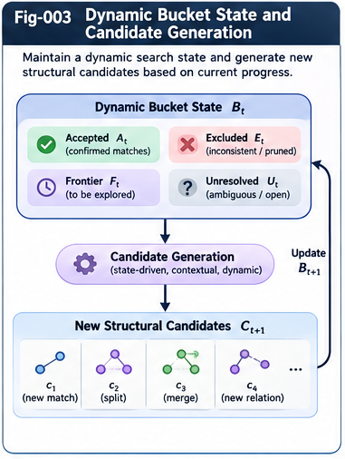
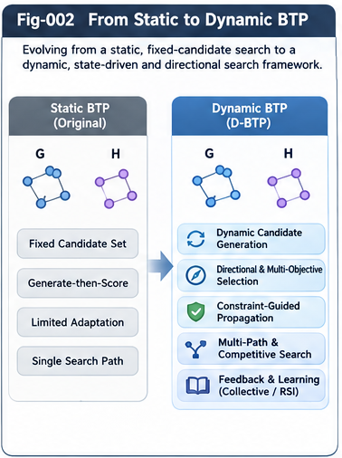
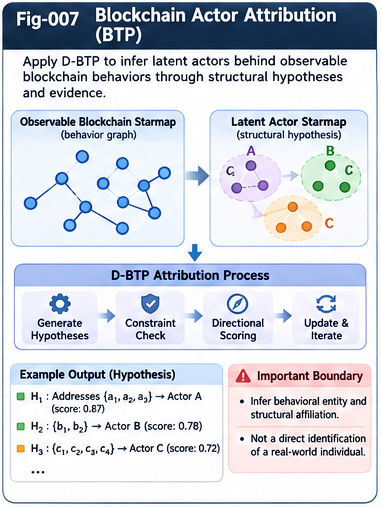

# D-BTP-002 — Dynamic Bucket States and Candidate Generation

**Project:** Dynamic Bucket Tree of Permutation (D-BTP): Directional Structural Generation and Hypothesis Evolution  
**Series:** Foundations · D-BTP-002  
**Status:** Research foundation / proposed formalization  
**Version:** 1.0.0-draft · 2026-11-03  
**Companion:** D-BTP-001 — From Metric Similarity to Structural Hypothesis Search

## Abstract

The conventional description of a Bucket Tree of Permutation (BTP) starts with a fixed set of candidate node pairs and branches on whether each pair is included. This representation is convenient for static metric-starmap similarity, but it is not essential to the BTP search principle. This paper develops a dynamic formulation in which a bucket carries a structural hypothesis, evolving model state, decision history, evidence, and search-control context. Candidate pairs are *generated from the current bucket state*, rather than enumerated once in an immutable unresolved list. The resulting search can discover new relations, expand or revise latent structural objects, propagate constraints, and allocate effort under directional guidance. We specify transition semantics, key invariants, candidate provenance, duplicate prevention, stopping conditions, and distinctions between exhaustive and budget-limited search. The formulation is proposed as a reusable foundation for structural hypothesis search; it does not by itself establish optimality, empirical superiority, or autonomous intelligence.



*Fig-003. A dynamic bucket carries a hypothesis ledger, structural state, evidence with provenance, directional policy state, and versioned metadata. Candidate generation reads the current state; accept, exclude, and defer decisions produce traceable successor states.*

## 1. Motivation: the fixed-list description is only a special case

Let two metric structures or starmaps be \(A\) and \(B\). In a baseline static formulation, a matching procedure produces a finite candidate set \(C_0\) of node pairs. A search node stores accepted pairs, unresolved pairs, and updated matching states. Each branching step accepts or rejects one unresolved pair. A leaf is reached when the list is empty.

This model describes a useful *implementation regime*, not the full conceptual extent of BTP. In a dynamic application, accepting or rejecting a relation can expose new candidate nodes, revise cluster membership, reveal constraints, or change which relationships are even meaningful. A candidate set that was complete at initialization may become incomplete after one transition. The appropriate generalization is therefore not merely to append entries to a list, but to make candidate discovery a function of the evolving state.

**Central thesis:** A dynamic BTP bucket is an evolving hypothesis state; candidate generation and hypothesis evaluation are coupled operations within the search process.

## 2. Scope and terminology

- **Structural object:** A node, relation, cluster, event, latent actor, or other domain-defined element represented by the plugin contract.
- **Candidate relation:** A proposed correspondence or attribution, conventionally called a *pair*, though its semantics need not be one-to-one.
- **Hypothesis:** A set of accepted, rejected, and provisionally characterized claims about structural objects.
- **Bucket:** A search state containing the hypothesis, domain model, evidence, and control context.
- **Direction field:** A state-dependent policy or collection of criteria guiding candidate generation, ranking, and resource allocation.
- **Structural evolution:** Changes to the inferred model or its representation, not necessarily changes to the underlying observed world.
- **Weak evidence:** Fallible or incomplete information that may guide exploration without justifying a hard conclusion.

Dynamic BTP should not be confused with a claim that all source data are mutable. Observations may be immutable while *inferred* actors, relations, candidate pairs, and search state evolve.

## 3. A canonical dynamic bucket

A conceptual bucket at search step \(t\) is

\[
\mathcal B_t=(H_t,S_t,E_t,P_t,M_t).
\]

Here:

1. \(H_t\) is the **hypothesis ledger**: accepted and explicitly rejected claims, plus their qualifications.
2. \(S_t\) is the **structural state**: observed objects, inferred entities, derived relationships, constraint indexes, and domain-specific cached state.
3. \(E_t\) is the **evidence state**: evidence references, provenance, dependencies, contradictions, and scores or bounds.
4. \(P_t\) is the **directional/control state**: objectives, priorities, resource budgets, search policy, and possibly learned guidance.
5. \(M_t\) is **search metadata**: branch lineage, visited-state fingerprints, candidate-disposition records, generator versions, and termination status.

These are *logical components*, not mandatory separate in-memory structures. A concrete implementation may share immutable data across buckets and use deltas or persistent data structures to avoid copying whole starmaps.

### 3.1 Why a hypothesis ledger matters

An excluded candidate must not silently return as an identical unresolved candidate on the next generation call. The ledger distinguishes:

- **Accepted:** the current hypothesis asserts the relation.
- **Rejected:** the current branch excludes the relation.
- **Deferred:** the relation is known but not yet decided.
- **Superseded or reinterpreted:** the structural objects or candidate semantics changed; this requires an explicit versioned rule, not silent resurrection.

A rejected relation is a *branch decision*, not necessarily a fact about the world. Other branches may accept it.

### 3.2 Identity, versioning, and provenance

Candidate identity should include canonical relation semantics and relevant object versions. If a latent actor cluster is split, a pair referencing the pre-split cluster cannot be treated as identical to a pair referencing a successor cluster without a declared equivalence rule. Store the generator, triggering state, and evidence references so that results remain auditable.



*Fig-002. From fixed-candidate BTP to dynamic BTP. A static search explores a previously defined candidate universe; dynamic BTP generates additional candidates from the evolving bucket state and observed structural consequences. Both retain explicit branch decisions and feasibility checks.*

## 4. Dynamic candidate generation

Instead of assuming a fixed \(C_0\), define

\[
C_t=G(\mathcal B_t;\theta_G,\mathcal R_t),
\]

where \(G\) is a domain-aware candidate generator, \(\theta_G\) its configuration, and \(\mathcal R_t\) the available resource budget. \(C_t\) may be empty, partial, ordered, or lazily streamed. The generator may use hard constraints, weak evidence, structural residuals, and a direction field to focus its proposals.

The effective admissible frontier is

\[
F_t=\operatorname{Deduplicate}(C_t)\setminus\operatorname{Disposed}(H_t,M_t),
\]

followed by feasibility filtering. A finite materialized frontier is an optional cache; it is not the definition of the search state.

### 4.1 Sources of newly generated candidates

Candidates can emerge from (a) newly accepted correspondences; (b) exclusion-driven constraint propagation; (c) inferred latent entities or cluster changes; (d) newly acquired observations; (e) new scoring or search perspectives; and (f) cross-agent relays. These sources must be distinguished in provenance because they have different completeness and trust implications.

### 4.2 Generation is not proof

A generated pair is a proposal. A directional score may justify evaluating it early, but does not convert it into a verified relation. Hard validity, evidential support, and exploration priority remain separate judgments.

## 5. Transition semantics

Let \(q\in F_t\) be a selected candidate. The conventional binary decision is preserved:

\[
\mathcal B_{t+1}^{+}=T_{\mathrm{accept}}(\mathcal B_t,q),\qquad
\mathcal B_{t+1}^{-}=T_{\mathrm{reject}}(\mathcal B_t,q).
\]

Each transition performs a transaction-like sequence:

1. Record the branch decision in the hypothesis ledger.
2. Check hard admissibility and reject an inconsistent child if necessary.
3. Apply domain state changes and constraint propagation.
4. Update evidence and score or bound information.
5. Invalidate stale candidate caches and regenerate or lazily discover relevant candidates.
6. Update search metadata and enqueue the surviving child under the search policy.

**Accept** and **reject** need not produce symmetric changes. Rejecting a pair may force other choices only under explicitly stated exhaustiveness and exclusivity assumptions.

### 5.1 State transition versus world transition

A search branch usually changes an *internal hypothesis*, not the blockchain, network, animal, or other external system being studied. A domain that performs actual actions must define a separate action/observation contract; simulation and intervention should not be conflated with inference.

## 6. Core invariants

A conforming dynamic BTP implementation should maintain at least the following invariants:

**I1 — Decision consistency.** No canonical claim is both accepted and rejected in the same branch under the same object/version semantics.

**I2 — Hard-constraint consistency.** Every retained bucket satisfies the declared hard constraints; invalid children are pruned or marked inconsistent.

**I3 — Traceability.** Every state change can be traced to a decision, observation, plugin result, or explicit policy update.

**I4 — Candidate disposition.** A disposed candidate is not reconsidered unchanged within a branch unless a documented reopening rule applies.

**I5 — Evidence separation.** Candidate priority, probabilistic support, and logical feasibility are distinct quantities.

**I6 — Bounded execution.** Implementations enforce explicit computational budgets and return a declared termination status.

**I7 — Version coherence.** Candidates derived from outdated structural versions are revalidated before use.

**I8 — Reproducibility boundary.** Deterministic runs record configuration and generator versions; stochastic runs additionally record seeds or sampling traces where feasible.

These invariants are proposed contracts. Formal proofs of preservation depend on domain plugins and will be developed in the specifications.

## 7. Search frontier, leaves, and stopping conditions

In static BTP, a leaf may mean that the unresolved list is empty. In dynamic BTP, an empty *currently generated* frontier does not prove that no future candidate can exist. Three distinct outcomes are necessary:

- **Closed leaf:** a sound closure criterion establishes that no admissible, relevant expansion remains under the specified generator universe and constraints.
- **Quiescent state:** no candidate was produced by the current generator/policy, but completeness is not established.
- **Budget-terminated partial state:** execution stops because time, memory, candidate-generation calls, or expansion budgets are exhausted.

A fourth outcome, **inconsistent/pruned**, is not a feasible leaf. These distinctions prevent an incomplete generator from making unjustified claims of exhaustive search.

### 7.1 Search completeness is conditional

If the generator is incomplete, a globally optimal hypothesis may never be proposed. Even an exhaustive branch controller cannot repair that omission. Completeness therefore requires assumptions about candidate coverage, transition reachability, fairness, and termination—not merely exploration of every emitted binary branch.

## 8. Directional generation and selection

A direction field \(D_t\), represented within \(P_t\), may influence both which candidates are generated and which buckets are expanded:

\[
C_t=G(S_t,H_t,E_t,D_t),\qquad
q_t=\operatorname{Choose}(C_t,D_t,\mathcal R_t).
\]

After a transition and evidence update, the guidance may itself be revised:

\[
D_{t+1}=U(D_t,\mathcal B_{t+1},\text{feedback}_t).
\]

This is a **coupled generation–selection–feedback** model, not merely a generate-then-rank pipeline. Nevertheless, it is useful to distinguish a fixed-direction implementation from one that learns or changes the field. Updating search scores is not, by itself, recursive self-improvement.

### 8.1 Multiple directional objectives

Evidence fit, explanation complexity, expected information gain, search diversity, and compute cost may conflict. The controller may retain a Pareto or diversified top-\(k\) portfolio rather than collapsing every consideration into one scalar. Directional guidance must not silently weaken hard constraints.

## 9. Illustrative case: blockchain actor attribution

Consider a synthetic ledger with observable transactions \(T_1,T_2,\ldots\) and latent control actors \(A_1,A_2,\ldots\). A candidate relation \((A_i,T_j)\) means *actor \(A_i\) may control or be responsible for behavior \(T_j\) under a stated attribution model*. Unlike ordinary one-to-one graph matching, one actor may be associated with many transactions; a transaction may also involve multiple distinct roles.

Suppose accepting \((A_1,T_1)\) creates a provisional behavioral cluster. The cluster may suggest a new candidate \((A_1,T_3)\) that was not present in an initial pair list. Rejecting \((A_1,T_3)\) may prompt a different cluster interpretation and a candidate involving \(A_2\). The search state, candidate generator, and evidence interpretation evolve together.

The system must distinguish *transaction-level structural similarity*, *common control*, and *real-world identity*. Neither shared patterns nor a high-scoring leaf establish personal identity. For validation, use synthetic or properly authorized datasets with known ground truth, and report uncertainty and alternative explanations.

---



*Fig-007. Illustrative blockchain behavior attribution using D-BTP. Observed transactions and behavioral patterns support competing latent-actor grouping hypotheses, subject to constraints and directional evidence. The inferred units are behavioral actors, not verified real-world identities.*

---

## 10. Implementation-oriented pseudocode

```text
function DynamicBTP(initialBucket, plugins, policy, budget):
    frontier = PriorityQueue([initialBucket])
    solutions = Portfolio()
    visited = StateFingerprintSet()

    while not frontier.empty() and budget.available():
        bucket = frontier.pop()
        if not plugins.hardConstraintsHold(bucket):
            continue
        key = canonicalFingerprint(bucket)
        if policy.safeToMerge(key) and visited.contains(key):
            continue
        visited.add(key)

        candidates = plugins.generateCandidates(bucket, budget)
        candidates = validateVersionsAndDeduplicate(candidates, bucket)
        candidates = removeDisposedCandidates(candidates, bucket)

        if candidates.empty():
            status = plugins.certifyClosure(bucket)
            solutions.record(bucket, status or "QUIESCENT")
            continue

        q = policy.selectCandidate(bucket, candidates)
        for decision in [ACCEPT, REJECT]:
            child = plugins.applyDecision(bucket, q, decision)
            child = plugins.propagateConstraints(child)
            if plugins.hardConstraintsHold(child):
                child = plugins.updateEvidenceAndDirection(child)
                frontier.push(child, policy.priority(child))

    solutions.recordRemaining(frontier, "BUDGET_TERMINATED")
    return solutions
```

This pseudocode is illustrative, not a normative reference implementation. In particular, safe state merging requires a proof that merged states have equivalent future expansion and scoring semantics; fingerprints alone do not justify pruning. Streaming generation, nonbinary decisions, and concurrent agents require additional contracts.

## 11. Complexity and efficiency considerations

For a fixed set of \(m\) independent binary candidates, the naive decision space has up to \(2^m\) combinations. With dynamic generation, \(m\) may be unknown in advance or grow during search. There is no universal finite bound without assumptions on the structural universe, candidate generator, and expansion depth.

Practical efficiency therefore depends on candidate quality, early constraint propagation, cached structural deltas, admissible bounds, branch ordering, diversity preservation, and resource control. A learned direction field can improve search efficiency, but may also introduce bias, overlook counterevidence, or amplify generator errors. These are empirical questions.

## 12. Validation hypotheses and baselines

The following are *testable proposals*, not established results:

- **H1 — Dynamic discovery:** Dynamic generation recovers valid correspondences unavailable to a fixed initial candidate list.
- **H2 — Budget efficiency:** Under matched compute budgets, directional generation improves quality of discovered hypotheses relative to unguided dynamic generation.
- **H3 — Constraint value:** Incremental constraint propagation reduces invalid branch expansions without eliminating feasible hypotheses.
- **H4 — Weak-evidence utility:** Calibrated weak evidence improves candidate ordering or information gain without increasing false attribution beyond a declared tolerance.
- **H5 — Robustness:** A diverse hypothesis portfolio reduces overconfident single-solution failures when evidence is ambiguous.

Recommended comparisons: (A) static fixed-list BTP; (B) dynamic generation without directional guidance; (C) dynamic generation with fixed directional heuristics; (D) adaptive directional guidance. Hold observation access, compute budget, and evaluation datasets constant. Report recall, precision where meaningful, best-found objective, calibration, candidate coverage, search expansions, wall time, memory, and sensitivity to misleading evidence.

## 13. Failure modes and safeguards

**Generator blind spots:** A candidate never proposed cannot be found. Audit coverage against oracle or exhaustive small instances.

**State explosion:** Dynamic inferred entities can grow combinatorially. Apply explicit budgets, equivalence rules, and bounded cluster creation.

**Self-reinforcing evidence:** A generated hypothesis may create derived features that are mistakenly counted as independent supporting evidence. Preserve dependency graphs and avoid double counting.

**Unstable direction fields:** Continually changing priorities can starve low-ranked branches. Use exploration floors or fairness policies where completeness matters.

**Invalid merging:** Two visually similar buckets may have different future possibilities. Merge only under a sound equivalence criterion.

**Attribution overreach:** A structural fit must not be reported as proof of real-world identity. Maintain uncertainty, provenance, and competing explanations.

**Unverifiable closure:** An empty generator output is not a proof that search is finished. Report quiescence honestly.

## 14. Relationship to the D-BTP research series

- **D-BTP-001** establishes the conceptual move from metric similarity to structural hypothesis search.
- **D-BTP-002 (this paper)** defines the dynamic bucket and generated candidate frontier.
- **D-BTP-003** develops constraint-guided composition and consistency.
- **D-BTP-004** formalizes directional fields for generation and selection.
- **D-BTP-005** investigates weak evidence as search guidance.
- **D-BTP-006** studies coupled generation, selection, and feedback.
- **D-BTP-007** examines multi-agent learning and relay.
- **D-BTP-008** investigates open-ended structural evolution and its limits.

The normative interface details are reserved for **SPEC-001 Dynamic Bucket State Contract** and **SPEC-002 Candidate Generation and Constraint Plugins**. This paper intentionally specifies conceptual semantics without prematurely fixing a runtime language or storage representation.

## 15. Open research questions

1. What minimal conditions on a candidate generator guarantee search completeness over a bounded structural universe?
2. Which state equivalence relations permit safe merging without discarding distinct future hypotheses?
3. How can dynamic inferred-entity creation be constrained while retaining meaningful structural discovery?
4. Can direction fields improve search without making weak evidence appear stronger than it is?
5. How should the system detect and recover from systematically misleading candidate-generation policies?
6. What distinguishes useful recursive structural growth from repetitive expansion with no information gain?
7. Which properties of dynamic BTP transfer across metric similarity, actor attribution, and strategic hypothesis search?

## 16. Conclusion

The fixed unresolved-pair list is a convenient static representation, not a defining limitation of BTP. In a dynamic formulation, each bucket contains an evolving structural hypothesis and associated evidence and control state. Candidate relations are generated contextually, branching changes the state from which later candidates emerge, and directional guidance may shape both generation and selection. This turns BTP into a candidate framework for **constraint-guided structural hypothesis evolution** while preserving essential distinctions among proposal, feasibility, evidence, and proof. The next research task is to formalize the constraints that make this evolution sound, auditable, and computationally useful.

---

**Research note:** This document records a proposed SI/D-BTP framework and associated hypotheses. It does not claim a peer-reviewed theorem, a deployed attribution system, or experimental validation. Reuse and implementation should preserve domain-specific safety, privacy, and evidence-governance requirements.
