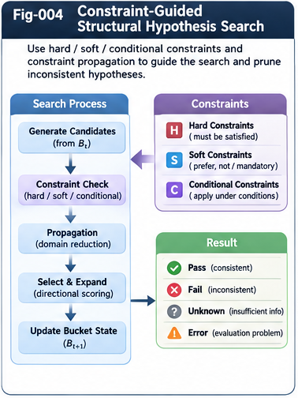
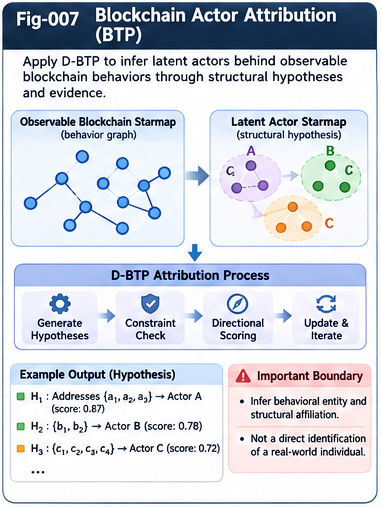

# D-BTP-003 — Constraint-Guided Structural Composition

**Project:** Dynamic Bucket Tree of Permutation (D-BTP): Directional Structural Generation and Hypothesis Evolution  
**Series:** Foundations · D-BTP-003  
**Status:** Research foundation / proposed formalization  
**Version:** 1.0.0-draft · 2026-11-03  
**Companions:** D-BTP-001 — From Metric Similarity to Structural Hypothesis Search; D-BTP-002 — Dynamic Bucket States and Candidate Generation

## Abstract

Dynamic Bucket Tree of Permutation (D-BTP) searches over evolving structural hypotheses rather than only fixed node-pair lists. Candidate generation alone, however, does not guarantee that a collection of locally plausible relations forms a coherent global explanation. This paper develops **constraint-guided structural composition**: a formal separation of hard feasibility conditions, defeasible evidence, and directional preferences; an incremental accept/reject transition model; constraint propagation over evolving structural states; and sound pruning conditions. It examines non-bijective attribution, latent entities, correlated evidence, incomplete candidate discovery, and the distinction between logical contradiction and low plausibility. The paper proposes plugin contracts, a reference search loop, examples, testable hypotheses, and validation criteria. Its contribution is a research architecture and set of falsifiable design claims, not a proof of universal efficiency or correctness for arbitrary plugins.

## 1. Why composition is harder than matching

A baseline metric-starmap matcher may identify individually compatible node pairs and search for a high-scoring subset. But **pairwise compatibility does not imply global consistency**. Three pair assignments may each look acceptable alone while jointly violating a shared resource, temporal, cardinality, causal, or identity constraint. Conversely, a candidate that appears weak in isolation may become valuable when combined with other relations.

D-BTP treats a candidate relation as a *hypothesis-bearing structural operation*, not merely a similarity edge. The core question becomes:

> Under which constraints may a newly proposed structural relation join the current hypothesis, and what new structural consequences follow from that decision?

The constraint layer is therefore a participant in generation, branching, propagation, scoring, and termination—not an after-the-fact validator.

## 2. Scope and conceptual boundaries

This paper distinguishes four levels:

1. **Observation:** Recorded facts or source assertions with provenance and uncertainty; observations should not be silently rewritten by hypothesis updates.
2. **Hypothesis:** Proposed correspondences, actor attributions, group memberships, structural explanations, and explicit exclusions.
3. **Constraint:** A rule governing whether a set of hypotheses is feasible, conditionally feasible, or unresolved.
4. **Preference/evidence:** A graded assessment used to rank feasible alternatives and direct search effort.

The formalism is intentionally domain-neutral. A candidate may be a node pair, an edge correspondence, an actor–behavior attribution, a cluster merge, or a more general typed relation. Where ordinary BTP speaks of a `kNodePair`, the generalized engine speaks of a **candidate structural claim** `c` while preserving pair-based specializations.

## 3. Dynamic bucket and constraint state

Following D-BTP-002, represent a bucket as

$$
\mathcal B_t=(H_t,S_t,E_t,P_t,M_t).
$$

- $H_t$: accepted and rejected hypothesis ledger, with stable claim identifiers.
- $S_t$: observed and inferred structural objects, indexes, and domain state.
- $E_t$: evidence references, dependencies, scores, and admissible bounds if available.
- $P_t$: direction fields, search policy, and budget allocation state.
- $M_t$: provenance, visited-state signatures, generation epochs, and execution metadata.

For clarity, let $A(H)$ be the set of accepted claims and $X(H)$ the explicitly excluded claims. Let $K_t$ denote the active set of hard constraints, possibly including constraints generated by sound inference from earlier accepted claims. A bucket is **feasible** if there exists at least one completion satisfying the applicable hard constraints:

$$
\mathrm{Feasible}(\mathcal B_t)\iff
\exists H^*\supseteq A(H_t):\ H^*\cap X(H_t)=\varnothing
\ \land\ K_t(H^*,S_t)=\mathrm{true}.
$$


$$
\mathrm{Feasible}(\mathcal B_t)\iff
\exists H^*\supseteq A(H_t):\ H^*\cap X(H_t)=\varnothing
\ \land\ K_t(H^*,S_t)=\mathrm{true}.
$$

This definition presupposes a specified domain of possible completions and a stable meaning for each claim. In practice, a plugin may be unable to decide feasibility. The engine must distinguish `FEASIBLE`, `INFEASIBLE`, and `UNKNOWN` rather than treating an unproved feasible completion as a proven one.

## 4. Three classes of constraints

### 4.1 Hard constraints: validity and impossibility

Hard constraints express domain rules whose violation invalidates a branch *under the declared model*. Examples include a mutually exclusive assignment rule, a verified signature relation, or an explicitly specified capacity limit. They may be used to prune only when their applicability and truth conditions are sufficiently established.

### 4.2 Soft constraints: graded compatibility

Soft constraints describe tendencies, statistical associations, and imperfect evidence. They affect scores or likelihoods but do **not** justify categorical rejection. Temporal proximity, similar transaction patterns, and behavioral resemblance are ordinarily soft signals, not proof of shared control.

### 4.3 Conditional and revisable constraints

Some rules hold only under assumptions: “if this account is individually controlled,” “if these events share a clock,” or “if the source record is complete.” Such assumptions must be explicit. A revisable rule cannot be treated as an unconditional hard constraint without making the search unsound relative to the intended problem.

**Design principle:** `hard reject` requires a declared invariant or certified contradiction; `low score` requires only weak or defeasible evidence. Conflating them produces premature pruning.



*Fig-004. Constraint-guided structural composition. Candidate hypotheses pass through explicit hard-constraint checks, conditional evaluations, and propagation. Soundly inconsistent branches can be pruned; uncertain or weakly supported branches remain eligible for further investigation.*

## 5. Structural composition as a transition

Let $c\in G(\mathcal B_t)$ be a dynamically generated candidate. The two familiar BTP branches remain:

$$
\mathcal B_{t+1}^{+}=\mathrm{Propagate}(\mathrm{Accept}(\mathcal B_t,c)),
$$

$$
\mathcal B_{t+1}^{-}=\mathrm{Propagate}(\mathrm{Exclude}(\mathcal B_t,c)).
$$

An `Accept` transition may create a relation, merge a latent cluster, update cardinality indexes, or expose new candidates. An `Exclude` transition records a decision and may narrow domains or change generation priorities. Neither operation is assumed to be a mere list edit.

A correct implementation must preserve a distinction between **source facts** and **inferred structural state**. A cluster created by an accepted hypothesis is not itself a new observation. Its derivation must remain traceable and reversible by returning to the parent bucket or replaying the branch.

### 5.1 Atomic transitions

Each branch should be committed atomically: validate candidate type and preconditions; apply its proposed state delta; propagate consequences; verify invariants; then publish the child bucket. If validation fails, the parent remains unchanged. Copy-on-write snapshots, persistent data structures, or replayable event logs can implement this semantics.

### 5.2 Non-bijective and typed composition

A traditional one-to-one node correspondence is only one possible constraint contract. In actor attribution, one actor may explain many behaviors; several actors may coordinate one event; a custodial service may act for many customers. The relevant relation must be typed (`controls`, `initiates`, `signs`, `benefits`, `clusters-with`, etc.). Distinct relation types must not be silently collapsed into “same real-world person.”

## 6. Constraint propagation

Propagation derives consequences of current decisions without requiring a new arbitrary search choice. Possible propagators include:

- **Domain reduction:** Remove candidate values incompatible with accepted claims.
- **Cardinality propagation:** Update at-most/at-least/exactly-one conditions when those conditions are genuinely part of the domain model.
- **Equality and inequality closure:** Maintain equivalence classes and explicit non-equivalence constraints, with relation-specific semantics.
- **Temporal and resource propagation:** Tighten intervals or capacity bounds.
- **Structural closure:** Derive permitted relations or latent objects from validated composition rules.
- **Conflict explanation:** Record a minimal or small explanatory subset of decisions sufficient to trigger a contradiction when available.

A propagation step may be expressed as

$$
(K_{t+1},S_{t+1},H_{t+1})
=\Phi(K_t,S_t,H_t),
$$

where $\Phi$ is required to be **sound relative to the declared hard-constraint semantics**. Monotonic constraint accumulation is a useful special case, but dynamic models may revise inferred structures. Such revisions require explicit versioning and cannot silently invalidate previously justified pruning decisions.

### 6.1 Fixed-point propagation

For a finite, monotone propagation lattice, repeatedly applying sound propagators until no new consequence appears yields a fixed point. For open-ended candidate generation, this guarantee does not automatically hold. Implementations should enforce per-transition propagation budgets and return `INCOMPLETE_PROPAGATION` when saturation is not reached.

### 6.2 The danger of an incomplete candidate universe

Suppose a behavior currently has two known candidate actors. Excluding one does not prove the other actor responsible if a third actor could be discovered later. “Only remaining known candidate” is not equivalent to “only possible candidate.” Any exactly-one inference requires a **certified closed candidate domain** or an explicit closed-world assumption.

## 7. Contradiction, uncertainty, and search outcomes

The engine should return one of the following for a proposed branch:

| Status | Meaning | Permitted action |
|---|---|---|
| `VALID` | Declared hard constraints are satisfied for the evaluated transition | Retain and score |
| `INVALID` | Certified hard contradiction | Prune, with explanation |
| `UNKNOWN` | Feasibility unresolved or solver incomplete | Retain or defer; do not label impossible |
| `ERROR` | Plugin failure, timeout, or malformed result | Isolate and retry/fail safely |

`VALID` does not mean that the full hypothesis is true or that a globally feasible completion has been proved. It means the checks actually performed did not invalidate the branch, unless a stronger feasibility certificate is explicitly provided.

A contradiction record should identify rule version, implicated claims, evidence provenance where relevant, and whether the contradiction is logical, model-relative, or empirical.

## 8. Constraint-guided candidate generation

Generation should exploit constraint information before expensive scoring:

$$
C_t=G(S_t,H_t,K_t,P_t).
$$

A generator may propose candidates from neighborhood overlap, structural motifs, residual mismatches, historical cases, or weak directional cues. It may also avoid candidates already excluded in the same stable semantic context.

There are two distinct mechanisms:

1. **Certified filtering:** Remove candidates proved impossible under hard constraints.
2. **Heuristic prioritization:** Rank, delay, or sample candidates based on estimated value.

Only the first is safe as a completeness-preserving elimination rule. The second trades search coverage for budget efficiency and must be reported as such.

## 9. Search control and admissible pruning

For an objective $F(H)$, branch-and-bound may prune bucket $\mathcal B$ if a valid upper bound $U(\mathcal B)$ on every feasible completion satisfies

$$
U(\mathcal B)\le F(H_{\mathrm{incumbent}}).
$$

The bound must account for candidates that may be generated in the future. A bound computed only over currently visible candidates may be invalid in an open-ended dynamic search. If no admissible bound is available, the engine can still use beam search or heuristic priority queues, but must not claim exact optimality.

Constraint propagation can improve search efficiency by detecting infeasibility early. However, propagation has a cost, and strong but expensive reasoning may perform worse under tight budgets than simpler checks. A practical controller should compare expected pruning benefit against propagation cost.

## 10. Evidence and directional fields are not constraints by default

Let $D_t$ be a direction field and $E_t$ an evidence state. A search priority might take the form

$$
\mathrm{Priority}(\mathcal B)
=\alpha\,\widehat{F}(\mathcal B)
+\beta\,\mathrm{InformationGain}(\mathcal B)
-\gamma\,\mathrm{ComputeCost}(\mathcal B).
$$

This is an illustrative heuristic, not a calibrated universal score. Weak evidence can guide which bucket to expand next, which candidate to generate, and where to spend computation. It must not silently become a hard exclusion rule. Evidence dependencies should be tracked so that several correlated observations are not counted as independent confirmations.

The direction field may change with feedback; the *semantics of hard validity* should not change without an explicit model or rule-version transition. Otherwise previously pruned branches may need reconsideration.

## 11. Reference plugin contracts

The following interface is illustrative, not a prescribed programming language API:

```text
CandidateBatch generateCandidates(BucketSnapshot bucket,
                                  ConstraintView constraints,
                                  DirectionContext direction,
                                  GenerationBudget budget);

ConstraintResult checkHardConstraints(BucketSnapshot bucket,
                                      CandidateClaim candidate,
                                      BranchDecision decision);

PropagationResult propagate(BucketSnapshot proposedChild,
                            ConstraintView constraints,
                            PropagationBudget budget);

EvidenceResult evaluateEvidence(BucketSnapshot child,
                                EvidenceContext provenance);

PriorityResult rankForExpansion(BucketSnapshot child,
                                DirectionContext direction);
```

**Contract requirements:** typed claims; stable candidate identifiers; deterministic replay or recorded nondeterminism; immutable parent snapshots; explicit plugin versions; bounded resource use; `UNKNOWN` distinct from `INVALID`; evidence provenance; and no unauthorized external side effects during branch simulation.

For plugin composition, define an ordering or dependency graph among propagators. Detect cycles and repeated generation. A plugin must state whether it is sound, heuristic, complete for a specified domain, or merely best-effort.

## 12. Reference search procedure

```text
frontier <- {initialBucket()}
incumbents <- empty hypothesis portfolio
visited <- empty set

while frontier not empty and budget remains:
    b <- selectBucket(frontier, directionPolicy)
    if equivalentStateAlreadyProcessed(b, visited): continue
    recordState(b, visited)

    p <- propagate(b, hardConstraints, propagationBudget)
    if p.status == INVALID: recordConflict(p); continue
    if p.status == ERROR: quarantineOrRetry(p); continue

    candidates <- generateCandidates(p.bucket, directionPolicy,
                                     generationBudget)
    candidates <- removePreviouslyDecidedAndCertifiedInvalid(candidates, p.bucket)

    if candidates empty:
        classifyAsClosedQuiescentOrIncomplete(p.bucket,
                                              generatorCoverage,
                                              pendingWork)
        updatePortfolioIfAppropriate(incumbents, p.bucket)
        continue

    c <- chooseCandidate(candidates, directionPolicy)
    for decision in [ACCEPT, EXCLUDE]:
        child <- transactionalTransition(p.bucket, c, decision)
        verdict <- checkHardConstraints(child, c, decision)
        if verdict == INVALID: recordConflict(verdict); continue
        if verdict == ERROR: quarantineOrRetry(verdict); continue
        child <- propagate(child, hardConstraints, propagationBudget)
        if child.status != INVALID:
            child <- attachEvidenceAndPriority(child)
            if not certifiedBoundPrunes(child, incumbents):
                frontier.push(child)

return portfolio, coverageReport, unresolvedStates, provenanceLog
```

The procedure is deliberately agnostic about whether the generator can exhaust the candidate universe. The returned coverage report is part of the answer, not a mere implementation detail.

## 13. Worked example: evolving actor–behavior hypotheses

Consider three observed behaviors $b_1,b_2,b_3$ and two provisional latent actors $a_1,a_2$. A generator proposes `controls(a1,b1)` and `controls(a1,b2)` from shared transaction timing and flow motifs. These are **weak** attribution hypotheses, not established identities.

1. Accepting `controls(a1,b1)` updates a provisional actor cluster and may expose a new candidate involving $b_3$.
2. A temporal pattern lowers the plausibility of `controls(a1,b2)` but does not automatically rule it out: automated systems can act concurrently.
3. If the model contains a verified, explicit exclusivity rule for a particular *typed action*, a conflicting assignment can be rejected under that rule. The rule must not be generalized to all actor relationships.
4. Excluding `controls(a1,b2)` changes the ledger and generation priorities. It does not prove `controls(a2,b2)` without a complete candidate domain and appropriate uniqueness semantics.
5. The engine retains competing portfolios, including an unresolved option, rather than declaring a real-world person from transaction-pattern similarity.

This example illustrates a methodological boundary: on-chain address control, transaction execution, economic benefit, and real-world identity are distinct predicates. Public-key verification establishes a cryptographic relation, not a person's identity. Any external linkage data must be used only when lawfully obtained and appropriately authorized.



*Fig-007. Illustrative blockchain behavior attribution using D-BTP. Observed transactions and behavioral patterns support competing latent-actor grouping hypotheses, subject to constraints and directional evidence. The inferred units are behavioral actors, not verified real-world identities.*

## 14. Static BTP as a special case

D-BTP reduces to a familiar static subset-selection search when:

- The candidate set $C_0$ is finite, fixed, and complete.
- Generation returns only as-yet-undecided members of $C_0$.
- Structural state updates do not introduce new objects or claims.
- Pair compatibility is determined by fixed constraints.
- The objective is defined over the selected subset.

Under these assumptions, each branch accepts or excludes a known pair, and an empty unresolved set can represent an exhaustive leaf. This inclusion relationship is an architectural claim about representation; rigorous equivalence depends on the precise baseline BTP semantics and the objective preserved by the reduction.

## 15. Correctness obligations and limitations

**Safety (conditional):** If every hard-constraint propagator is sound, transition checks are correct, and plugin failures never masquerade as valid conclusions, then certified-invalid branches can be pruned without losing a solution feasible under the declared model.

**Completeness (conditional):** A search can claim exhaustive coverage only if candidate generation is complete for a specified finite hypothesis universe, all required branches are explored, and termination is reached without resource truncation. Open-ended generation generally lacks this guarantee.

**Optimality (conditional):** Exact optimality additionally requires a well-defined objective, correct scoring, admissible pruning, and exhaustive or otherwise proven search.

**Termination:** A finite candidate universe with a strictly decreasing undecided measure suffices for basic termination. Dynamic candidate creation requires separate progress measures, quotas, well-founded generation rules, or explicit budget termination. A quiescent generator call alone does not prove closure.

**Identifiability:** Multiple distinct hypotheses may fit all available evidence equally well. No search procedure can recover a unique real-world cause from observationally indistinguishable data without additional assumptions or evidence.

## 16. Complexity and engineering tradeoffs

With $m$ fixed binary candidate decisions, naive enumeration has up to $2^m$ assignments. In D-BTP, $m$ may grow as hypotheses expose new objects, and the effective state space depends on generator behavior and state equivalence. Strong propagation can reduce branching but incurs additional cost. State caching can help, provided its equivalence signature preserves every feature relevant to future candidate generation and scoring.

Promising implementation strategies include persistent state snapshots, incremental constraint solvers, typed relation indexes, conflict memoization, canonical state hashing, delayed expensive evidence checks, and budget-aware portfolios. Their value is empirical and workload-dependent.

## 17. Testable hypotheses and evaluation plan

**H1 — Earlier contradiction detection.** Constraint propagation reduces invalid expanded nodes compared with post-hoc validation at equal candidate-generation coverage.

**H2 — Better budget efficiency.** Constraint-guided candidate generation improves the best verified feasible score per unit computation over unguided dynamic generation.

**H3 — Soft/hard separation improves calibration.** Keeping weak evidence out of hard rejection reduces false exclusions and improves uncertainty calibration.

**H4 — Explicit exclusions reduce repeated work.** Stable exclusion ledgers and semantic deduplication reduce regenerated equivalent decisions without excluding valid novel candidates.

**H5 — Typed relations reduce attribution errors.** Modeling `controls`, `signs`, and `benefits` separately reduces erroneous identity-level conclusions compared with untyped matching.

**Suggested baselines:** fixed-list BTP; dynamic generation without propagation; propagation without directional ranking; post-hoc-only validation; and a generic constraint-programming or graph-matching solver where representationally comparable.

**Measurements:** feasibility violations; verified objective value; search nodes; propagation cost; runtime/memory; candidate recall against known synthetic truth; false hard exclusions; top-K hypothesis diversity; evidence calibration; and frequency of `UNKNOWN`/budget-truncated outcomes.

Use synthetic or authorized datasets with known ground truth and deliberately include ambiguous, adversarial, and incomplete-observation scenarios. Report rule sets, plugin versions, budgets, seeds, and generator coverage. A positive result on one domain does not establish universal superiority.

## 18. Failure modes and safeguards

| Failure mode | Consequence | Proposed safeguard |
|---|---|---|
| Weak evidence encoded as hard rule | False pruning | Typed hard/soft contract and rule audit |
| Incomplete candidate universe treated as closed | False forced assignment | Coverage certificate or explicit open-world status |
| Unsound propagator | Lost feasible hypotheses | Property tests and proof obligations for pruning rules |
| Correlated evidence counted repeatedly | Overconfidence | Dependency-aware provenance and calibration |
| Dynamic generation cycles | Unbounded search | Stable claim IDs, state hashing, generation budgets |
| Mutable plugin semantics | Non-reproducible search | Versioned contracts and replay logs |
| Overaggressive state deduplication | Lost valid alternatives | Equivalence criteria preserving future behavior |
| Heuristic score mistaken for a bound | False optimality claim | Separate admissible bound and priority interfaces |
| Ambiguous attribution presented as identity | Misleading or harmful conclusions | Typed attribution, unresolved options, explicit uncertainty |

## 19. Relationship to the D-BTP research series

- **D-BTP-001:** establishes the shift from metric similarity to structural hypothesis search.
- **D-BTP-002:** specifies dynamic bucket states, candidate generation, and transition/termination concepts.
- **D-BTP-003 (this paper):** formalizes constraints, propagation, composition, and soundness boundaries.
- **D-BTP-004:** will study directional fields as generation and selection guides.
- **D-BTP-005:** will examine weak evidence and exploration under uncertainty.
- **D-BTP-006:** will integrate generation, selection, and feedback.
- **SPEC-001–004:** will turn these foundations into normative, testable contracts.
- **CASE-001:** will examine blockchain actor attribution as a bounded, evidence-aware application.

The present paper deliberately leaves detailed directional policy learning, multi-agent relay, and recursive objective evolution to their dedicated documents.

## 20. Open research questions

1. Which useful constraint classes admit sound, incremental propagation when latent structural objects are created dynamically?
2. How should a system certify candidate-domain closure without assuming a fixed universe from the outset?
3. Can conflict explanations be reused across buckets with differing inferred entity boundaries?
4. What is the appropriate notion of semantic state equivalence when future generation depends on provenance and direction fields?
5. How can partial feasibility and uncertain domain assumptions be represented without weakening correctness claims?
6. Under which workload conditions does expensive propagation outweigh its pruning benefit?
7. How can constraint-learning plugins be updated without invalidating earlier search certificates?
8. What minimal conformance suite can distinguish sound pruning from useful but incomplete heuristic filtering?

## 21. Conclusion

Constraint-guided structural composition is the mechanism that turns locally proposed relations into coherent, revisable structural hypotheses. D-BTP preserves the accept/exclude branching intuition of baseline BTP while allowing candidate discovery, inferred structure, and constraint state to evolve together. Its essential discipline is to keep **hard feasibility**, **soft evidence**, and **directional search preferences** distinct—even when they cooperate in one search engine. This separation makes dynamic BTP more explainable, testable, and extensible, while preserving uncertainty where the available observations do not uniquely determine a solution.

---

**Research note:** This document proposes a general algorithmic framework. It does not claim a formal proof for arbitrary plugins, demonstrated empirical gains, or reliable identification of real-world actors from blockchain data. Those claims require explicit assumptions, implementations, and controlled validation.

**Suggested repository path:** `docs/foundations/D-BTP-003-Constraint-Guided-Structural-Composition.md`
