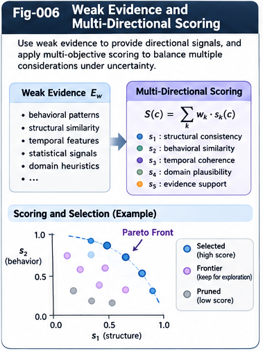
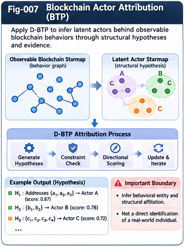

# D-BTP-005 — Weak Evidence and Directional Exploration

**Project:** Dynamic Bucket Tree of Permutation (D-BTP): Directional Structural Generation and Hypothesis Evolution  
**Series:** Foundations · D-BTP-005  
**Status:** Research foundation / proposed formalization  
**Version:** 1.0.0-draft · 2026-11-03  
**Companions:** D-BTP-001 — From Metric Similarity to Structural Hypothesis Search; D-BTP-002 — Dynamic Bucket States and Candidate Generation; D-BTP-003 — Constraint-Guided Structural Composition; D-BTP-004 — Directional Fields for Generation and Selection  
**Next:** D-BTP-006 — Coupled Generation, Selection and Feedback

## Abstract

Weak evidence is frequently insufficient to establish the truth of a structural hypothesis, yet it may still be useful for deciding which hypothesis to generate, test, or expand next. This paper develops **weak-evidence directional exploration** within the Dynamic Bucket Tree of Permutation (D-BTP) framework. Its central claim is deliberately limited and testable: *a fallible signal can have positive computational value even when it has inadequate evidential strength for definitive attribution or hard rejection*. We distinguish evidential strength from search utility, formalize provenance-aware evidence records, describe direction fields that guide candidate generation and frontier selection, and develop mechanisms for counterevidence, correlation control, uncertainty, calibration, and adaptive resource allocation. A blockchain actor-attribution example illustrates the approach without equating on-chain control hypotheses with real-world identity. The paper proposes experimental comparisons against random, static, and conventional heuristic search; it reports no completed empirical results. The goal is not to celebrate weak evidence indiscriminately, but to establish when it helps, when it misleads, and how a dynamic search can learn the difference.

## 1. The overlooked computational role of weak evidence

A conventional evidential question asks: *Does observation e justify accepting hypothesis h?* A directional-search question asks something different: *Given limited time and computation, does e help us decide what to examine next?* The answers need not coincide.

A signal may be too noisy, indirect, context-dependent, or correlated with other signals to support a conclusion. Nevertheless, it may be statistically associated with useful search directions. A rough geographic hint may guide an investigator toward a promising subset of records without establishing the location of a person. An approximate structural similarity may prioritize a candidate mapping without proving that the mapped nodes correspond.

D-BTP treats this distinction as a first-class design principle:

> Weak evidence may guide exploration without being promoted into a fact, a hard constraint, or a claim of identity.

The corresponding research problem is to measure *search value* separately from *truth support*, and to prevent an efficient search from becoming an overconfident inference system.

## 2. Scope and terminology

**Evidence:** an observation, measurement, or derived claim bearing on a hypothesis, accompanied by its origin and limitations.

**Weak evidence:** evidence whose reliability, discriminative power, independence, completeness, or applicability is insufficient for a decisive inference in the current context. Weakness is relative to a hypothesis and task, not an intrinsic property of a datum.

**Directional signal:** a function of evidence and current state that influences which candidates are proposed or which search branches receive resources.

**Structural hypothesis:** a set of accepted, excluded, and unresolved relational claims, potentially involving latent objects and changing structural representations.

**Search utility:** expected contribution of a signal to a search objective under a defined resource budget. This may include earlier discovery of high-quality feasible hypotheses, increased coverage, useful falsification, or reduced compute.

**Epistemic confidence:** a calibrated degree of support for a proposition, under an explicitly stated model. A search-priority score is not automatically an epistemic probability.

**Counterevidence:** evidence that lowers the support for a hypothesis or reveals a failure in a previously favored explanation. Counterevidence can have positive search value.

## 3. A dynamic-bucket view

Let a search bucket be represented abstractly as

$$
B_t=(H_t,S_t,P_t,E_t),
$$

where $H_t$ is the current hypothesis record, $S_t$ is the evolving structural state, $P_t$ contains control policies and search bookkeeping, and $E_t$ is the evidence ledger. This representation is logical rather than a requirement that all fields be materialized or copied at every branch.

A dynamic candidate generator proposes a context-dependent set or stream:

$$
C_t \sim G(\cdot\mid B_t,D_t,\mathcal{K}_t),
$$

where $D_t$ is the current directional field and $\mathcal{K}_t$ denotes available domain knowledge. The notation allows deterministic enumeration, stochastic proposals, and bounded streams.

For a proposed candidate $c$, the controller may choose an accept, exclude, defer, or investigative transition, subject to the core search semantics. Weak evidence influences the proposal distribution, expansion order, or investigative action; it does **not** override a hard feasibility contract.

A transition can be summarized as

$$
(B_{t+1},o_t)=T(B_t,c_t,a_t,\Delta E_t),
$$

where $o_t$ includes diagnostics and provenance. Direction may then be updated from **validated** outcomes:

$$
D_{t+1}=U(D_t,o_t,\text{feedback}_t).
$$

Updates must distinguish an observed ground-truth label, an independently verified outcome, a delayed proxy, and a self-generated model score. These are not interchangeable feedback sources.

## 4. Evidential strength versus directional utility

Consider a candidate $c$, evidence $e$, and search budget $b$. Define a task-specific utility difference:

$$
\Delta V(e;b)=\mathbb{E}[Q(\pi_e,b)]-\mathbb{E}[Q(\pi_0,b)]-\lambda\,\Delta Cost(e;b),
$$

where $\pi_e$ is a policy using the signal, $\pi_0$ is an appropriate control policy, and $Q$ is an evaluation metric defined independently of the policy's own internal score. This is a proposed evaluation quantity, not a universal closed-form estimator.

A signal can have $\Delta V>0$ while the posterior probability of the suggested hypothesis remains low. Conversely, a highly reliable observation may have almost no search utility when it is already known or does not distinguish remaining candidates.

Four illustrative cases clarify the separation:

| Evidence condition | Search value | Recommended treatment |
| --- | --- | --- |
| Weak but discriminative | Potentially high | Use for ranking; retain alternatives |
| Strong but redundant | Potentially low | Record for explanation; avoid duplicate credit |
| Weak and misleading | Negative | Downweight or quarantine after validation |
| Strong and contradictory | High for falsification | Reassess affected hypotheses; apply hard rejection only if logically warranted |

No monotonic relationship between evidential strength and computational utility is assumed.



Fig-006. Weak evidence can contribute to several directional objectives—plausibility, novelty, information gain, cost, and counterevidence potential—without becoming a hard feasibility verdict. Provenance, correlation checks, and competing perspectives constrain how scores are interpreted.*

## 5. Evidence record and provenance contract

Each evidence item should carry sufficient information to support audit and re-evaluation. A proposed canonical record is:

```yaml
EvidenceRecord:
  evidence_id: string
  source_id: string
  observation_time: timestamp_or_unknown
  acquisition_context: object
  observed_claim: typed_claim
  target_hypotheses: [hypothesis_id]
  polarity: support | oppose | mixed | neutral
  reliability_estimate: optional_calibrated_value
  uncertainty_model: optional_model_reference
  correlation_group: optional_string
  transformation_lineage: [evidence_id]
  applicability_conditions: [condition]
  privacy_and_access_policy: policy_reference
  verification_status: observed | independently_verified | inferred | disputed
  notes: string
```

This is a research contract, not an assertion that every field is available in all domains. Missing values must remain explicitly missing. A transformed measurement must preserve its lineage: repeated processing of the same observation does not create independent evidence.

Evidence ledgers should be append-oriented or versioned, with retractions and corrections represented explicitly. Hypothesis states should reference evidence IDs rather than duplicating potentially inconsistent descriptions.

## 6. Weak evidence is not a hard constraint

The separation is fundamental:

$$
\mathrm{Feasible}(B,c) \in \{0,1\},
\qquad
\mathrm{Priority}(B,c,D)\in\mathbb{R}\text{ or a partial order}.
$$

A feasibility predicate should reject only what is incompatible with an established rule under the specified model. A directional priority may be low because of noisy evidence, but low priority does not establish infeasibility.

For example, two transactions occurring close together do not logically prove that they were made by one actor; transactions occurring simultaneously do not prove distinct actors, because one controller may operate multiple automated systems. An invalid cryptographic signature can disprove a narrow signature-verification claim, but cannot by itself disprove all claims about common beneficial control.

**Operational rule:** heuristic rejection must be labeled *budget pruning*, *deferment*, or *policy exclusion*, never silently recorded as a logically impossible branch. This preserves the distinction between incomplete search and proof of absence.

## 7. Directional-field representation

A single scalar is sometimes useful, but weak evidence often supports several incomparable directions. Let

$$
D_t(c\mid B_t)=
\bigl(d_{\mathrm{fit}},d_{\mathrm{novelty}},d_{\mathrm{information}},
 d_{\mathrm{cost}},d_{\mathrm{risk}},d_{\mathrm{counterexample}}\bigr).
$$

Components may be probabilities, calibrated predictions, ordinal rankings, or interval estimates, but their types and units must be explicit. Aggregation is a policy choice, not an inherent mathematical property of the field.

Possible controllers include Pareto-frontier retention, lexicographic priorities, constrained optimization, contextual bandits, and weighted scores. Weighting should be tested for sensitivity; a change in weights may change the favored hypotheses without changing the underlying evidence.

**Perspective-aware direction:** different analysts or agents may have distinct legitimate objectives, such as explanatory fit, information gain, auditability, or computational efficiency. The system should retain the perspective identifier and avoid presenting a perspective-specific ranking as objective truth.

## 8. Where directional evidence enters the search

### 8.1 Candidate generation

Weak evidence may focus a generator on likely structural motifs, suggest latent entities, or trigger a local expansion around a newly discovered relation. A generator must expose its coverage assumptions: a biased generator that never proposes the correct candidate cannot be repaired by excellent downstream scoring.

### 8.2 Branch ordering

Given a feasible candidate, a weak signal can determine whether its accept or exclude branch is expanded first. Ordering can improve *anytime* performance without changing the set of branches available to a complete search.

### 8.3 Budget allocation

The controller may reserve additional expansions for promising regions, uncertain regions, and explicit counterexample probes. A minimum exploration reserve helps protect against feedback loops that suppress unfamiliar hypotheses.

### 8.4 Evidence acquisition

Where permissible, the system can choose which additional measurement, test, or authorized query would most reduce uncertainty. This introduces the distinction between *exploring hypotheses* and *acquiring evidence*; both consume resources and require separate cost accounting.

### 8.5 Model and field updates

Validated results can improve the generator or priority model. The update mechanism must not train on its own ranking as if it were independent ground truth.

## 9. Bayesian interpretation and its limits

Where likelihood models are justified, evidence may be combined using posterior odds:

$$
\frac{P(H\mid E)}{P(\neg H\mid E)} = \frac{P(H)}{P(\neg H)} \cdot\frac{P(E\mid H)}{P(E\mid\neg H)}.
$$

This identity does not license naive multiplication of likelihood ratios for correlated observations. If $E=(e_1,e_2)$, conditional dependence must be modeled or conservatively handled. On-chain behavioral features often share a common causal origin; counting each as independent can inflate confidence dramatically.

For many practical cases, reliable likelihoods are unavailable. The framework may then use nonprobabilistic directional scores, uncertainty intervals, or learned rankings, while explicitly refusing to call them posterior probabilities. Calibration, abstention, and external validation are essential if the scores will support substantive attribution claims.

## 10. Information gain and exploratory value

An uncertain candidate may be worth investigating even if it is not the most likely to be correct. Under a probabilistic model, expected information gain from a prospective observation $Y$ can be written as

$$
IG(a)=H(H\mid E)-\mathbb{E}_{Y\mid a,E}[H(H\mid E,Y)],
$$

where $a$ is an evidence-acquisition action and $H(\cdot)$ is entropy. The expression presupposes a coherent distribution and observation model. In nonprobabilistic settings, alternative measures include reduction in feasible-hypothesis volume, expected falsification power, or improved coverage of competing explanations.

Information gain is not the same as objective progress. A costly observation may greatly reduce uncertainty about an irrelevant variable. Thus the field should distinguish epistemic gain from task value and measurement cost.

## 11. Counterevidence as an active search direction

A purely confirmatory field is vulnerable to self-reinforcement: early weak hints favor a hypothesis; favored branches collect more supporting observations; neglected alternatives never receive a fair test.

D-BTP should therefore support **counterexample-directed generation**:

1. Identify the current leading hypothesis and its most consequential assumptions.
2. Generate candidate observations or structural relations that would contradict those assumptions.
3. Evaluate whether such tests are feasible and authorized.
4. Allocate a bounded investigation budget to the most discriminative tests.
5. Update the hypothesis ledger whether the tests support or oppose the leader.

A counterexample probe may lower the score of the current best hypothesis while increasing the reliability of the overall search process. Such outcomes should be rewarded by evaluation metrics that value calibration and error detection, not merely internal score maximization.

## 12. Multi-source correlation and evidence folding

Multiple evidence items can be redundant or causally entangled. The evidence subsystem should track at least three relations: **shared origin**, **derived-from**, and **potentially correlated with**. Correlation groups are a conservative bookkeeping device; they are not a substitute for a causal model.

A directional fold can combine evidence into a search signal while preserving provenance:

$$
F_t=\mathrm{Fold}(E_t,\mathcal{C}_t,\theta_t),
$$

where $\mathcal{C}_t$ describes dependence assumptions and $\theta_t$ contains model parameters. The fold should expose diagnostics, sensitivity to dependence assumptions, and an explicit abstention or uncertainty state.

This creates an interface with UCPSF-style scoring and BM-ODWEI-style directional weak evidence, without assuming that any particular fold is statistically valid in every domain.

## 13. Blockchain actor-attribution example



*Fig-007. Illustrative blockchain behavior attribution using D-BTP. Observed transactions and behavioral patterns support competing latent-actor grouping hypotheses, subject to constraints and directional evidence. The inferred units are behavioral actors, not verified real-world identities.*

---

Suppose an authorized analyst examines a synthetic blockchain transaction graph. Observable nodes represent transactions, addresses, and contracts; actor nodes are latent hypotheses rather than known people. Candidate pairs express claims such as *latent controller A may be associated with activity cluster X*.

Possible weak signals include transaction timing, recurrent interaction patterns, common funding motifs, or similar operational behavior. These signals may suggest candidate clusters, but common use of an exchange, automated infrastructure, or popular software can create misleading similarities. Cryptographic keys establish narrowly defined signing relationships, not automatically a person's identity. Network identifiers, when lawfully available, are also imperfect proxies for a human controller.

A dynamic search might proceed as follows:

```text
Bucket B0: no actor attribution fixed; initial evidence ledger E0
  -> propose cluster-to-actor hypotheses using weak structural cues
  -> check domain constraints and preserve alternative assignments
  -> expand selected accept/exclude branches
  -> discover a new behavioral motif within one branch
  -> generate additional candidate relations from that motif
  -> direct some budget toward a competing explanation
  -> compare explanations using independently evaluated criteria
  -> output a ranked, uncertainty-aware hypothesis portfolio
```

A high-ranking hypothesis is an attribution hypothesis, not a finding of real-world identity. The example should be evaluated first with synthetic ground truth or otherwise authorized data, with privacy, false-positive costs, and uncertainty explicitly represented.

## 14. Connection to REN and directional weak-evidence intelligence

REN (Relational Evidence Navigation) offers a useful conceptual analogy: weak relational similarities may orient a search even when they cannot settle the underlying proposition. In D-BTP, this intuition becomes a concrete interface between evidence and search control.

The proposed connection has three layers:

- **Relational measurement:** detect weak correspondences or directional patterns.
- **Navigational use:** turn those patterns into candidate-generation or expansion priorities.
- **Validation and correction:** measure whether navigation improved independent outcomes and revise the directional policy accordingly.

This is a research bridge, not a proof that all weak-evidence heuristics transfer across domains. A direction learned in one domain can produce *negative transfer* in another.

## 15. Multi-agent evidence competition and collective learning

Different agents can propose incompatible explanations, independently challenge evidence, or specialize in distinct structural motifs. Their outputs should be recorded as attributed proposals with provenance and test outcomes. Agreement among agents that share training data, prompts, or source observations must not be mistaken for independent corroboration.

A collective-learning loop can retain reusable information such as: which signals improved search under which conditions, which candidate generators missed true structures, which counterexample tests were informative, and which field configurations suffered systematic bias.

The objective is to learn **reliable exploration policies**, not merely to accumulate more confident assertions. Relay contracts should carry unresolved alternatives and explicit leftover work.

## 16. A reference algorithm sketch

The following pseudocode emphasizes interfaces rather than a required implementation:

```python
def directional_weak_evidence_search(initial_bucket, plugins, budget):
    frontier = initialize_frontier(initial_bucket)
    portfolio = []
    audit_log = []

    while frontier and budget.has_capacity():
        bucket = select_bucket(frontier, plugins.direction_field)
        candidates, coverage = plugins.generate_candidates(bucket)
        record_coverage(bucket, coverage, audit_log)

        if not candidates:
            classify_no_candidate_state(bucket, portfolio, audit_log)
            continue

        candidate = choose_candidate(candidates, bucket, plugins.direction_field)
        for decision in ("accept", "exclude"):
            successor = plugins.transition(bucket, candidate, decision)
            if plugins.violates_proven_hard_constraint(successor):
                audit_log.append((successor.id, "hard-infeasible"))
                continue
            successor.evidence = plugins.evaluate_evidence(successor)
            successor.priority = plugins.directional_priority(successor)
            frontier.push(successor)

        budget.charge_generation_and_expansion()
        portfolio = maintain_diverse_hypotheses(portfolio, frontier)

    return portfolio, frontier, audit_log, budget.accounting()
```

**Important qualifications:** (i) candidate generation may be a stream rather than a finite list; (ii) the pseudocode does not establish completeness or termination; (iii) repeated candidate IDs and state equivalence need explicit handling; (iv) a temporarily empty generator is not proof of a closed leaf; (v) learning updates should be separated from evaluation and governed by independent feedback; and (vi) hard constraints must be demonstrably sound under their declared semantics.

## 17. Failure modes and safeguards

| Failure mode | Mechanism | Proposed safeguard |
| --- | --- | --- |
| Confirmation bias | Favorable hypotheses attract further evidence | Counterexample budget and alternative portfolio |
| Double counting | Correlated observations folded as independent | Provenance and dependence groups |
| Generator blind spot | Correct candidate never proposed | Coverage probes and unguided exploration reserve |
| False hard rejection | Weak signal converted into impossibility | Typed separation of feasibility and priority |
| Score hacking | Controller learns to optimize internal score | Independent outcome metrics and held-out tests |
| Negative transfer | Direction from one domain fails in another | Domain-shift tests and conservative fallback |
| Privacy harm | Attribution overstates evidence about persons | Synthetic/authorized data, minimization, abstention |
| Search starvation | Low-ranked branches never revisited | Diversity and fairness-of-exploration quotas |
| Unbounded expansion | Dynamic generator repeatedly creates variants | Canonical IDs, deduplication, budgets, closure checks |
| Miscalibration | Priority scores interpreted as probabilities | Separate score types and calibration assessment |

## 18. Testable hypotheses

**H1 — Search utility without decisiveness.** Some signals that fail a predefined threshold for decisive attribution nevertheless improve best-found feasible hypothesis quality at equal total computation compared with a no-signal control.

**H2 — Generation advantage.** Weak-evidence-guided candidate generation increases recall of useful structural hypotheses at a fixed proposal budget compared with uniform or structure-agnostic generation, on at least some declared benchmark families.

**H3 — Counterevidence advantage.** Reserving resources for falsification improves calibration or reduces false positive attribution relative to purely confirmatory expansion.

**H4 — Dependence awareness.** Provenance-aware evidence folding reduces overconfidence relative to naive independent aggregation when observations are correlated.

**H5 — Directional diversity.** A portfolio controller with explicit diversity preservation outperforms a single-score greedy controller on ambiguity-heavy cases, measured by hypothesis recall and robustness rather than solely by top-1 internal score.

**H6 — Learning under shift.** Directional policies trained on one family of cases may fail under distribution shift; a shift detector and conservative fallback reduce worst-case degradation.

**H7 — Value of negative results.** Search controllers rewarded for informative disconfirmation produce more reliable final hypothesis sets than controllers rewarded only for confirming the current leader.

All hypotheses require domain-specific operational definitions and may be falsified. They are not established findings.

## 19. Validation protocol and metrics

### 19.1 Benchmark families

Use (a) synthetic graph alignment with known mappings, (b) dynamic latent-actor clustering with controlled noise and confounding, and (c) evolving relational graphs where new candidate types emerge after state transitions. Generate multiple graph sizes, ambiguity levels, dependence structures, and evidence-quality regimes.

### 19.2 Baselines

Compare against random expansion, exhaustive search where tractable, fixed-candidate BTP, dynamic BTP without evidence guidance, conventional heuristic best-first or beam search, and directional D-BTP with each component ablated. Ensure comparable candidate-generation, evidence-evaluation, and model-training costs.

### 19.3 Primary measurements

- Best independently evaluated feasible solution at matched wall-clock or operation budget.
- Candidate recall, hypothesis coverage, and time-to-first-useful-hypothesis.
- False-positive attribution rate, abstention rate, and uncertainty calibration where probabilities are claimed.
- Robustness to correlated evidence, missing data, adversarial decoys, and domain shift.
- Compute accounting including generator calls, evidence acquisition, plugin execution, and learning.
- Diversity and coverage of top-K explanations, not just a single best score.

### 19.4 Experimental discipline

Predefine the primary outcome and test families; retain random seeds; use held-out graphs; report confidence intervals and negative results; distinguish search-budget termination from certified completeness. When a learned field is used, isolate training, tuning, and final evaluation data. Report both mean performance and worst-case failure regimes.

### 19.5 Expected negative controls

A deliberately shuffled directional signal should not consistently improve outcomes. Duplicated correlated evidence should not increase confidence under a dependence-aware fold. A generator that suppresses true candidates should exhibit measurable recall loss even if its selected branches appear high-scoring.

## 20. Open questions

1. What minimum evidence metadata suffices to detect dangerous double counting?
2. Can the search value of a weak signal be estimated online without excessive exploration cost?
3. How should an uncertain field express a preference for counterevidence rather than confirmation?
4. What forms of weak relational similarity transfer across domains, and which fail under shift?
5. When does a vector field outperform a calibrated scalar ranking?
6. Can a search certify useful candidate coverage when candidate types themselves evolve?
7. How should multi-agent disagreement be scored when agents share sources or models?
8. What is the appropriate abstention contract for actor-attribution outputs?
9. How can a controller preserve novelty without rewarding meaningless structural proliferation?
10. Which independently observable outcomes are sufficient to justify a claim of improved weak-evidence intelligence?

## 21. Relationship to companion papers

D-BTP-001 supplies the generalized hypothesis-search framing. D-BTP-002 defines evolving buckets and dynamic candidate generation. D-BTP-003 formalizes hard constraints and sound pruning. D-BTP-004 defines directional fields and their role in generation and selection. **This paper isolates the epistemic and computational treatment of weak evidence**. D-BTP-006 will address the closed-loop coupling of generation, selection, and validated feedback in more detail. Later specifications should make the evidence and learning contracts executable and testable.

## 22. Conclusion

The most important proposal of D-BTP-005 is a separation of responsibilities: **evidence supports or challenges hypotheses; directional guidance allocates attention; hard constraints enforce justified impossibility; and independent validation determines whether the guidance was useful**. Weak evidence need not be discarded merely because it cannot prove a conclusion, but neither should it be promoted into certainty. Its legitimate role may be to make exploration more purposeful under bounded resources.

Dynamic BTP provides a concrete setting in which to test that proposition. Candidate generation, branching, evidence evaluation, and search control can be measured separately and together. The research opportunity lies in identifying where weak signals improve discovery, where they introduce bias, and how feedback can correct the difference.

---

## Research status and citation note

This document presents proposed definitions, interfaces, hypotheses, and validation protocols. It does not claim completed experiments, established performance improvements, or proof of a universal weak-evidence algorithm. Cite the eventual versioned repository release and DOI only after they exist.
