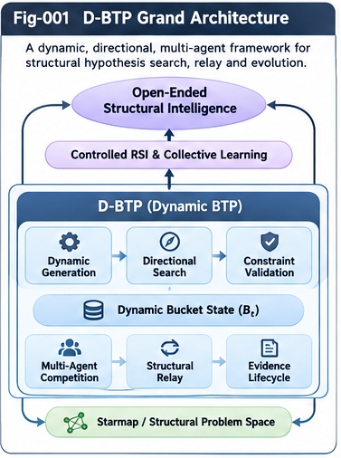
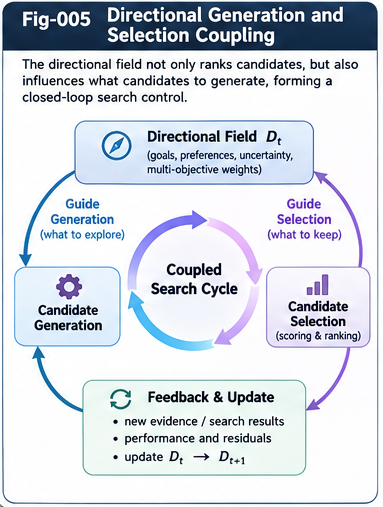
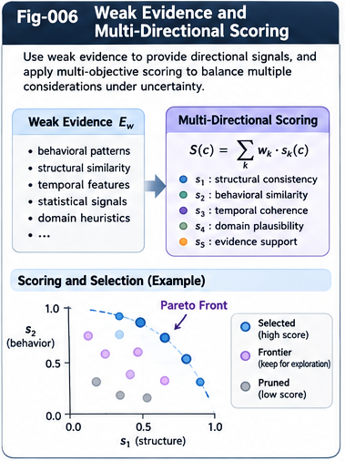

# D-BTP-006 — Coupled Generation, Selection, and Feedback

**Project:** Dynamic Bucket Tree of Permutation (D-BTP): Directional Structural Generation and Hypothesis Evolution  
**Series:** Foundations  
**Status:** Research foundation / testable architecture hypothesis  
**Version:** 1.0.0 (draft)  
**Date:** 2026-11-03  
**License:** Apache-2.0

## Abstract

Dynamic Bucket Tree of Permutation (D-BTP) generalizes bucket-based structural matching into a constraint-guided search over evolving structural hypotheses. Its distinguishing research proposition is not simply that candidate hypotheses can be generated dynamically, nor that a scoring function can rank them. Rather, **generation, directional selection, and evidence feedback can be coupled within a single evolving search process**. The current directional field influences which candidate pairs and structural transformations are proposed; the resulting branches reveal evidence and constraints; validated feedback may then revise the field and future generation policy. This article defines the coupling, separates search-state changes from learned policy changes, specifies invariants and failure modes, and proposes controlled experiments to determine when coupling is more effective than staged generate-then-rank approaches. The framework is an architectural hypothesis, not a claim of demonstrated general intelligence or guaranteed superiority.

**Keywords:** D-BTP; structural hypothesis search; directional field; generative branching; feedback; weak evidence; constraint propagation; policy learning; collective learning; search governance.

---



*Fig-001. D-BTP grand architecture. A dynamic bucket maintains structural hypotheses and evidence; state-dependent candidate generation, constraint validation, directional search control, and feedback jointly govern exploration. Structural relay and learning may operate across search episodes.*

---



*Fig-005. Directional fields couple what is proposed with what is explored next. Directional policies influence candidate generation, branch prioritization, and resource allocation; evaluated outcomes and independently checked evidence feed back into subsequent policy updates.*

---



Fig-006. Weak evidence can contribute to several directional objectives—plausibility, novelty, information gain, cost, and counterevidence potential—without becoming a hard feasibility verdict. Provenance, correlation checks, and competing perspectives constrain how scores are interpreted.*

---

## 1. Position in the D-BTP Research Series

D-BTP-001 reframes metric similarity and unaligned AND as special instances of structural hypothesis search. D-BTP-002 introduces dynamically generated candidates and evolving bucket states. D-BTP-003 distinguishes hard constraints from heuristic evidence and specifies sound rejection. D-BTP-004 formalizes directional guidance for generation, selection, and resource allocation. D-BTP-005 explores the computational value of weak evidence as a search signal. The present paper asks a different question: **how should these mechanisms interact over time without confusing hypothesis plausibility, search utility, and empirical truth?**

Its contribution is an integrated process model, interface boundaries, testable invariants, and a validation program. It does not replace the contracts specified by the preceding papers.

## 2. From Pipeline to Coupled Process

A conventional pipeline has the form:

1. Generate a fixed candidate set.
2. Evaluate candidates.
3. Select the best candidate.
4. Return a result.

This is appropriate when the candidate universe is sufficiently known and scoring does not affect what can be discovered. Dynamic structural problems violate those assumptions: accepting or excluding a pair can expose new relations, alter feasibility, and suggest new questions. Directional signals may also make some ungenerated candidates more valuable than already visible candidates.

D-BTP therefore studies a loop:

**State → Direction-guided proposals → Branching and constraint propagation → Evidence and evaluation → Feedback → Updated state and, when warranted, updated guidance.**

The loop does not require every step to change the direction field. A stable external objective and frozen scoring policy are valid configurations and useful experimental controls.

## 3. Core Objects and Semantics

Let a search bucket at time *t* be

$$
B_t=(H_t,S_t,E_t,X_t,M_t),
$$

where:

- $H_t$ is the set of accepted structural hypotheses and their dependencies;
- $S_t$ is the current domain-specific structural state, including inferred and observed elements with distinct provenance;
- $E_t$ is the accumulated evidence ledger and derived statistics;
- $X_t$ records explicit exclusions, conflicts, and already examined decisions;
- $M_t$ is operational metadata, including budget, generator cursor, state version, and replay information.

A **directional field** $D_t$ is a structured policy or vector of priorities, not necessarily a scalar similarity score. It may contain task objectives, expected information gain, confidence calibration, risk, novelty, and resource costs. A **generation policy** $G_{\theta_t}$ proposes candidate pairs or transformations. A **selection policy** $\Pi_{\phi_t}$ determines which eligible proposal or frontier bucket to expand. The parameters $\theta_t$ and $\phi_t$ may be fixed or learned.

The distinction between *search-state evolution* (changing $B_t$) and *policy evolution* (changing $\theta_t,\phi_t,D_t$) is essential: dynamic candidates do not, by themselves, imply learning or recursive self-improvement.

## 4. Formal Coupled Transition

One illustrative transition is:

$$
C_t=G_{\theta_t}(B_t,D_t;\mathcal K_t),
$$

$$
c_t=\Pi_{\phi_t}(C_t,\mathcal F_t,D_t,\mathcal B_t),
$$

$$
(B_{t+1}^{+},B_{t+1}^{-})=T(B_t,c_t;\mathcal C),
$$

where $\mathcal K_t$ is available knowledge, $\mathcal F_t$ is the frontier, $\mathcal B_t$ is remaining budget, and $\mathcal C$ is the domain constraint contract. The two children correspond to accepting and explicitly excluding the selected candidate, subject to feasibility checks. Evidence evaluation and feedback then follow:

$$
Z_{t+1}=V(B_{t+1}^{\pm},\mathcal O_t),
$$

$$
(D_{t+1},\theta_{t+1},\phi_{t+1})
=U(D_t,\theta_t,\phi_t,Z_{t+1};\mathcal G),
$$

where $\mathcal O_t$ denotes observations and $\mathcal G$ denotes governance constraints. The update operator $U$ may be the identity. Importantly, the field used to prioritize search is not automatically a posterior probability or a proof of attribution.

This formulation describes a *family* of algorithms. Different choices of $G,\Pi,T,V,U$ lead to different completeness, cost, and calibration properties.

## 5. The Two-Way Coupling

### 5.1 Direction influences generation

A direction field can bias which candidate relationships are proposed, the granularity at which they are represented, and whether to expand or refine a structural hypothesis. For example, a search focused on information gain may propose a discriminating candidate even when its current plausibility score is modest.

### 5.2 Generation changes the available directions

New branches can reveal previously invisible constraints, create new latent structural units, or expose an ambiguity that suggests a new experiment. Thus generation changes the *actionable* direction space, even when the externally defined objective remains fixed.

### 5.3 Evidence may update the field

Only evidence with appropriate provenance and evaluation status should update learned directional weights. Search heuristics must not be trained on their own unverified outputs as though those outputs were independent ground truth. Feedback may be delayed, sparse, or contradictory; uncertainty should be preserved.

### 5.4 Selection governs compute

A coupled architecture can allocate computation among exploitation, exploration, falsification, and diversity preservation. This is more general than ranking leaves by a single score.

## 6. A Three-Layer Control Model

To avoid conflating purposes, D-BTP separates:

**Layer A — Domain truth and feasibility.** Observations, immutable facts, hard constraints, and consistency checks. This layer determines whether a branch is admissible, not merely attractive.

**Layer B — Search direction and resource control.** Heuristic evidence, expected gain, novelty, uncertainty, and budget-sensitive prioritization. This layer may be changed without changing domain truth.

**Layer C — Learning and governance.** Calibrated feedback, plugin performance measurement, policy updates, audit trails, and rollback. This layer determines when and how the search policy itself may evolve.

An external goal contract governs all three. Self-modifying direction fields must not silently redefine success criteria.

## 7. Multiple Directions and Hypothesis Portfolios

A single scalar objective can hide valuable tradeoffs. Let

$$
D_t(B)=(q_{fit},q_{info},q_{novelty},q_{risk},q_{cost},q_{diversity}).
$$

The components need not share units or support a naive weighted sum. A policy can use Pareto dominance, lexicographic constraints, bounded scalarization, or a portfolio of distinct search strategies. The frontier should retain alternative explanations when the evidence cannot distinguish them.

In actor-attribution problems, structural fit, control attribution, and real-world identity are different levels of claim. A high search score at one level must not be promoted automatically to the next.

## 8. Weak Evidence as Guidance, Not Proof

Weak evidence may be useful because it changes the order in which candidates are investigated. Its value should be measured by *downstream outcomes*, such as discovery rate under fixed budget, rather than by apparent plausibility alone.

A signal may have positive search value even if it is too uncertain for hard rejection. Conversely, correlated weak signals can create false confidence if counted repeatedly. D-BTP therefore requires evidence provenance, dependency tracking, counterevidence search, and calibration tests. Negative or null feedback must be eligible to change future generation and selection policies.

## 9. Structural Growth Versus Search-Space Growth

Not every new candidate constitutes new knowledge. The framework distinguishes:

- **Candidate growth:** additional untested hypotheses are proposed.
- **Representational growth:** new structural units or relations are introduced to express hypotheses.
- **Validated knowledge growth:** evidence supports retaining a new claim or rule.
- **Policy growth:** the system learns a better generation or selection mechanism.

These are separate measurable events. A growing tree may indicate inefficiency rather than intelligence; an evolving directional field may overfit rather than improve generalization.

## 10. Reference Execution Cycle

```text
initialize frontier with root bucket and fixed goal contract
initialize directional field, generator policy, and search policy
while budget remains and frontier is nonempty:
    bucket = choose_frontier_bucket(frontier, direction, budget)
    candidates = generate(bucket, direction, generator_state)
    candidates = deduplicate_and_check_provenance(candidates, bucket)
    if candidates are empty:
        if generator_exhaustion_is_certified(bucket):
            mark_closed_leaf(bucket)
        else:
            mark_quiescent_or_deferred(bucket)
        continue
    candidate = choose_candidate(candidates, direction, budget)
    for decision in [ACCEPT, EXCLUDE]:
        child = transition(bucket, candidate, decision)
        child = propagate_sound_constraints(child)
        if not violates_hard_constraints(child):
            evaluate_evidence_without_double_counting(child)
            add_to_frontier(child)
    feedback = collect_validated_feedback_if_available()
    update_direction_and_policies_only_if_authorized(feedback)
return diverse_best_supported_hypotheses_with_uncertainty_and_audit()
```

This pseudocode omits implementation details, including asynchronous generators, multi-agent scheduling, and parallel execution. An empty candidate response is not proof that all possible candidates have been exhausted.

## 11. Correctness and Operational Invariants

**I1 — Hard-constraint soundness.** A branch rejected as impossible must violate a valid hard constraint; heuristic disfavor is insufficient.

**I2 — Decision consistency.** Accepted and explicitly excluded versions of the same hypothesis cannot coexist in one bucket without a defined retraction or revision mechanism.

**I3 — Evidence provenance.** Every observational claim records origin, transformation, dependencies, and evaluation status.

**I4 — No unearned certainty.** Search priority, hypothesis score, and calibrated probability are distinct outputs.

**I5 — Goal integrity.** Learning may tune search heuristics but cannot silently alter externally specified success and safety constraints.

**I6 — Reproducibility.** State versions, plugin versions, random seeds where applicable, and direction updates are logged for replay.

**I7 — Honest termination.** Certified exhaustion, provisional quiescence, budget termination, and pruned branches receive different statuses.

**I8 — Coverage disclosure.** If generation or beam pruning is incomplete, the result must not be represented as globally optimal without additional proof.

## 12. Computational Complexity and Tradeoffs

For a fixed set of $m$ binary candidate decisions, exhaustive branching has up to $2^m$ assignments before constraints and equivalence reduction. Dynamic generation removes the assumption that $m$ is known in advance; it does not remove combinatorial hardness. If the generator can produce unbounded distinct candidates, termination is not guaranteed without a finite closure condition, a well-founded progress measure, or an explicit budget.

Directional selection can improve **anytime performance** under a budget, but may worsen completeness or introduce bias. Sound branch-and-bound requires valid upper bounds; heuristic pruning does not establish optimality. Policy-learning overhead must be included in comparisons, not hidden outside the runtime budget.

## 13. Failure Modes and Countermeasures

| Failure mode | Mechanism | Countermeasure |
|---|---|---|
| Self-confirming search | Generated hypotheses become training labels | Independent validation and provenance |
| Directional collapse | One high-scoring direction suppresses alternatives | Diversity quotas and exploration reserves |
| Weak-to-hard promotion | Heuristic disfavor becomes rejection | Typed constraint contracts and audits |
| Endless candidate regeneration | No durable exclusion or generator progress state | Canonical IDs, memoization, progress certificates |
| Score gaming | Learned policy optimizes proxy instead of task | Held-out outcomes and fixed goal contract |
| Evidence double counting | Correlated signals appear independent | Dependency graph and calibrated aggregation |
| Premature closure | No candidates now is mistaken for no candidates ever | Explicit generator exhaustion contract |
| Expensive policy churn | Feedback updates too frequently | Versioned epochs and update thresholds |

## 14. Case Study: Blockchain Actor Attribution

Consider a synthetic transaction graph in which latent actors can control multiple addresses and execute multiple transactions. A bucket represents a provisional attribution hypothesis, not a confirmed personal identity. Candidate generation proposes actor–behavior relationships based on public transaction structure and other authorized evidence. Hard constraints encode logically necessary conditions; weak timing, flow, or behavioral signals influence exploration but cannot prove common control.

An accepted relation may create a new cluster, reveal a conflicting hypothesis, or prompt examination of a previously unconsidered transaction. A directional field can allocate budget among likely clusters, ambiguity-reducing tests, and competing explanations. Independent synthetic ground truth allows evaluation of attribution precision, recall, uncertainty calibration, and compute cost. Experiments must distinguish cluster recovery from identifying real people; the latter is not implied by successful graph inference.

## 15. Other Potential Applications

**Dynamic starmap similarity:** propose correspondences as partial alignment reveals new relational context. Compare against static candidate enumeration.

**Multi-agent hypothesis competition:** multiple agents generate distinct candidate structures; a shared evaluator maintains evidence provenance and comparable budgets. Relay preserves dissenting hypotheses instead of merging incompatible claims prematurely.

**Adaptive scientific exploration:** candidate relationships and discriminating tests co-evolve. The external scientific question remains fixed while exploration policies learn from validated observations.

These are proposed applications, not established demonstrations of cross-domain superiority.

## 16. Testable Hypotheses

**H1 — Coupling benefit.** At equal total compute, direction-guided generation plus feedback finds higher-quality feasible hypotheses than fixed generation followed by ranking on at least some dynamic structural tasks.

**H2 — Weak-evidence utility.** Properly calibrated weak evidence improves time-to-first-valid-solution or area under the anytime-quality curve, without being used as hard rejection.

**H3 — Diversity benefit.** Multi-directional portfolios reduce premature convergence and improve recovery of alternative ground-truth explanations relative to single-score greedy search.

**H4 — Feedback benefit.** Validated feedback improves held-out task performance compared with frozen direction fields, after accounting for training and update costs.

**H5 — Provenance benefit.** Explicit evidence dependency tracking reduces overconfidence caused by duplicated or correlated evidence.

**H6 — Governance benefit.** Separating feasibility, search direction, and learning control reduces unsound pruning and untraceable policy changes.

**H7 — Boundary condition.** On simple fixed-candidate tasks, coupled D-BTP may perform no better, or worse, than static baselines due to added overhead.

## 17. Validation Roadmap

### Phase 1 — Synthetic microbenchmarks

Generate small graphs with known latent correspondences, controllable ambiguity, and candidate emergence. Exhaustively solve tractable instances to establish ground-truth optima and detect unsound pruning.

### Phase 2 — Ablation matrix

Compare: (A) static generate-then-rank, (B) dynamic generation with frozen direction, (C) directional generation without policy learning, (D) full coupling with validated feedback, and (E) full coupling with multi-directional portfolios. Keep domain constraints, observations, and compute accounting comparable.

### Phase 3 — Robustness and counterevidence

Inject misleading weak signals, correlated evidence, delayed labels, adversarial patterns, and generator non-exhaustion. Measure calibration, false attribution, missed hypotheses, and recovery after contradictory evidence.

### Phase 4 — Cross-domain transfer

Evaluate on dynamic starmap alignment and multi-agent hypothesis tasks with held-out distributions. Report transfer failures as carefully as successes.

### Required metrics

- Feasible hypothesis quality at fixed wall-clock and compute budget;
- anytime quality curves and time-to-first-valid-solution;
- candidate precision, novelty, and duplicate rate;
- search coverage, diversity, and missed-solution rate;
- attribution precision/recall where ground truth exists;
- evidence calibration and false-confidence rate;
- policy-update overhead and reproducibility;
- termination-status correctness and hard-constraint violations.

All reported improvements should include uncertainty intervals and repeated random seeds where relevant.

## 18. Interfaces to Specifications and Adjacent Research

- **SPEC-001:** bucket state, decision log, generator progress, and termination statuses.
- **SPEC-002:** candidate generator, constraint propagation, plugin side effects, and canonical hypothesis IDs.
- **SPEC-003:** directional scoring, multi-objective frontier selection, budget control, and admissible bounds.
- **SPEC-004:** evidence provenance, validated feedback, policy versioning, and relay lifecycle.

The framework is compatible in spirit with SI research on scoring control planes, directional weak evidence, structural relay, autonomous questioning, and recursive improvement. Compatibility is a proposed design relationship, not proof of equivalence between those systems.

## 19. Open Research Questions

1. Under what assumptions can candidate generation be certified complete?
2. Which direction-field representations preserve interpretability while supporting policy learning?
3. When does direction-guided generation outperform adaptive best-first search with a conventional heuristic?
4. Can structural novelty be measured independently of candidate volume?
5. How should a system balance hypothesis fit, falsification value, and expected information gain?
6. How can multi-agent relay avoid correlated errors and evidence laundering?
7. Which feedback signals support genuine cross-domain transfer rather than domain-specific overfitting?
8. What minimal contracts allow a learned generator to change without invalidating search invariants?

## 20. Conclusion

D-BTP-006 proposes **coupled generation, selection, and feedback** as a concrete architecture for purposeful structural exploration. Generation expands what can be considered; directional fields govern which possibilities receive attention and resources; independently validated feedback can improve future guidance. The coupling is most meaningful when structural states and candidate spaces evolve together. Its scientific value depends on demonstrable gains under controlled budgets, preserved hard-constraint soundness, calibrated uncertainty, and honest reporting of incompleteness. The result is a testable research program for dynamic structural intelligence—not an assertion that search, learning, or intelligence has been solved.

---

**Suggested figure:** `figures/Fig-005-Directional-Generation-and-Selection-Coupling.png` (also referenced in D-BTP-004).  
**Next foundation:** `D-BTP-007-Multi-Agent-RSI-and-Collective-Structural-Learning.md`.
