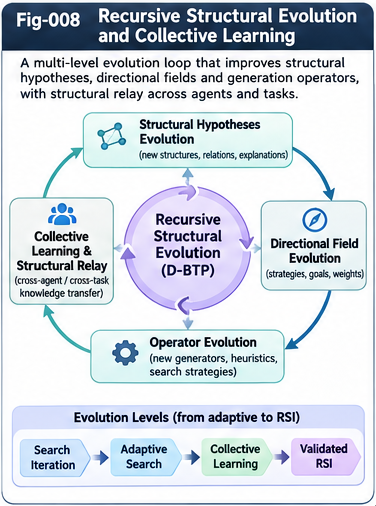

# D-BTP-007 — Multi-Agent RSI and Collective Structural Learning

**Project:** Dynamic Bucket Tree of Permutation (D-BTP): Directional Structural Generation and Hypothesis Evolution  
**Document type:** Research foundation / proposed architecture  
**Status:** Research hypothesis; not an empirical performance claim  
**Version:** 1.0.0-draft  
**Date:** 2026-11-03

## Abstract

Dynamic Bucket Tree of Permutation (D-BTP) extends a structural matching search into a state-dependent process in which candidate hypotheses, constraints, evidence, and directional priorities can evolve together. This paper proposes a multi-agent layer for D-BTP in which specialized agents generate candidate relations, test constraints, search for counterevidence, evaluate alternative hypotheses, and improve search policies through validated feedback. Structural Relay provides the contract for passing reusable hypothesis units and their evidence between agents; Collective Structural Learning accumulates results across cases; and Recursive Self-Improvement (RSI) is reserved for controlled, measurable changes to the system's search mechanisms rather than assumed from ordinary repeated execution. We define an agent architecture, typed relay units, learning boundaries, governance mechanisms, failure modes, and a falsifiable evaluation program. The central claim is conditional: diverse, auditable agents *may* improve search quality and transfer under fixed resource budgets, but their benefit must be established against strong single-agent and non-learning baselines.

**Keywords:** D-BTP; Bucket Tree of Permutation; multi-agent search; structural relay; collective learning; recursive self-improvement; directional fields; weak evidence; hypothesis portfolios; conformance.

## 1. Scope and research position

D-BTP-001 reframes BTP as constraint-guided structural hypothesis search. D-BTP-002 formalizes dynamic bucket states and candidate generation; D-BTP-003 addresses constraint-guided composition; D-BTP-004 and 005 distinguish directional guidance from evidentiary proof; and D-BTP-006 treats generation, selection, and feedback as a coupled process. The present paper adds *coordination and learning across multiple search participants*. It does not redefine the D-BTP core, nor does it claim that multi-agent operation is necessary for every task.

The proposal separates four propositions:

1. **Multi-agent exploration:** different agents can propose and examine different regions of a hypothesis space.
2. **Structural relay:** evidence-bearing intermediate results can be exchanged under explicit contracts.
3. **Collective structural learning:** verified outcomes can improve future search policies or reusable structural components.
4. **Controlled RSI:** an improvement process can propose, evaluate, and conditionally adopt changes to its own candidate generation, scoring, or control policies.

The first two can be implemented without learning. The third requires feedback and generalization tests. The fourth requires a protected evaluation and adoption mechanism.

## 2. A minimal D-BTP state model

Let a bucket be

\[
B_t=(H_t,S_t,D_t,E_t,M_t),
\]

where \(H_t\) contains accepted, excluded, and unresolved hypotheses; \(S_t\) is the structural state; \(D_t\) represents directional priorities; \(E_t\) stores evidence and provenance; and \(M_t\) records metadata, budgets, and exploration history. This is a conceptual contract, not a mandatory storage schema.

Candidate hypotheses are generated from the *current* state rather than from an immutable initial list:

\[
C_t=G(B_t,\pi_t),
\]

where \(\pi_t\) is the active policy. A valid expansion applies domain constraints and updates the bucket:

\[
B_{t+1}=T(B_t,c,a),\qquad c\in C_t,
\]

with \(a\) representing accept, exclude, defer, or another explicitly defined operation. **Accept** and **exclude** are logical search decisions, not assertions of ground truth. Deferral must not silently imply rejection.

For a multi-agent system, agent \(i\) has a policy \(\pi_i\), a bounded view \(V_i(B_t)\), and a role-specific output \(o_i\):

\[
o_i=\pi_i(V_i(B_t),\mathcal{R}_i),
\]

where \(\mathcal{R}_i\) is its permitted resource budget. Outputs are proposals until checked by shared contracts.

## 3. Why multiple agents may help

Dynamic BTP exposes several kinds of work that are related but not identical: finding candidate pairs, maintaining feasibility, estimating evidence value, discovering counterexamples, selecting frontier buckets, and proposing better policies. Specialization may reduce interference among these objectives and preserve diverse hypotheses.

However, agents can also duplicate work, amplify the same bias, correlate errors, and consume more resources than a unified search controller. Consequently, a multi-agent design must justify itself through *net performance* under equalized compute, wall-clock, and evidence-access budgets.

A useful design question is not “How many agents can we add?” but “Which separable responsibilities benefit from independent policies and explicit relay?”

## 4. Proposed agent roles

### 4.1 Candidate Discovery Agent

Generates candidate pairs, clusters, relations, or structural transformations from the current bucket. Each candidate carries an origin, novelty key, expected utility estimate, and stated assumptions. It cannot unilaterally mark a candidate as feasible.

### 4.2 Constraint and Conformance Agent

Checks hard invariants, domain compatibility, and transition legality. It may produce a proof-like rejection certificate for a genuinely hard contradiction. Soft or uncertain signals are passed to evidence evaluation rather than converted into hard pruning.

### 4.3 Evidence and Directional Scoring Agent

Evaluates supporting and contradicting observations, dependency between signals, and uncertainty. Its directional score is used for search guidance; it is not automatically a posterior probability or proof of identity.

### 4.4 Counterevidence and Adversarial Review Agent

Attempts to falsify leading hypotheses, construct alternative explanations, and detect correlated evidence. This agent should have access to competing hypotheses, not only the current top-ranked bucket.

### 4.5 Search Portfolio Controller

Allocates compute among buckets and agents, retains diverse promising alternatives, manages exploration/exploitation, and enforces stopping rules. It may use beam search, best-first search, branch-and-bound where admissible bounds exist, or adaptive portfolios. Heuristic pruning must be labeled separately from logically sound pruning.

### 4.6 Relay and Learning Curator

Normalizes reusable findings, deduplicates evidence, assigns provenance, and separates verified knowledge from tentative heuristics. It controls promotion into shared registries.

### 4.7 Policy Improvement Agent

Proposes changes to candidate generation, ranking, resource allocation, or agent coordination. Its proposals are tested in a sandbox before adoption. It must not modify the evaluation criteria or bypass protected conformance checks.

These roles are logical functions: a deployment may merge roles into one process or distribute them across several models or programs.

## 5. Structural Relay: transferable units, not raw conclusions

The minimal relay artifact is a **Structural Hypothesis Unit (SHU)**:

```yaml
unit_id: shu-illustrative-001
schema_version: 1
hypothesis:
  type: candidate_relation
  subject: actor_cluster_A
  predicate: may_control
  object: behavior_cluster_B
  status: proposed
origin:
  agent_role: candidate_discovery
  parent_bucket: bucket-042
  generator_version: gen-v3
constraints:
  hard_checks: []
  unresolved: [ownership_ambiguity]
evidence:
  support_refs: [evidence-17]
  counter_refs: []
  dependency_groups: [source-group-2]
assessment:
  directional_utility: 0.63  # illustrative, not a calibrated probability
  uncertainty: high
lineage:
  parent_units: []
  created_at: 2026-11-03T00:00:00Z
lifecycle:
  state: proposed
  review_required: true
```

This example deliberately distinguishes a proposed relation from an established fact. A relay receiver must validate schema version, referential integrity, authorization, provenance, and domain constraints. The receiver may accept the *artifact* for consideration without accepting its *hypothesis* as true.

Recommended lifecycle:

`proposed -> checked -> evaluated -> relayed -> validated / refuted / unresolved -> archived or promoted`

A unit can be relayed repeatedly as additional observations accumulate. Repetition is useful as a data-collection relay only when it preserves distinct observations and does not multiply-count the same underlying evidence.

---



*Fig-008. Multi-agent structural relay and recursive evolution. Competing search agents exchange versioned hypotheses, evidence, and candidate improvements. Independent validation and governance distinguish ordinary adaptation from accepted reusable improvements and from stronger claims of recursive self-improvement.*

---


*Fig-008. Multi-agent structural relay and recursive evolution. Competing search agents exchange versioned hypotheses, evidence, and candidate improvements. Independent validation and governance distinguish ordinary adaptation from accepted reusable improvements and from stronger claims of recursive self-improvement.*

---

## 6. Competition and cooperation among hypotheses

The search controller should preserve a portfolio \(\mathcal{P}_t\) rather than only one winning hypothesis:

\[
\mathcal{P}_t=\operatorname{Select}_{K,\delta}
\left(\bigcup_i \operatorname{Proposals}_i(B_t)\right),
\]

where \(K\) is the portfolio budget and \(\delta\) is a diversity policy. The selection function should account for evidence quality, constraint status, novelty, information gain, and expected cost.

Competition improves robustness only if alternatives are genuinely different. If all agents use the same model, prompt, and evidence, apparent agreement may represent correlated error rather than independent corroboration. Diversity can be measured by hypothesis distance, evidence-source overlap, generator lineage, and structural differences.

## 7. Directional fields across agents

A directional field is a policy-level guide for what to generate, evaluate, or investigate next. It can contain multiple dimensions:

\[
D_t=(d_{fit},d_{novelty},d_{information},d_{cost},d_{risk},d_{diversity}).
\]

Different agents may optimize different projections of this field. A candidate with low immediate fit may deserve exploration because it has high expected information gain. The controller must not collapse all objectives into an opaque scalar unless the trade-offs are documented and testable.

A useful conceptual allocation rule is

\[
\mathcal{R}_{i,t+1}=A(D_t,Q_{i,t},U_{i,t},\mathcal{B}_t),
\]

where \(Q\) is observed quality, \(U\) represents uncertainty, and \(\mathcal{B}\) is the remaining resource budget. Allocation updates should retain some exploration capacity for agents with uncertain potential.

## 8. Weak evidence: guidance without premature certainty

Weak evidence may rank search directions, nominate additional measurements, or prioritize candidate generation. It should not create an irreversible rejection unless a separate hard-constraint justification exists. The evidence subsystem should track:

- source and acquisition context;
- independence or dependency group;
- temporal validity and possible drift;
- supportive and contradictory interpretations;
- calibration status and uncertainty;
- permissible downstream use.

For blockchain actor attribution, a shared transaction pattern may suggest common control but is not equivalent to a real-world identity. Shared infrastructure, custodial services, coordinated behavior, and automation can produce observational equivalence. The system must retain competing explanations and avoid presenting a high-scoring hypothesis as identification.

## 9. Collective Structural Learning

Collective learning is more than collecting successful buckets. It should preserve both positive and negative lessons in a reusable registry:

| Learned object | Example | Promotion condition |
|---|---|---|
| Candidate-generation heuristic | A structural motif that often yields useful candidates | Out-of-sample improvement |
| Constraint pattern | A provably incompatible pair combination | Soundness check or proof |
| Evidence calibration | Reliability of a weak signal in a defined context | Held-out calibration |
| Search policy | A budget allocation rule | Controlled benchmark gain |
| Failure precedent | A high-score false attribution | Reproducible counterexample |

A precedent must include its domain, assumptions, evaluation conditions, and known failure modes. Transfer across domains is a new hypothesis requiring validation, not an automatic consequence of shared terminology.

## 10. RSI: a narrower and testable definition

Ordinary iterative search changes bucket states. **It is not, by itself, recursive self-improvement.** In this architecture, an RSI cycle changes the mechanism that produces future searches:

\[
\pi_{k+1}=\operatorname{AdoptIfValidated}
\left(\pi_k,\operatorname{ProposeImprovement}(\pi_k,\mathcal{L}_k)\right),
\]

where \(\mathcal{L}_k\) is a validated learning record. A candidate policy is adopted only if it passes protected tests. Improvements may target generation, branching, scoring calibration, relay efficiency, or resource allocation; they must not silently relax hard constraints.

A defensible RSI claim requires evidence of repeated, independently evaluated improvement across multiple cycles, including tests for overfitting and regressions. One successful policy revision is an improvement experiment, not proof of open-ended RSI.

## 11. Protected improvement pipeline

1. **Observe:** record search traces, missed candidates, false positives, cost, and uncertainty.
2. **Diagnose:** identify a bounded mechanism to change and a causal hypothesis.
3. **Propose:** generate a versioned policy or plugin modification.
4. **Sandbox:** execute on isolated benchmarks with immutable evaluation rules.
5. **Compare:** evaluate against current policy using matched budgets and statistical uncertainty.
6. **Conformance:** recheck invariants, evidence handling, and domain-specific safety requirements.
7. **Adopt or reject:** promote only passing versions; preserve rollback metadata.
8. **Monitor:** detect drift and regressions on later cases.

Protected benchmarks should include unseen cases. The proposing agent must not edit test labels, benchmark definitions, or approval thresholds.

## 12. Reference execution architecture

```text
Observed structures + domain constraints + task objective
                         |
                         v
              D-BTP Bucket Registry
                         |
             +-----------+------------+
             |           |            |
             v           v            v
         Candidate    Constraint    Evidence /
         Discovery    Checking      Counterevidence
             |           |            |
             +-----------+------------+
                         |
                         v
                Relay Validation
                         |
                         v
            Search Portfolio Controller
                         |
                         v
              Bucket State Transition
                         |
                         +----> New candidate discovery
                         |
                         v
                Outcome / Feedback
                         |
                         v
             Collective Learning Registry
                         |
                         v
             Sandbox Policy Improvement
                         |
                    Conformance gate
                         |
                         v
              Versioned Policy Updates
```

The architecture supports asynchronous agents, but correctness must not depend on nondeterministic arrival order. Where ordering affects results, preserve event logs and versioned snapshots for replay.

## 13. Illustrative orchestration pseudocode

```python
# Research pseudocode; interfaces are illustrative.
def multi_agent_dbtp(initial_bucket, agents, controller, contracts, budget):
    frontier = controller.initialize(initial_bucket)
    archive = []
    while frontier and budget.available():
        bucket = controller.choose_bucket(frontier)
        proposals = []
        for agent in agents.for_generation_and_review():
            proposals.extend(agent.propose(bucket, budget.slice_for(agent)))
        proposals = contracts.validate_and_deduplicate(proposals, bucket)
        for proposal in controller.rank(proposals, bucket):
            if not budget.available():
                break
            for action in contracts.allowed_actions(proposal, bucket):
                child = contracts.transition(bucket, proposal, action)
                if child.is_hard_inconsistent():
                    archive.append(child.with_status("rejected_with_certificate"))
                else:
                    frontier.add(child)
        archive.append(bucket.with_status("expanded"))
    return controller.report(frontier, archive, budget)
```

The loop omits engineering details such as concurrent execution, atomic budget accounting, and policy-version locks. An empty proposal set is not necessarily a proof of search completion: generator completeness and quiescence conditions must be specified separately.

## 14. Termination, soundness, and boundedness

A multi-agent D-BTP deployment should distinguish:

- **Closed leaf:** no admissible expansion exists under a specified complete generator and fixed domain assumptions.
- **Quiescent state:** no candidate is currently proposed; more evidence or another generator may reopen search.
- **Budget-terminated partial solution:** resources were exhausted before completeness was established.
- **Invalid branch:** a hard constraint is violated and a rejection certificate is retained.

Soundness of accepted *search transitions* is distinct from truth of the inferred real-world hypothesis. Incomplete heuristic generation may produce useful answers without guaranteeing that the best explanation has been considered.

## 15. Governance and safety boundaries

The architecture should be designed for auditable, authorized analysis. For attribution applications, use synthetic, consented, or otherwise lawfully obtained datasets; enforce data minimization, access control, retention limits, and human review. Public blockchain visibility does not imply that linking transactions to a person is accurate or appropriate.

Agents should not acquire private network identifiers, device fingerprints, or off-chain personal records without a lawful basis and explicit authorization. Any real-world identity claim requires independent corroboration and review. Audit logs should distinguish observations, hypotheses, scores, and confirmed findings.

## 16. Testable hypotheses

**H1 — Search diversity.** Under matched compute budgets, a diverse agent portfolio increases the number of distinct feasible high-quality hypotheses discovered compared with a single-agent controller.

**H2 — Counterevidence.** A dedicated counterevidence agent reduces confidently wrong top-ranked hypotheses compared with an otherwise identical system without that role.

**H3 — Relay reuse.** Contract-validated relay units reduce redundant computation across related cases without increasing evidence double counting.

**H4 — Collective learning.** Versioned precedents improve held-out search quality or time-to-quality relative to a non-learning baseline.

**H5 — Controlled policy improvement.** A protected improvement pipeline yields reproducible gains across successive policy versions without weakening conformance.

**H6 — Directional specialization.** Multi-directional agent allocation improves coverage of rare but valid hypotheses relative to a single scalar-priority policy.

**H7 — Transfer boundaries.** Benefits learned in one domain diminish or reverse under some distribution shifts; explicit transfer checks reduce harmful adoption.

These hypotheses may fail. Negative results are valuable for identifying where coordination overhead outweighs search benefits.

## 17. Evaluation protocol

### 17.1 Baselines

Compare at least: (A) static candidate BTP; (B) dynamic single-agent BTP; (C) dynamic multi-agent BTP without shared learning; (D) multi-agent BTP with validated relay; (E) multi-agent BTP with controlled policy improvement. Where relevant, add standard best-first, beam-search, or constraint-programming baselines.

### 17.2 Datasets

Use synthetic structural matching problems with known ground truth; controlled dynamic starmap problems; and synthetic blockchain actor-behavior attribution with deliberately ambiguous shared-control and custodial cases. Separate training, tuning, and held-out test families.

### 17.3 Metrics

Measure feasible solution quality, top-K recall, diversity, false attribution rate, calibration, constraint violations, time-to-quality, total compute, relay duplication, improvement stability, and robustness under distribution shift. Report uncertainty intervals and failed trials.

### 17.4 Ablations

Remove candidate specialization, counterevidence review, evidence provenance, relay registry, directional allocation, and policy improvement one at a time. Equalize compute and evidence access; otherwise apparent multi-agent gains may merely reflect more resources.

## 18. Failure modes and mitigations

| Failure mode | Mechanism | Mitigation |
|---|---|---|
| Echo-chamber agreement | Correlated agent errors | Independent generators and source-overlap audits |
| Evidence multiplication | Same observation relayed repeatedly | Provenance IDs and dependency groups |
| Premature convergence | Top-ranked bucket dominates resources | Diversity quotas and exploration reserve |
| False hard pruning | Weak evidence treated as impossibility | Typed constraint checks and rejection certificates |
| Reward hacking | Policy learns benchmark artifacts | Protected held-out tests and immutable objectives |
| Coordination overhead | Agent messages exceed search value | Budgeted roles and measured net benefit |
| Nontermination | Dynamic candidates regenerate indefinitely | Canonical IDs, deduplication, budgets, quiescence rules |
| Unsafe attribution | Structural fit mistaken for identity | Uncertainty reporting and independent review |
| Cross-domain negative transfer | Local heuristic generalized without evidence | Domain tags and transfer validation |

## 19. Connections to the wider SI research program

This paper proposes interfaces—not equivalence claims—with related research threads:

- **SIF:** structural representation, evaluation, and control interfaces.
- **UCPSF:** multi-perspective scoring and control-plane governance.
- **BM-ODWEI / REN:** weak directional evidence, counterevidence, and source-aware navigation.
- **UIERU / Structural Relay:** reusable intelligence units and collective learning contracts.
- **SSICR:** competitive hypothesis portfolios and strategy selection.
- **AQSI:** question generation as an evidence-acquisition or candidate-discovery action.
- **ISGFTR:** transfer and spillover hypotheses, subject to domain validation.

The proposed multi-agent layer should remain interoperable with a single-agent D-BTP implementation. Its contracts should not require any particular language model, vendor, or runtime.

## 20. Open research questions

1. Which agent specializations consistently justify their coordination cost?
2. How can evidence independence be estimated when sources share hidden dependencies?
3. What minimal relay schema preserves enough information for reliable reuse?
4. Can the system learn better directional fields without changing protected objectives?
5. When does hypothesis diversity improve final accuracy, and when does it waste budget?
6. Which guarantees survive incomplete or stochastic candidate generators?
7. How can policy improvements be causally attributed rather than inferred from noisy score changes?
8. What are the empirical limits of cross-domain transfer of BTP heuristics?
9. How should quiescent states be reopened after new evidence arrives?
10. Can recursive improvement remain stable across many policy generations?

## 21. Recommended implementation sequence

**Phase 1 — Contract-first baseline:** implement bucket state, candidate generation, hard-constraint checks, evidence provenance, and deterministic replay in a single-agent engine.

**Phase 2 — Agent separation:** add candidate, counterevidence, and portfolio roles without learning; quantify overhead and gains.

**Phase 3 — Relay and collective registry:** introduce typed SHUs, lineage, deduplication, and validated precedent reuse.

**Phase 4 — Controlled learning:** tune directional policies on training cases; evaluate on held-out cases.

**Phase 5 — Bounded RSI experiments:** propose and sandbox versioned policy changes under immutable conformance and evaluation criteria.

Each phase must demonstrate value before the next is introduced.

## 22. Conclusion

Multi-Agent D-BTP is best understood as a proposed *coordination and learning layer* around a constraint-guided dynamic structural search core. Specialized agents can generate and challenge hypotheses; structural relay can preserve reusable intermediate findings; collective learning can improve future policies; and bounded RSI can test changes to the search mechanism itself. These are distinct capabilities and should be validated separately.

The central research opportunity is the coupling of **dynamic structural generation**, **directional selection**, **independent evidence review**, and **versioned learning**. The central discipline is to preserve the distinction between useful search guidance, sound constraints, and verified conclusions. If controlled experiments show consistent gains under matched budgets, multi-agent D-BTP could provide a practical bridge from structural hypothesis search to progressively more capable collective structural intelligence.

---

## Document relationships

**Prerequisites:** D-BTP-001 through D-BTP-006.  
**Next foundation:** D-BTP-008 — Open-Ended Structural Evolution and Intelligence.  
**Formal contracts:** SPEC-001 through SPEC-004.  
**Related cases:** CASE-001 — Blockchain Actor Attribution; CASE-003 — Multi-Agent Hypothesis Competition.  
**Suggested figure:** Fig-008 — Recursive Structural Evolution and Collective Learning.

**Publication note:** This document states a research architecture and testable hypotheses, not demonstrated empirical results. Numerical values in examples are illustrative.
