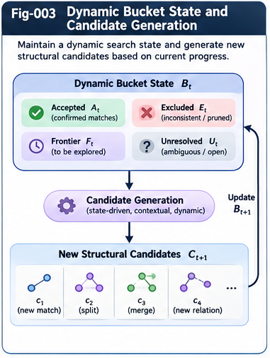

# SPEC-001 — Dynamic Bucket State Contract

**Project:** D-BTP — Dynamic Bucket Tree of Permutation: Directional Structural Generation and Hypothesis Evolution  
**Status:** Proposed research specification · v1.0.0  
**Scope:** State representation, transitions, invariants, provenance, persistence, and conformance  
**License:** Apache-2.0

## Abstract

This specification defines the canonical state contract for a Dynamic Bucket in D-BTP. A Bucket is not merely a list of selected node pairs. It is a versioned, auditable structural-hypothesis state from which new candidates can be generated, evaluated, accepted, rejected, deferred, and revisited under explicit rules. The contract separates hard feasibility from uncertain evidence and directional search preference; defines the semantics of state transitions and terminal classifications; and establishes minimum conformance tests independent of any runtime implementation.

This document is a proposed interoperability contract, not a claim that a reference implementation has passed validation.



*Fig-003. A dynamic bucket carries a hypothesis ledger, structural state, evidence with provenance, directional policy state, and versioned metadata. Candidate generation reads the current state; accept, exclude, and defer decisions produce traceable successor states.*

## 1. Normative Language and Scope

The terms **MUST**, **MUST NOT**, **SHOULD**, **SHOULD NOT**, and **MAY** indicate requirements for implementations claiming conformance to this proposed specification.

The specification governs: (a) Bucket identity and state representation; (b) candidate and hypothesis decisions; (c) transition and constraint-propagation records; (d) evidence and directional metadata; (e) lineage, versioning, and replay; and (f) closure and budget termination.

It does not prescribe a particular graph model, probability calculus, scheduler, machine-learning model, or distributed execution framework. Domain plugins MAY introduce additional typed fields, but MUST preserve the core invariants.

## 2. Conceptual Model

A dynamic Bucket at logical step *t* is represented by

\[
B_t = (I_t, H_t, S_t, E_t, P_t, M_t, V_t),
\]

where:

- **I**: stable identity, parentage, and lineage;
- **H**: hypothesis ledger and candidate dispositions;
- **S**: composed structural state and constraint domains;
- **E**: evidence references, assessments, and provenance;
- **P**: directional fields, search preferences, and policy references;
- **M**: execution metadata, resource accounting, and terminal status;
- **V**: schema, rule, plugin, and state revisions.

The decomposition is logical. Physical storage MAY normalize or distribute these elements if a faithful canonical view is reconstructible.

A transition is a partial function

\[
T(B_t,a_t,r_t) \rightarrow (B_{t+1},\Delta_t)
\]

where *a* is an authorized action, *r* is the rule/plugin context, and *Δ* is a durable transition record. An invalid action MUST yield an explicit rejection or error; it MUST NOT silently corrupt the Bucket.

## 3. Canonical Bucket Envelope

A conforming Bucket MUST expose the following logical fields:

| Field | Type | Required semantics |
|---|---|---|
| `bucket_id` | string | Globally unique or namespace-unique immutable identifier |
| `parent_ids` | array of strings | Direct ancestor Buckets; empty only for roots |
| `root_id` | string | Root lineage identifier |
| `schema_version` | string | Version of this contract or compatible schema |
| `state_revision` | nonnegative integer | Monotonically increasing committed revision |
| `structural_context` | typed object/reference | Source structures, namespaces, relation ontology |
| `hypothesis_ledger` | collection | Canonical candidate/hypothesis decisions |
| `composition_state` | typed object/reference | Accepted structure and derived domains |
| `constraint_state` | typed object | Rule set, evaluations, conflicts, propagation |
| `evidence_state` | typed object | Evidence references, assessments, independence metadata |
| `directional_state` | typed object | Field identifiers, scores, policy and uncertainty |
| `frontier_state` | typed object | Pending generation/evaluation work and cursor |
| `resource_state` | typed object | Budget spent, limits, checkpoints |
| `lifecycle` | enum + rationale | Active, closed, quiescent, budget-terminated, invalidated |
| `provenance` | typed object | Origin, timestamps/logical clocks, actor and tool versions |
| `state_digest` | string | Canonical digest or documented equivalent |

Optional fields MUST be namespace-qualified and MUST NOT override normative semantics. Sensitive domain identifiers SHOULD be stored as references or appropriately protected values rather than copied into every Bucket.

## 4. Identity, Immutability, and Lineage

`bucket_id` MUST be immutable. A committed state revision MUST be immutable in the event history even if an implementation maintains a mutable materialized view. Each child MUST reference its direct parent revision, not merely its parent Bucket ID. Branches generated from a common parent MUST have distinct IDs.

A merge of multiple Buckets is OPTIONAL. If supported, it MUST identify all parents, explain compatibility of accepted/rejected decisions, and record a deterministic or explicitly non-deterministic merge policy. A merge MUST NOT erase conflicting evidence or create an unsupported claim of equivalence.

Lineage graphs MUST be acyclic. Cross-references to hypotheses in other branches are allowed but are not parent edges.

## 5. Hypothesis Ledger Contract

Each ledger entry MUST contain:

```yaml
hypothesis_id: "h-001"
proposal:
  kind: "relation"
  subject_ref: "actor-placeholder-A"
  predicate: "may-control"
  object_ref: "observed-cluster-7"
  cardinality_semantics: "many-to-many-allowed"
disposition: "pending" # pending | accepted | rejected | deferred | superseded
origin:
  generator_id: "candidate-generator-v2"
  parent_revision: 12
  proposal_event_id: "evt-031"
assessments:
  hard_constraint_refs: []
  evidence_refs: []
  directional_score_refs: []
decision:
  event_id: null
  rationale: null
  authority: null
```

A hypothesis identifier MUST be stable within a lineage. Equivalent proposals MAY share a canonical structural key, but their evidence histories MUST remain recoverable. A single hypothesis MUST NOT simultaneously be `accepted` and `rejected` in one committed revision.

`deferred` means not yet decided; it MUST NOT be interpreted as false. `superseded` requires an explicit replacement reference or rationale. Reconsideration of a rejected hypothesis MUST occur through a new revision and an explicit `reopen` event, preserving the earlier decision and its justification.

## 6. Structural Composition Contract

The composition state represents accepted structural commitments, unresolved variables, cardinality constraints, and derived relations. It MUST distinguish:

1. **Asserted commitments** from accepted hypotheses;
2. **Derived consequences** inferred by named, versioned rules;
3. **Unresolved alternatives** not yet committed;
4. **Rejected or prohibited combinations** and their explanations.

Implementations MUST NOT assume one-to-one mapping unless the domain schema explicitly requires it. One actor may explain multiple behaviors, and one observed behavior may admit multiple competing explanations. Cardinality policies MUST be named and versioned.

A composition operation MUST be atomic with respect to its constraint checks: either it commits a valid successor state or records failure without altering the parent revision.

## 7. Constraint State and Soundness

Constraint entries MUST declare `constraint_id`, `version`, `scope`, `severity`, `evaluation_status`, and `explanation_ref`. Severity is one of:

- `hard`: violation renders a candidate infeasible under the current formal model;
- `soft`: affects ranking or utility but is not by itself a proof of infeasibility;
- `conditional`: enforceable only after explicit activation predicates are satisfied.

A conforming implementation MUST NOT prune a branch solely because of a soft score or unverified weak evidence. Hard rejection MUST be supported by a traceable constraint evaluation and the applicable rule version. `unknown` is not `violated`.

Propagation MUST distinguish sound deductions from heuristic suggestions. If a plugin cannot guarantee soundness, its outputs MUST be labeled heuristic and MUST NOT be used as hard-pruning certificates.

## 8. Evidence State Contract

Each evidence record MUST include a stable `evidence_id`, source/provenance reference, observation or claim type, acquisition context, relevant hypothesis IDs, uncertainty or reliability representation, and evaluation version. Where applicable it SHOULD include time validity, dependence group, counterevidence links, and access restrictions.

Evidence MAY be weak, incomplete, directional, contradictory, or noisy. A weak evidence record MAY influence proposal generation, prioritization, and experiment selection; it MUST NOT be silently promoted into a hard constraint. Multiple observations from a shared source MUST NOT be treated as independent without an explicit dependence assessment.

Evidence used in an assessment MUST be reproducibly attributable to a record and an evaluator version. Deletion or redaction of restricted evidence MUST preserve an auditable tombstone or access-controlled provenance reference, subject to applicable policy.

## 9. Directional State Contract

The directional state SHOULD contain a portfolio of fields rather than one universal scalar:

```yaml
fields:
  - field_id: "exploration-value"
    version: "1.2"
    purpose: "candidate_generation_and_priority"
    score_ref: "score-144"
    uncertainty_ref: "uncertainty-144"
  - field_id: "counterevidence-seeking"
    version: "1.0"
    purpose: "falsification_and_diversity"
    score_ref: "score-145"
policy_id: "search-policy-5"
policy_version: "2.0"
allocation_ref: "budget-allocation-20"
```

A field MUST declare whether its output controls generation, ranking, resource allocation, or a combination. Score units and comparison domains MUST be documented. Incomparable scores MUST NOT be silently aggregated. Policy updates MUST be versioned and associated with feedback evidence or a declared experimental change.

Directional preferences MUST remain separate from feasibility judgments. A low-priority hypothesis may still be feasible.

## 10. Candidate Frontier and Generation Contract

The frontier MUST track generation requests or cursors, pending proposals, visited-state policy, and the scope of any exhaustion claim. Candidate generation is modeled as

\[
C_t = G(B_t;\theta_G,R_t),
\]

where generator configuration and rule context are versioned. A generator MAY propose candidates absent from the initial state. It MUST identify the source revision and generation policy that produced each proposal.

Generation is not assumed exhaustive. The frontier MUST distinguish `not_generated`, `generated_pending`, `evaluated`, and `exhausted_under_policy`. A claim of global exhaustion requires a separately justified completeness condition; absence of newly generated candidates is insufficient.

## 11. Lifecycle States

| State | Meaning | Required supporting record |
|---|---|---|
| `active` | Work remains or further generation is authorized | Frontier and budget status |
| `closed` | No further valid successors within a specified, justified search scope | Closure certificate and scope |
| `quiescent` | No currently available action; new evidence or policy may reopen work | Blocking conditions and wake triggers |
| `budget_terminated` | Search halted due to a resource limit | Limit, consumed budget, residual frontier |
| `invalidated` | A prior assumption, rule, or provenance requirement is no longer valid | Invalidation event and affected dependencies |

`closed`, `quiescent`, and `budget_terminated` MUST NOT be conflated. A closed state is only as strong as its declared model and completeness assumptions. Any terminal state MAY be revisited through an explicit new lineage event or revision according to implementation policy; history MUST remain intact.

## 12. Authorized Transition Operations

The minimal operation set is:

| Operation | Preconditions | Commit effects |
|---|---|---|
| `propose` | Valid parent revision and proposal schema | Add pending candidate and origin |
| `accept` | Pending/deferred candidate; hard checks pass | Commit hypothesis and composition consequences |
| `reject` | Pending/deferred candidate; explicit rationale | Record rejection without assuming universal falsity |
| `defer` | Candidate exists | Record wake condition or priority rationale |
| `propagate` | Applicable versioned rules | Commit sound consequences and their derivations |
| `attach_evidence` | Authorized evidence reference | Append evidence link; schedule reassessment if needed |
| `update_direction` | Authorized policy/feedback | New field or policy revision |
| `fork` | Valid parent revision | New child identity and parent revision reference |
| `checkpoint` | Valid state | Persist digest, replay position, resource ledger |
| `terminate` | Valid classification evidence | Set lifecycle and supporting certificate |
| `reopen` | Recorded reason and authorization | New revision/branch; preserve previous decisions |

Every committed transition MUST be atomic, uniquely identified, attributable to a rule/actor, and recorded in the event log. Repeated delivery of the same event ID MUST be idempotent or explicitly rejected as a duplicate.

## 13. Transition Record Schema

```json
{
  "event_id": "evt-032",
  "bucket_id": "bucket-09",
  "from_revision": 12,
  "to_revision": 13,
  "operation": "accept",
  "target_ids": ["h-001"],
  "precondition_digest": "sha256:example-parent-digest",
  "rule_set_id": "constraints-v3",
  "plugin_versions": {"feasibility": "2.1"},
  "decision_basis": {
    "hard_check_refs": ["check-88"],
    "evidence_refs": ["ev-14"],
    "directional_score_refs": ["score-144"]
  },
  "derived_event_refs": ["derive-22"],
  "actor_ref": "agent-constraint-1",
  "logical_clock": 210,
  "result_digest": "sha256:example-child-digest"
}
```

Digest strings above are illustrative placeholders, not real hashes. Production records MUST use a specified canonical encoding and real digest algorithm. Wall-clock timestamps MAY supplement, but MUST NOT replace, ordering and causal references where distributed clocks can disagree.

## 14. Conflict Handling and Concurrency

Concurrent updates MUST use optimistic revision checks, serialized commits, or an equivalent mechanism that prevents lost decisions. A stale transition MUST be rejected or rebased with explicit conflict evaluation. A system MUST NOT resolve conflicting accept/reject operations by last-writer-wins without retaining and evaluating the conflict.

Conflicts may be structural, evidentiary, policy-related, or provenance-related. A conflict record SHOULD identify minimal conflicting assumptions when feasible. Contradictory weak evidence SHOULD be preserved for comparative assessment rather than deleted.

## 15. State Equivalence, Deduplication, and Caching

A state fingerprint MAY support duplicate detection. Two Buckets MUST NOT be merged solely because they share accepted node pairs if their constraints, evidence, unresolved frontier, policy context, or relevant histories differ in ways that can affect future transitions.

A safe equivalence claim requires that the states have equivalent admissible successors and decision semantics under the declared rule and policy scope. Weaker fingerprints MAY be used for heuristic caching but MUST be labeled as such and MUST NOT justify completeness claims.

## 16. Resource Accounting and Termination

`resource_state` MUST record the active budget definition and consumed amounts. Resource dimensions MAY include expansions, candidate evaluations, plugin calls, wall time, memory, and external evidence acquisition cost. Budget resets and reallocations MUST be explicit events.

When a budget is exhausted, the Bucket MUST retain its residual frontier and an appropriate `budget_terminated` classification. It MUST NOT claim structural closure solely because the allocated computation ended.

## 17. Security, Privacy, and Evidence Governance

This contract can support sensitive inference applications, including behavioral attribution. Implementations SHOULD minimize unnecessary personal data, apply purpose-based access control, preserve provenance, and define retention/redaction policies. An inferred structural association MUST NOT be represented as a verified real-world identity without independent corroboration and appropriate authorization.

Plugins and agents MUST operate under declared permissions. Untrusted evidence content MUST be treated as data, not executable policy instructions. A conforming system SHOULD record policy changes and external-data accesses needed for auditability.

## 18. Serialization and Compatibility

Canonical serialization MUST define stable field ordering or an equivalent canonicalization scheme, numeric representation, Unicode handling, and hashing rules. Schema migrations MUST preserve event history or record a verifiable migration mapping.

Unknown optional fields MAY be ignored by older readers if they do not alter required semantics. Unknown required constraint types MUST cause an explicit unsupported-state result rather than silent acceptance. Schema compatibility MUST be declared, not inferred from similar version strings.

## 19. Minimum Conformance Test Suite

A proposed conforming implementation SHOULD publish machine-readable fixtures and test results for at least the following cases:

| ID | Test | Expected outcome |
|---|---|---|
| C01 | Create root Bucket | Required fields valid; revision initialized |
| C02 | Fork two children | Distinct IDs, correct parent revisions |
| C03 | Propose candidate dynamically | Origin, generator version, frontier updated |
| C04 | Accept feasible candidate | Atomic composition and evidence references |
| C05 | Attempt hard-invalid acceptance | Rejected without parent-state mutation |
| C06 | Soft negative score only | No hard rejection or unsound prune |
| C07 | Defer unresolved candidate | Deferred, not interpreted as rejected |
| C08 | Reopen rejected hypothesis | Earlier decision preserved in history |
| C09 | Attach contradictory evidence | Both sides retained with provenance |
| C10 | Re-deliver event ID | Idempotent result or explicit duplicate error |
| C11 | Concurrent stale revision | Conflict detected; no lost update |
| C12 | Budget exhaustion | Residual frontier and budget termination |
| C13 | Quiescent state | Wake trigger and non-closure classification |
| C14 | Closure request without proof | Closure refused or scope qualified |
| C15 | Rule/plugin version change | Revision and dependency impacts recorded |
| C16 | Dedup of superficially similar states | Unsafe merge rejected |
| C17 | Serialize and replay | Canonical state and digests reproducible |
| C18 | Unknown required constraint type | Explicit unsupported-state error |
| C19 | Evidence access restriction | Unauthorized read prevented or redacted |
| C20 | Directional policy update | Versioned and separate from feasibility |

Conformance SHOULD report which tests pass, fail, or are unsupported. Passing this suite is not a proof of search optimality, attribution accuracy, or algorithmic self-improvement.

## 20. Reference Transition Pseudocode

```text
function COMMIT_TRANSITION(bucket, action, context):
    require action.expected_revision == bucket.state_revision
    require authorize(action.actor, action.operation, bucket)
    require validate_schema(action, bucket.schema_version)

    draft = copy_on_write(bucket)
    outcome = apply_operation(draft, action)
    if outcome.invalid:
        return REJECT(outcome.reason)  # parent remains unchanged

    checks = evaluate_hard_constraints(draft, context.rule_versions)
    if checks.has_proven_violation:
        return REJECT(checks.certificates)
    if checks.has_unknown and action.requires_proven_feasibility:
        return DEFER_WITHOUT_COMMIT(checks.unknown_reasons)

    derivations = propagate_sound_rules(draft, context.rule_versions)
    require validate_invariants(draft, derivations)

    draft.state_revision = bucket.state_revision + 1
    event = create_event(bucket, draft, action, checks, derivations)
    atomic_append_and_commit(event, draft)
    return COMMITTED(draft, event)
```

The pseudocode is illustrative. Implementations may choose three-valued or richer constraint logics; they MUST document when acceptance requires proven feasibility versus merely absence of known contradiction.

## 21. Relationship to the D-BTP Research Series

- **D-BTP-001:** motivation for structural hypothesis search beyond static metric matching.
- **D-BTP-002:** dynamic Bucket semantics and candidate generation.
- **D-BTP-003:** constraint-guided structural composition and sound pruning.
- **D-BTP-004:** directional fields for generation and selection.
- **D-BTP-005:** weak evidence, counterevidence, and directional exploration.
- **D-BTP-006:** coupled generation, selection, and feedback.
- **D-BTP-007:** multi-agent RSI and collective structural learning.
- **D-BTP-008:** open-ended structural evolution and its limits.
- **SPEC-002:** candidate generation and constraint plugin contracts.
- **SPEC-003:** directional scoring and search control.
- **SPEC-004:** evidence relay and learning lifecycle.

This document specifies the state substrate. The companion specifications define how external operators interact with it.

## 22. Open Design Decisions

The following remain research and implementation choices rather than settled requirements:

1. What is the smallest canonical state sufficient for sound replay and pruning?
2. Which constraint logics and proof certificates offer a useful performance/soundness tradeoff?
3. When may an `unknown` constraint outcome permit provisional acceptance?
4. How should cross-branch evidence sharing affect state equivalence?
5. What are safe merge conditions for asynchronously evolving multi-agent Buckets?
6. How can provenance be retained while minimizing sensitive data exposure?
7. Which directional-field components must be checkpointed to reproduce search behavior?
8. How should schema migration preserve the meaning of historical decisions?

## 23. Conclusion

A Dynamic Bucket is a versioned, provenance-bearing hypothesis state, not a static collection of pairwise matches. Its contract must support evolving candidates, explicit decisions, sound constraint propagation, uncertain evidence, directional control, competing branches, and auditable feedback. This specification provides a proposed foundation for interoperable D-BTP components and conformance-first experimentation, without assuming that any particular search policy is complete, optimal, or empirically validated.

---

**Suggested repository path:** `docs/specifications/SPEC-001-Dynamic-Bucket-State-Contract.md`  
**Research status:** Proposed specification; validation and implementation remain future work.
