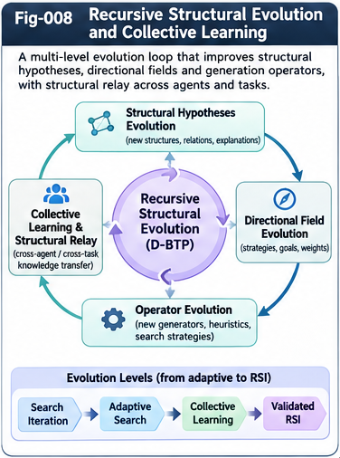

# SPEC-004 — Evidence Relay and Learning Lifecycle

**Project:** D-BTP — Dynamic Bucket Tree of Permutation: Directional Structural Generation and Hypothesis Evolution  
**Status:** Proposed research specification · v1.0.0  
**Scope:** Evidence objects, provenance, hypothesis relay, feedback, collective learning, and controlled policy evolution  
**License:** Apache-2.0

## Abstract

D-BTP couples dynamic structural-hypothesis generation with constraint validation, directional scoring, and feedback. In a multi-agent environment, this coupling requires more than passing a candidate or a numerical score between agents. The receiving system must know what was observed, what was inferred, which assumptions were used, how evidence was obtained, whether its sources are independent, what remains unresolved, and whether an apparent improvement was independently validated.

This specification proposes an **Evidence Relay and Learning Lifecycle** contract. It defines evidence and counterevidence records; provenance and dependency graphs; a portable Structural Hypothesis Unit (SHU); relay acceptance and quarantine; feedback events; reusable learning artifacts; controlled promotion and rollback; and conformance tests. It preserves three separations throughout: **observation versus inference**, **hard feasibility versus directional preference**, and **search progress versus validated self-improvement**.

This is a research-stage interoperability specification. The schemas and algorithms below are proposed contracts, not claims of a deployed implementation, proven completeness, or empirical performance.

---



*Fig-008. Multi-agent structural relay and recursive evolution. Competing search agents exchange versioned hypotheses, evidence, and candidate improvements. Independent validation and governance distinguish ordinary adaptation from accepted reusable improvements and from stronger claims of recursive self-improvement.*

---

## 1. Purpose, Applicability, and Normative Language

### 1.1 Purpose

SPEC-004 defines how evidence and learned structural knowledge travel across Bucket states, agents, experiments, and potentially different problem domains without losing their interpretation or audit trail. It complements:

- **SPEC-001 — Dynamic Bucket State Contract:** canonical Bucket state, hypothesis ledger, transitions, and lineage.
- **SPEC-002 — Candidate Generation and Constraint Plugins:** candidate generation, plugin decisions, and sound constraint handling.
- **SPEC-003 — Directional Scoring and Search Control:** directional objectives, frontier scheduling, resource allocation, and policy updates.

This specification governs information **entering**, **moving through**, **leaving**, and **returning to** the D-BTP search-and-learning system.

### 1.2 Normative terms

**MUST**, **MUST NOT**, **SHOULD**, **SHOULD NOT**, and **MAY** indicate requirements for implementations claiming conformance to this *proposed* specification. They do not imply an external standards body's approval.

### 1.3 Explicit non-goals

This document does not mandate a universal Bayesian evidence model, a universal ontology, a particular cryptographic signature algorithm, or an automatic right to transfer data across organizations. It does not define real-world identity proof from blockchain behavior, guarantee that an adaptive agent improves, or equate multi-agent activity with recursive self-improvement (RSI).

---

## 2. Design Principles

1. **Provenance before persuasion.** A score without a recoverable basis is insufficient for evidentiary relay.
2. **Evidence is not a verdict.** Observations, interpretations, hypotheses, and conclusions MUST remain distinguishable.
3. **Counterevidence is first-class.** A relay MUST be able to transport disconfirming and unresolved evidence.
4. **No silent double counting.** Correlated or derived evidence MUST declare dependencies when known.
5. **No authority by relay.** Receiving an assertion from another agent does not validate it.
6. **Weak evidence may guide search, not silently create hard infeasibility.**
7. **Learning requires evaluation.** Search-state updates and heuristic adaptation are not automatically validated RSI.
8. **Local governance persists.** The receiver's privacy, resource, and policy boundaries control whether an artifact may be used.
9. **Explicit leftovers.** Rejected, deferred, incomplete, or unverified items remain traceable for future work.
10. **Portable semantics, not forced agreement.** Agents MAY disagree while exchanging the same canonical records.

---

## 3. Architectural Overview

The proposed lifecycle has six logical planes:

| Plane | Main responsibility | Primary output |
| --- | --- | --- |
| Acquisition | Obtain observations, measurements, claims, and metadata | EvidenceRecord |
| Interpretation | Associate evidence with structural hypotheses and alternative explanations | EvidenceAssessment |
| Hypothesis relay | Package transferable hypotheses and their support/contradiction | StructuralHypothesisUnit |
| Evaluation | Verify compatibility, constraints, provenance, and independent tests | RelayReceipt / ValidationRecord |
| Learning | Distill reusable patterns and proposed changes | LearningArtifact |
| Governance | Authorize promotion, rollback, expiry, and cross-boundary use | PromotionDecision |

A typical path is:

```text
Observation / Claim
       |
       v
EvidenceRecord -- dependency/provenance graph
       |
       v
EvidenceAssessment <----> Counterevidence / Alternative Hypotheses
       |
       v
StructuralHypothesisUnit (SHU)
       |
       v
Relay validation --> accept | quarantine | reject | request-more-data
       |
       v
Bucket integration / hypothesis portfolio
       |
       v
Feedback --> LearningArtifact --> independent evaluation
                                     |
                                     v
                            promote | defer | rollback
```

This is a logical architecture; implementations MAY combine services, but MUST preserve the distinctions in their persisted records.

---

## 4. Canonical Identifiers, Versions, and References

Every canonical object MUST include:

- `object_id`: globally distinguishable within the declared namespace.
- `schema_name` and `schema_version`.
- `created_at`: timestamp or logical time, with clock semantics declared.
- `producer_id`: agent or service identity, which may be pseudonymous.
- `project_or_tenant_scope`: permitted interpretation and data scope.
- `content_digest`: digest of canonicalized semantic content, with algorithm identifier.
- `provenance_ref`: reference to a source or derivation record.

Versioned references SHOULD use `(object_id, revision, content_digest)` rather than mutable object IDs alone. A receiver MUST NOT treat equal IDs with different digests as identical evidence. A content digest provides integrity checking, not proof that the underlying assertion is true. Authenticity, when required, needs an independently verified signature or equivalent trust mechanism.

Canonical serialization, timestamp precision, identifier collision handling, and cryptographic algorithms MUST be declared by the deployment profile. Implementations MUST NOT claim byte-for-byte replay if nondeterministic model outputs, external data snapshots, or random seeds are unavailable.

---

## 5. EvidenceRecord Contract

### 5.1 Core fields

An `EvidenceRecord` MUST represent the following semantic fields:

| Field | Required | Semantics |
| --- | --- | --- |
| `evidence_id` | Yes | Stable record identifier |
| `kind` | Yes | `observation`, `measurement`, `source_claim`, `derived_feature`, or `simulation_result` |
| `subject_refs` | Yes | Entities, nodes, relations, or hypotheses to which the record may apply |
| `payload_ref` | Yes | Immutable or versioned evidence payload, possibly redacted |
| `assertion` | Yes | Machine-readable proposition or structured observation |
| `source_ref` | Yes | Origin, collection method, and authority context |
| `observed_at` | Conditional | Observation time or explicit `unknown` |
| `recorded_at` | Yes | Time ingested by the system |
| `quality` | Yes | Quality dimensions and uncertainty representation |
| `dependencies` | Yes | Known upstream evidence and derivation relationships, possibly empty |
| `scope` | Yes | Domain, validity period, permissions, and usage limitations |
| `status` | Yes | Lifecycle status, never implicit |

A record MUST declare whether its assertion is a **direct observation**, a **third-party claim**, or a **derived inference**. It MUST NOT silently relabel a derived inference as a direct observation during relay.

### 5.2 Quality is multidimensional

Recommended dimensions include source reliability, measurement error, relevance to the tested hypothesis, temporal validity, completeness, adversarial susceptibility, and calibration status. A single confidence number MAY be used for ranking, but MUST NOT erase the underlying dimensions or be interpreted as a probability unless its calibration and semantics are declared.

### 5.3 Example (illustrative, not normative wire format)

```json
{
  "schema_name": "dbtp.evidence",
  "schema_version": "1.0.0-proposed",
  "evidence_id": "ev:case-17:042",
  "kind": "derived_feature",
  "subject_refs": ["hyp:case-17:H3"],
  "assertion": {"feature": "temporal_cooccurrence", "value": true},
  "payload_ref": "artifact:features:v4:042",
  "source_ref": "pipeline:temporal-extractor:v4",
  "observed_at": "unknown",
  "recorded_at": "2026-11-03T00:00:00Z",
  "quality": {"relevance": "uncertain", "calibration": "not_established"},
  "dependencies": ["ev:case-17:010", "ev:case-17:011"],
  "scope": {"domain": "synthetic_attribution", "sharing": "restricted"},
  "status": "active",
  "object_id": "ev:case-17:042",
  "created_at": "2026-11-03T00:00:00Z",
  "producer_id": "agent:feature-2",
  "project_or_tenant_scope": "synthetic-lab",
  "content_digest": "sha256:<computed-by-implementation>",
  "provenance_ref": "prov:case-17:042"
}
```

The digest placeholder MUST be replaced by an actual computed value in conformant data. This example deliberately makes no claim of a calibrated likelihood.

---

## 6. Provenance and Dependency Graph

Let the evidence dependency graph be

\[
\mathcal{G}_E=(V_E, E_{\mathrm{derived}}, E_{\mathrm{shared}}, E_{\mathrm{contradicts}}).
\]

Edges have different meanings:

- **Derived-from:** one artifact was computed using another.
- **Shared-source:** observations may depend on a common underlying source.
- **Corroborates:** a claim supports another claim under stated assumptions.
- **Contradicts:** two assertions cannot both hold under a stated interpretation.
- **Supersedes:** a corrected version replaces an earlier version without erasing history.

Derived-from edges SHOULD form an acyclic history for a fixed version snapshot. Cross-version feedback cycles MUST be represented through time/version-separated nodes. A receiving agent MUST check known dependencies before aggregating evidence. Missing dependencies MUST be recorded as unknown rather than interpreted as independence.

### 6.1 Double-counting example

Suppose two agents report a similar temporal pattern. If both reports were produced from the same transaction extract, they are not independent corroboration merely because they have different producer IDs. The receiver SHOULD use dependency-aware aggregation or conservatively reduce their combined weight.

### 6.2 Evidence aggregation contract

An aggregation plugin MUST declare:

1. its independence assumptions;
2. its uncertainty interpretation;
3. how contradictory evidence is handled;
4. whether and how shared sources are discounted;
5. its calibration evidence, if any;
6. a reproducible version identifier.

Absent a defensible aggregation model, the system SHOULD preserve a vector of evidence assessments rather than manufacture a single probability.

---

## 7. Evidence Assessment and Counterevidence

An `EvidenceAssessment` links evidence to a hypothesis and an interpretation context:

```text
Assessment = (
  hypothesis_ref, evidence_refs, stance,
  interpretation, assumptions, strength,
  uncertainty, assessor, method_version,
  alternative_explanations, validation_status
)
```

`stance` MUST support at least `supports`, `contradicts`, `ambiguous`, and `irrelevant`. `strength` MAY be qualitative or numeric, but its scale MUST be declared. An assessment is not a hard-constraint verdict unless the associated constraint plugin explicitly proves a domain-defined hard condition.

### 7.1 Counterevidence acquisition

A hypothesis relay SHOULD carry a counterevidence search record describing what contradictory evidence was sought, what was found, and what was not tested. Absence of observed counterevidence MUST NOT be equated with proof of absence. A `not_searched` state MUST remain distinguishable from `searched_none_found`.

### 7.2 Alternative explanations

For consequential hypotheses, an assessment SHOULD identify at least one plausible competing explanation or state why no alternative is currently formulated. This is especially important where many hypotheses fit the same sparse observations.

---

## 8. Evidence Lifecycle State Machine

Proposed states:

```text
captured -> normalized -> assessed -> active -> superseded -> archived
                         |          |
                         v          v
                     quarantined  disputed
                         |          |
                         +--> reviewed --> active | rejected | archived
```

The lifecycle is not strictly linear. New observations can dispute an active record; a corrected record can supersede it; a previously quarantined record can be admitted after review.

| Transition | Minimum condition | Required event |
| --- | --- | --- |
| Capture → Normalize | Valid source/payload reference | `EvidenceNormalized` |
| Normalize → Assess | Interpretation context available | `EvidenceAssessed` |
| Assess → Active | Admission policy satisfied | `EvidenceAdmitted` |
| Any → Quarantine | Integrity, permission, or provenance concern | `EvidenceQuarantined` |
| Active → Disputed | Material contradiction or challenge | `EvidenceDisputed` |
| Active → Superseded | Linked corrected revision | `EvidenceSuperseded` |
| Any → Archived | Retention/expiry policy applied | `EvidenceArchived` |

An implementation MUST preserve prior state and transition reason in an append-only audit history or a functionally equivalent tamper-evident record. Archiving or deletion under privacy requirements MAY remove payload bytes; the system MUST then mark dependent conclusions as non-replayable or restricted rather than pretending the evidence remains available.

---

## 9. Structural Hypothesis Unit (SHU) Contract

A **Structural Hypothesis Unit** is a portable package of a hypothesis and the information required to evaluate or continue it. It is not merely a text summary or score.

### 9.1 Mandatory semantic fields

```text
SHU = (
  identity, schema_version, hypothesis_expression,
  structural_context, decision_history,
  supporting_evidence, counterevidence,
  unresolved_questions, constraint_assessments,
  directional_assessments, provenance,
  source_snapshot, policy_scope, validation_status,
  lineage, expiration_or_review_policy
)
```

An SHU MUST distinguish:

- **Structural assertion:** what is proposed about nodes, edges, assignments, or relationships.
- **Assumption set:** conditions under which the assertion is meaningful.
- **Feasibility state:** `valid`, `invalid`, `unknown`, or domain-defined finer states, with validator reference.
- **Directional value:** search preference, not truth.
- **Evidence state:** supporting, contradictory, disputed, or missing.
- **Completion state:** partial, quiescent, closed, or budget-terminated per SPEC-001.

### 9.2 SHU lineage

A relay-created SHU MUST retain a reference to the parent SHU and its transformation record. A merged SHU MUST retain all parent references and explain conflict resolution. Identical hypotheses from different agents MAY be deduplicated for storage, but their distinct evidence histories MUST NOT be discarded.

### 9.3 Portability boundary

The receiver MUST know whether the SHU is:

1. **self-contained** (all permitted dependencies included);
2. **reference-complete** (external dependencies resolvable);
3. **partial** (some dependencies unavailable); or
4. **redacted** (dependencies deliberately withheld).

Only the first two MAY be treated as fully replayable, subject to compatible execution and snapshot conditions.

---

## 10. Relay Envelope and Transport Semantics

A `RelayEnvelope` MUST carry:

| Field | Meaning |
| --- | --- |
| `relay_id` | Idempotency and traceability identifier |
| `sender_id`, `receiver_scope` | Source and authorized destination |
| `artifact_refs` | SHU, evidence, assessment, or learning artifact references |
| `schema_versions` | Versions used for interpretation |
| `dependency_manifest` | Required upstream objects and availability |
| `capability_requirements` | Required plugins, ontologies, and validation profiles |
| `usage_policy` | Retention, privacy, sharing, and permitted uses |
| `integrity_proofs` | Digests and optional authenticated signatures |
| `sent_at`, `expires_at` | Temporal metadata |
| `purpose` | Exploration, corroboration, challenge, or learning proposal |

Transport MAY be message-based, file-based, or database-mediated. Delivery MUST be idempotent with respect to `relay_id` and artifact revision; retry MUST NOT create additional independent evidence. Exactly-once delivery is not assumed. A relay acknowledgement confirms receipt, not correctness.

---

## 11. Relay Admission and Compatibility

Receiving an SHU is a request to consider an artifact, not an instruction to believe it or execute its plugins.

### 11.1 Admission pipeline

1. **Authenticate** the sender where required and verify integrity.
2. **Authorize** destination, purpose, and permitted data use.
3. **Validate schema** and mandatory fields.
4. **Resolve dependencies** or mark missing references.
5. **Check semantic compatibility:** ontology, units, time, domain, plugin versions, and constraint definitions.
6. **Assess conflicts** with local hard constraints and existing evidence.
7. **Re-evaluate** relevant directional scores under local policy; do not inherit foreign scores as authoritative.
8. **Record disposition** and reasons.

Permitted dispositions: `accepted`, `accepted_with_restrictions`, `quarantined`, `rejected`, `needs_more_information`.

### 11.2 Unknown versus invalid

An unknown constraint result MUST NOT be silently converted to invalid. Conversely, a foreign assertion of validity MUST NOT override a local hard-constraint failure. Conflicts SHOULD be recorded with minimal witness information and relevant validator versions.

### 11.3 RelayReceipt

```text
RelayReceipt = (
  relay_id, receiver_id, received_at,
  integrity_status, compatibility_status,
  admission_status, accepted_artifact_refs,
  missing_dependencies, conflict_refs,
  restrictions, reason_codes, reviewer_or_policy_version
)
```

The receiver MUST emit or persist a receipt for each processed envelope, including rejection and quarantine.

---

## 12. Multi-Agent Roles and Trust Boundaries

A deployment MAY include generator, validator, evidence analyst, counterevidence seeker, portfolio manager, evaluator, and learning-policy agent roles. Roles are logical capabilities, not necessarily separate models.

A useful separation is:

| Role | May propose | Must not unilaterally establish |
| --- | --- | --- |
| Candidate generator | New structural candidates | Hard feasibility or truth |
| Constraint validator | Feasibility verdict with witness | Evidence probability without method |
| Evidence analyst | Support/contradiction assessment | Unreviewed hard rejection |
| Directional controller | Search priorities and budgets | Historical facts |
| Counterevidence agent | Challenges and alternatives | Automatic deletion of disfavored hypotheses |
| Learning agent | New heuristics/plugins/fields | Production promotion without evaluation |
| Governance/evaluator | Promotion or rollback decisions | Unrecorded changes to evidence history |

An agent MAY hold multiple roles, but a system claiming independent validation MUST ensure that the evaluator is sufficiently independent of the proposed change (e.g., separate held-out data and locked evaluation criteria). Multiple prompts to the same model are not automatically independent evidence sources.

---

## 13. Feedback Event Contract

Feedback captures what happened during exploration and what can legitimately be learned from it.

### 13.1 Feedback categories

- **Structural:** candidate accepted, rejected, conflicted, or remained unresolved.
- **Evidentiary:** support, contradiction, source correction, or missing dependency discovered.
- **Search:** computational cost, branch coverage, diversity, time-to-first-valid hypothesis.
- **Predictive:** held-out performance, calibration, generalization, or out-of-domain failure.
- **Operational:** latency, reliability, resource consumption, and privacy-policy violations.
- **Governance:** promotion, restriction, suspension, or rollback.

### 13.2 FeedbackRecord

```text
FeedbackRecord = (
  feedback_id, triggering_event_ref, target_artifact_ref,
  task_context, outcome_type, observed_outcome,
  evaluation_protocol, metric_definition,
  baseline_ref, evidence_refs, uncertainty,
  leakage_checks, producer_id, timestamp,
  policy_version, validity_scope
)
```

A feedback record MUST distinguish **observed outcome** from **inferred lesson**. It MUST disclose when the ground truth is synthetic, simulated, expert-judged, or unavailable. Feedback derived from the same search trajectory SHOULD NOT be presented as independent external validation.

---

## 14. LearningArtifact Contract

A `LearningArtifact` packages a reusable proposed change to D-BTP's behavior:

| Artifact type | Examples |
| --- | --- |
| `generator_update` | New candidate-generation template or retrieval rule |
| `constraint_plugin_update` | New or corrected validator, with proof/coverage limits |
| `directional_field_update` | Weight, objective, or exploration-policy revision |
| `evidence_model_update` | Source reliability or correlation model |
| `structural_pattern` | Reusable subgraph, relation, or composition schema |
| `control_policy_update` | Budget, frontier, portfolio, or stop-condition change |
| `question_unit` | Unresolved structural question with proposed tests |

Every LearningArtifact MUST contain a proposed change, its motivating feedback, applicability conditions, expected benefit, known risks, evaluation plan, version dependencies, and rollback reference. It SHOULD include a falsifiable failure criterion.

### 14.1 No direct production mutation

A proposed learning artifact MUST NOT silently mutate production policy. Its status starts as `proposed` and proceeds through explicit evaluation and authorization. This prevents a local search success from becoming an untested global rule.

---

## 15. Learning Lifecycle and Promotion Gates

```text
proposed
   |
   v
sandboxed -> evaluated -> approved -> deployed -> monitored
   |            |           |            |          |
   v            v           v            v          v
rejected     revise       deferred     rollback <- regression
```

A conformant implementation MUST distinguish at least:

- `proposed`: change exists but is not validated;
- `sandboxed`: isolated evaluation permitted;
- `evaluated`: test results and limitations recorded;
- `approved`: authorized for a declared scope;
- `deployed`: active under version control;
- `monitored`: performance and regressions tracked;
- `rolled_back`: superseded by a recorded prior policy;
- `rejected` or `deferred`: explicit leftover retained.

### 15.1 PromotionDecision

A promotion decision MUST specify:

1. candidate artifact and immutable version;
2. baseline and comparison protocol;
3. predeclared metrics and acceptance thresholds;
4. dataset/task separation and leakage controls;
5. performance by relevant subpopulation or task family;
6. computational and operational costs;
7. adverse results and counterexamples;
8. permitted deployment scope;
9. monitoring trigger and rollback plan;
10. accountable policy or reviewer identity.

A policy that improves one benchmark but worsens critical hard-constraint safety MUST NOT be promoted merely on aggregate score.

---

## 16. Distinguishing Search Adaptation, Collective Learning, and RSI

These are separate claims:

**Level A — Search-state evolution:** Bucket states and candidate frontiers change while the algorithm is fixed.

**Level B — Adaptive search:** direction weights or priorities change within a fixed, preauthorized update rule.

**Level C — Collective learning:** evidence, patterns, and feedback from multiple tasks or agents are retained and reused with measurable benefit.

**Level D — Validated recursive self-improvement:** the system proposes changes to its own generators, validators, representation, or learning/control policies, evaluates them against independent baselines, and can iteratively improve the improvement process itself.

A system MUST NOT label ordinary Bucket branching as RSI. Claims of Level C or D SHOULD report transfer performance and failure cases, not only in-sample search speed.

### 16.1 Improvement metrics

A practical improvement vector is

\[
\Delta \mathbf{J} = (\Delta Q,\,-\Delta C,\,\Delta D,\,\Delta R,\,-\Delta V),
\]

where `Q` is task-quality, `C` is resource cost, `D` is hypothesis diversity or coverage, `R` is robustness/generalization, and `V` is safety/constraint violations. This vector is intentionally not collapsed into a universal scalar. Each metric MUST have a declared measurement protocol; directional preferences MAY choose tradeoffs but MUST NOT mask violations of mandatory constraints.

---

## 17. Collective Learning and Structural Relay

Collective learning is not the accumulation of unfiltered agent opinions. It is the controlled conversion of **traceable experiences** into **reusable structural capabilities**.

A suggested relay loop:

1. Agent A explores a Bucket and emits SHUs and feedback.
2. Agent B checks source dependencies, challenges assumptions, and attempts independent validation.
3. Agent C distills transferable structural patterns or a proposed generator change.
4. An evaluator compares the proposal with a frozen baseline on held-out cases.
5. A controller promotes, restricts, or rejects the proposal, retaining negative results.
6. Later tasks consume the versioned artifact and generate new feedback.

The loop MAY be repeated. Repetition of execution is itself a source of useful relay data when each run records its context and outcome. Repeated executions MUST NOT be counted as independent corroboration when they share the same source data or deterministic derivation.

### 17.1 Cross-domain transfer

Transfer requires an explicit mapping between source and target representations. A transfer record SHOULD identify preserved invariants, changed assumptions, new failure modes, and target-domain validation. Similar vocabulary is insufficient evidence of semantic equivalence.

---

## 18. Formal Lifecycle Semantics

Let the learning state at iteration `t` be

\[
\mathcal{L}_t=(\mathcal{E}_t,\mathcal{H}_t,\mathcal{A}_t,\Pi_t,\mathcal{V}_t),
\]

where `E` is the evidence graph, `H` the hypothesis portfolio, `A` the reusable artifact registry, `Π` the active policy/version set, and `V` the validation and governance history.

A relay event `r_t` produces an *admission decision*, not immediate belief:

\[
(\mathcal{L}_t,r_t)\xrightarrow{\operatorname{admit}}(\mathcal{L}'_t,d_t),
\quad d_t\in\{\mathrm{accept},\mathrm{restrict},\mathrm{quarantine},\mathrm{reject},\mathrm{request}\}.
\]

An authorized learning update has two distinct steps:

\[
 a_{t+1}^{\mathrm{proposal}}=\operatorname{distill}(\mathcal{E}_t,\mathcal{H}_t,\mathcal{V}_t),
\]

\[
 \Pi_{t+1}=\begin{cases}
 \operatorname{promote}(\Pi_t,a_{t+1}),&\text{if evaluation and governance gates pass},\\
 \Pi_t,&\text{otherwise}.
 \end{cases}
\]

This formulation deliberately leaves the distillation and evaluation algorithms open to domain-specific implementations. The governance condition is an operational requirement, not a proof that any proposed update improves performance.

---

## 19. Reference Interfaces (Language-Neutral)

```text
record_evidence(EvidenceRecord) -> EvidenceReceipt
assess_evidence(EvidenceRef[], HypothesisRef, Context) -> EvidenceAssessment
challenge_hypothesis(SHURef, ChallengePolicy) -> ChallengeReport
package_shu(HypothesisRef, SnapshotRef, RelayPolicy) -> SHU
send_relay(RelayEnvelope) -> DeliveryReceipt
admit_relay(RelayEnvelope, LocalPolicy) -> RelayReceipt
integrate_shu(SHURef, BucketRef, SnapshotRef) -> IntegrationResult
record_feedback(FeedbackRecord) -> FeedbackReceipt
propose_learning(FeedbackRef[], PolicyRef) -> LearningArtifact
run_evaluation(LearningArtifactRef, ProtocolRef) -> ValidationRecord
request_promotion(LearningArtifactRef, ValidationRef) -> PromotionDecision
rollback_policy(DeploymentRef, AuthorizedReason) -> RollbackReceipt
```

Every mutating operation MUST be idempotent or expose a transaction key and retry semantics. Implementations SHOULD expose explicit errors for missing dependencies, schema incompatibility, expired authorization, conflicting versions, and failed hard constraints. No interface may treat a score-only response as a substitute for a required constraint witness.

---

## 20. Reference Relay-and-Learning Loop (Illustrative)

```python
def process_relay(envelope, local_state, governance):
    integrity = verify_integrity_and_permissions(envelope, governance)
    if not integrity.ok:
        return record_receipt(envelope, "rejected", integrity.reasons)

    compatibility = validate_schema_and_dependencies(envelope, local_state)
    if compatibility.unresolved_or_unsafe:
        return record_receipt(envelope, "quarantined", compatibility.reasons)

    shu = load_structural_hypothesis_unit(envelope)
    assessment = independently_assess(shu, local_state)

    if assessment.proven_hard_conflict:
        return record_receipt(envelope, "rejected", assessment.witnesses)

    integrated = integrate_as_hypothesis_not_fact(shu, local_state)
    record_counterevidence_and_unknowns(integrated, assessment)
    receipt = record_receipt(envelope, "accepted", integrated.references)
    return receipt


def consider_learning(feedback_refs, policy_snapshot, evaluation_protocol):
    proposal = distill_learning_artifact(feedback_refs, policy_snapshot)
    sandbox_result = evaluate_in_sandbox(proposal, evaluation_protocol)
    record_validation(proposal, sandbox_result)

    if not independent_gates_pass(sandbox_result, evaluation_protocol):
        retain_as_explicit_leftover(proposal)
        return "deferred"

    decision = request_governance_approval(proposal, sandbox_result)
    if decision.authorized:
        deploy_versioned_with_rollback(proposal, decision.scope)
        return "deployed_under_monitoring"
    return "not_promoted"
```

The code is conceptual. The actual runtime MUST define concurrency, persistence, failure recovery, authorization, and atomicity semantics. `independently_assess` MUST not be assumed independent solely because it is called by a different software component.

---

## 21. Conformance Invariants

**R1 — Identity and integrity.** A relayed object MUST have verifiable identity and declared version semantics.

**R2 — Provenance preservation.** A transformation MUST retain upstream references or explicitly mark unavailable lineage.

**R3 — Observation/inference separation.** A derived assertion MUST NOT be relabeled as a direct observation without a new justified source.

**R4 — Evidence/constraint separation.** Directional preference MUST NOT become a hard-constraint failure without a valid hard-constraint rule and witness.

**R5 — Dependency awareness.** Known shared sources MUST be exposed to aggregation and learning processes.

**R6 — Counterevidence preservation.** Material contradictions MUST NOT be silently dropped during SHU packaging or merging.

**R7 — Relay non-authority.** External acceptance or high score MUST NOT automatically authorize local acceptance.

**R8 — Explicit unknowns.** Missing evidence, unavailable plugins, and untested alternatives MUST remain explicitly unresolved.

**R9 — No hidden policy mutation.** Production policy changes MUST require recorded evaluation and authorization.

**R10 — Rollbackability.** Promoted learning changes MUST have a defined rollback or safe-disable path.

**R11 — Privacy and scope.** Relayed artifacts MUST respect declared access, retention, and purpose limitations.

**R12 — Replay honesty.** Reproducibility claims MUST be limited to actually recoverable inputs, versions, and randomness.

**R13 — Non-independent duplication.** Retry, replication, or rephrasing MUST NOT count as independent evidence.

**R14 — Explicit leftovers.** Deferred, rejected, and quarantined artifacts MUST have traceable dispositions, subject to retention law and policy.

**R15 — Measured improvement.** An implementation MUST NOT assert validated RSI based solely on local search iteration.

---

## 22. Conformance Profiles

### Profile A — Evidence Core

Implements EvidenceRecord, EvidenceAssessment, provenance/dependency tracking, lifecycle transitions, and R1–R6, R8, R12–R13.

### Profile B — Structural Relay

Includes Profile A plus SHU, RelayEnvelope, compatibility checks, RelayReceipt, and R7, R11, R14.

### Profile C — Collective Learning

Includes Profile B plus FeedbackRecord, LearningArtifact, reusable artifact registry, and baseline evaluation records.

### Profile D — Controlled RSI Lifecycle

Includes Profile C plus explicit promotion gates, policy-version management, monitoring, rollback, and R9–R10, R15.

A deployment MUST name the profile(s) it claims and MUST NOT claim a higher profile solely because it exposes similarly named APIs. A profile claim requires passing its applicable tests with documented exceptions.

---

## 23. Conformance Test Matrix

| ID | Test | Expected result |
| --- | --- | --- |
| E-01 | Evidence object missing source | Reject or quarantine |
| E-02 | Derived evidence marked as observation | Reject or require correction |
| E-03 | Same ID with conflicting digest | Detect version/integrity conflict |
| E-04 | Uncalibrated confidence presented as probability | Flag semantic violation |
| E-05 | Two reports share upstream dataset | Do not count as independent |
| E-06 | Unknown dependency graph | Preserve uncertainty |
| E-07 | Evidence contradicts existing claim | Record dispute and both references |
| E-08 | No counterevidence search performed | Preserve `not_searched` |
| E-09 | Corrected source supersedes earlier record | Preserve lineage and status |
| E-10 | Archived payload no longer replayable | Mark replay limitation |
| R-01 | SHU lacks hypothesis assumptions | Reject as incomplete |
| R-02 | SHU lacks supporting payload but declares redaction | Accept restricted or quarantine |
| R-03 | SHU claims closed state without closure evidence | Reject closure claim |
| R-04 | Foreign directional score conflicts with local policy | Re-score locally |
| R-05 | Foreign hard-valid claim conflicts with local hard rule | Preserve local conflict witness |
| R-06 | Repeated relay delivery | Idempotent receipt, no duplicate evidence |
| R-07 | Unsupported schema version | Quarantine or explicit incompatibility |
| R-08 | Missing required plugin | Mark unresolved, not false |
| R-09 | Relay violates data-use policy | Reject or restrict |
| R-10 | SHU merge has contradictory assumptions | Record conflict; no silent merge |
| R-11 | Different agents report same evidence source | Preserve common dependency |
| R-12 | Relay request asks to execute untrusted plugin | Require authorization and sandbox |
| L-01 | Feedback lacks baseline or ground-truth status | Mark insufficient for improvement claim |
| L-02 | In-sample gain but held-out regression | Block promotion under declared gate |
| L-03 | Generator update proposed | Keep proposed until evaluated |
| L-04 | Directional update changes hard feasibility | Reject unauthorized change |
| L-05 | New policy increases constraint violations | Block or rollback |
| L-06 | Evaluation leakage detected | Invalidate affected evaluation |
| L-07 | Approved policy lacks rollback reference | Block deployment |
| L-08 | Policy update replay with same transaction key | No duplicate deployment |
| L-09 | Agent disagreement over evidence strength | Preserve competing assessments |
| L-10 | Cross-domain pattern lacks mapping assumptions | Restrict to exploratory status |
| L-11 | Deferred proposal receives new evidence | Reopen with new revision and history |
| L-12 | System labels branching as RSI | Fail claim-level conformance |

**Pass criterion:** every applicable test must produce the specified behavior, an auditable result, and no silent violation of R1–R15. These are proposed test cases; no execution results are asserted here.

---

## 24. Validation Hypotheses and Experiments

The following are **testable hypotheses**, not findings.

**H1 — Provenance-aware relay reduces erroneous corroboration.** Compare dependency-aware aggregation against naïve independent-vote aggregation on synthetic evidence graphs with controlled shared sources.

**H2 — Counterevidence-first relay improves calibration.** Compare hypothesis confidence and false-positive rates with and without mandatory counterevidence reports, controlling for compute budget.

**H3 — SHU portability improves reuse.** Measure transfer success, integration time, and semantic error rate across independently implemented agents versus ad hoc text summaries.

**H4 — Quarantine and compatibility checks reduce unsafe propagation.** Inject stale schemas, missing plugins, conflicting assumptions, and malicious payload references; measure containment and false rejection.

**H5 — Explicit negative-result retention improves later search.** Compare future duplicate exploration, search cost, and hypothesis diversity with and without retained rejected/deferred artifacts.

**H6 — Controlled learning outperforms unchecked adaptation under distribution shift.** Compare fixed baseline, ungoverned online adaptation, and gated promotion on held-out and shifted task families.

**H7 — Multi-agent relay improves solution diversity at matched cost.** Compare independent agents, shared-score-only agents, and full SHU relay while controlling total inference and validation budgets.

**H8 — Validated generator evolution yields transfer beyond tuning alone.** Compare fixed generator, adaptive directional weights, and versioned generator updates on novel structure families.

### 24.1 Recommended measurements

- Hard-constraint violation rate and missed-conflict rate.
- False attribution / false positive rate where ground truth exists.
- Evidence-source duplication rate and dependency detection recall.
- Calibration error for genuinely probabilistic models.
- Number and diversity of feasible hypotheses retained.
- Time and compute to first validated hypothesis.
- Cross-agent semantic compatibility and replay success.
- Out-of-domain performance and regression rate.
- Learning promotion success rate, rollback frequency, and operational overhead.

All experiments SHOULD publish task definitions, data provenance, seeds, cost budgets, baselines, confidence intervals where appropriate, and negative outcomes. A search-quality improvement MUST NOT be reported as proof of real-world identity or general intelligence.

---

## 25. Failure Modes, Threat Model, and Safeguards

### 25.1 Epistemic failure modes

- **Evidence laundering:** repeated relay makes a weak assertion appear authoritative. *Safeguard:* source-level dependency tracking and local re-evaluation.
- **Confirmation loops:** directional fields prioritize confirming observations. *Safeguard:* counterevidence budget and diversity constraints.
- **Source correlation:** agents unknowingly share upstream data. *Safeguard:* dependency graph and conservative aggregation.
- **Uncertainty collapse:** unknown becomes false, or heuristic becomes proof. *Safeguard:* typed states and hard/soft separation.
- **Overfitting through feedback:** a policy learns evaluation-specific artifacts. *Safeguard:* locked holdouts, distribution-shift tests, leakage review.
- **Unbounded policy drift:** self-updating components invalidate assumptions. *Safeguard:* versioned promotion and rollback.

### 25.2 Security and privacy failure modes

- **Untrusted plugin execution:** relay payload requests arbitrary execution. *Safeguard:* signed/allowlisted capability manifests, sandboxing, no implicit execution.
- **Prompt or instruction injection:** external text attempts to override governance. *Safeguard:* treat source text as data, enforce typed tool permissions.
- **Sensitive data amplification:** relayed records combine to identify people. *Safeguard:* purpose limitation, minimization, access controls, retention rules, and review of inference risk.
- **Adversarial fabricated evidence:** malicious actors plant mutually reinforcing claims. *Safeguard:* source authentication where possible, contradiction checks, independent validation.
- **Poisoned learning updates:** a compromised agent proposes harmful policies. *Safeguard:* isolation, adversarial evaluation, least privilege, rollback.

In attribution-oriented cases, D-BTP SHOULD focus on structural and behavioral hypotheses with explicit uncertainty. Linking a behavior cluster to a named person requires separate lawful, independently corroborated evidence and appropriate privacy protections; a graph match or public key alone is not proof of identity.

---

## 26. Implementation Roadmap

**Phase 1 — Evidence kernel:** implement canonical evidence objects, immutable versions, provenance references, and lifecycle events. Validate E-01–E-10.

**Phase 2 — SHU and relay:** implement envelopes, compatibility profiles, receipts, idempotent ingestion, and quarantine. Validate R-01–R-12.

**Phase 3 — Feedback registry:** record search and evidentiary outcomes with baselines and leakage flags. Introduce negative-result retention and learning proposals.

**Phase 4 — Controlled adaptation:** implement sandbox evaluation, policy approval, scoped deployment, monitoring, and rollback. Validate L-01–L-12.

**Phase 5 — Collective learning experiments:** evaluate multi-agent, cross-task, and cross-domain transfer against matched-cost baselines; publish failures and limitations before making broader RSI claims.

The phases are recommendations, not a claim that a reference implementation exists.

---

## 27. Cross-Document Traceability

| Concern | Primary contract | Supporting foundations |
| --- | --- | --- |
| Bucket identity, state and lineage | SPEC-001 | D-BTP-002 |
| Candidate generation and hard constraints | SPEC-002 | D-BTP-003 |
| Directional scoring and search allocation | SPEC-003 | D-BTP-004, D-BTP-006 |
| Weak evidence and counterevidence | SPEC-004 | D-BTP-005 |
| Structural hypothesis relay | SPEC-004 | D-BTP-007 |
| Learning lifecycle and validated RSI | SPEC-004 | D-BTP-007, D-BTP-008 |
| Dynamic starmap comparison | SPEC-001–004 | CASE-002 (planned) |
| Blockchain behavioral attribution | SPEC-001–004 | CASE-001 (planned) |
| Multi-agent hypothesis competition | SPEC-001–004 | CASE-003 (planned) |

Related conceptual directions include BM-ODWEI's directional weak evidence, REN's relational evidence navigation, UIERU's structural relay, AQSI's autonomous question generation, and SIF's residual-driven growth. These are research connections, not claims of implementation equivalence.

---

## 28. Open Questions

1. How can independent-source confidence be estimated when dependency graphs are incomplete?
2. Which evidence representations retain enough provenance without making relay prohibitively expensive?
3. Can provenance-preserving compression preserve counterevidence and constraint witnesses?
4. How should contradictory ontologies be reconciled without silently changing hypothesis meaning?
5. What are the minimal conditions for safe cross-domain structural-pattern transfer?
6. How can agents prove that a proposed generator change does not weaken hard-constraint enforcement?
7. What forms of evaluator independence are sufficient for different classes of learning claims?
8. How should policy updates be governed when objectives are contested or evolve over time?
9. What is the right tradeoff between retaining explicit leftovers and privacy-driven data deletion?
10. Can negative evidence be reused without causing premature exclusion of novel hypotheses?
11. Which metrics best distinguish genuine structural capability growth from benchmark specialization?
12. Under what conditions does repeated multi-agent relay produce diminishing returns or collective error amplification?

---

## 29. Conclusion

SPEC-004 completes the proposed D-BTP specification layer by defining how evidence, hypotheses, and learning results can be exchanged without collapsing provenance, uncertainty, constraints, and directional preference into one undifferentiated score. The central unit of collective progress is a **traceable, revisable structural hypothesis with its evidence and unresolved questions**, not a bare assertion of correctness.

Evidence relay enables shared exploration; explicit feedback enables reusable learning; controlled evaluation may enable improvement of the search machinery itself. The last step remains an empirical claim to be tested. D-BTP's engineering discipline is therefore to **relay broadly, validate locally, learn conditionally, and preserve the ability to disagree, defer, and roll back**.

---

## Research and Publication Note

This document is a proposed research specification for open discussion, implementation, and falsification. The contracts, examples, tests, and hypotheses are design proposals. They should be revised in light of independent implementations, counterexamples, empirical evidence, and community review.

**License:** Apache-2.0.  
**Suggested repository path:** `docs/specifications/SPEC-004-Evidence-Relay-and-Learning-Lifecycle.md`.
